# Agent版Hugging Face来了，openJiuwen发布首个开源智能体资产平台

Source: https://mp.weixin.qq.com/s/sYCKFu7piNu2Cd4xZzz14A

Accessed (UTC): 2026-11-08

过去一年，Agent 的讨论大多围绕模型本身展开：推理能力更强、上下文更长、工具调用更稳定。但进入真实工作流后，另一个问题开始变得更关键：Agent 的能力从哪里来，又如何被持续复用。

今天，很多 Agent 产品仍然把能力做成封闭内置功能。用户可以临时写 Prompt、临时接 MCP、临时调用工具，也可以在一次任务里拉起多个 Agent 协作。但这些能力往往停留在当前会话和当前项目里，任务完成后很难沉淀为下一次还能使用的资产。

这也是 Agent 走向生产环境时必须解决的问题。企业和开发者需要的不只是一个更聪明的对话入口，而是一套可扩展的能力体系：能力可以被创建、安装、装配和使用，也可以发布到生态中被更多人复用。

openJiuwen给出的答案，是把 Agent 周边能力拆成技能、连接器、插件、专家和专家团五类资源，让一次性的 Agent 使用经验，变成**可管理、可复用、可共享的能力资产**。

openJiuwen 是由华为 2012 实验室、华为云、终端、计算、算力先遣队等团队联合高校、企业等广大开发者联合构建的开源 AI Agent 平台，Agent的五类资产已上线至其蜂群智能体WorkSwarm和Agentic Hub中，可直接上传、下载、分享各类经验资产，共建共享Agent生态。

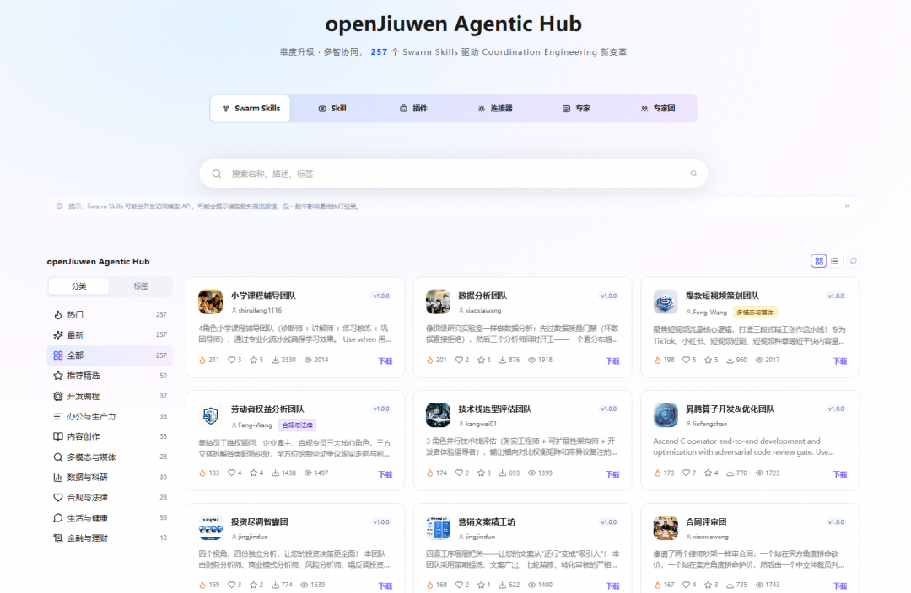

Agentic Hub：https://agentichub.openjiuwen.com/

# Agent 资源如何形成生态闭环

在 openJiuwen 中，资源不是一次性配置，而是经历创建、安装、使用、发布和再次获取的完整生命周期。使用阶段可以把专家、插件、技能、连接器叠加组合。Agentic Hub 承载发布出来的资源，再把它们变成下一次任务可发现、可获取、可安装的能力来源。

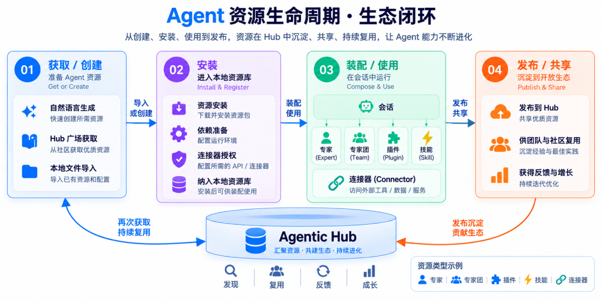

这五类资源分别处理不同问题：**技能沉淀方法，连接器接入外部系统，插件组合能力，专家定义角色，专家团队组织协作。** 它们不是五种互相替代的 Agent，而是可以围绕任务组合使用的资源单元。

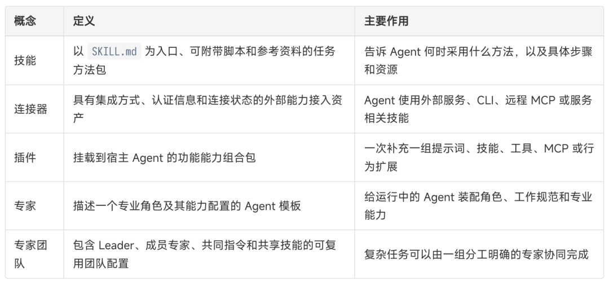

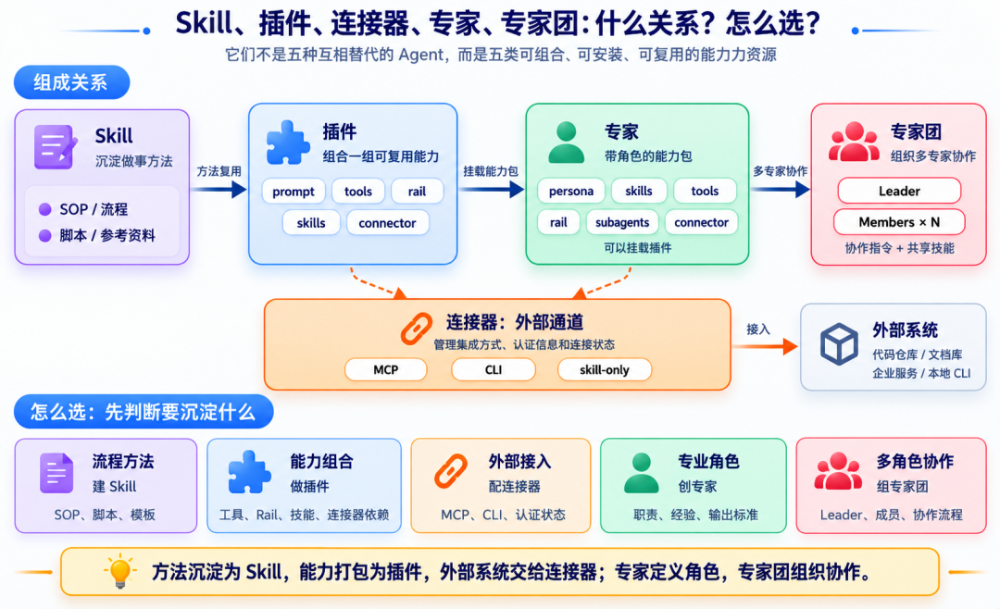

# 五类资源详解：技能、连接器、插件、专家与专家团

五类资源分别对应 Agent 任务里的不同层次：技能沉淀方法，连接器接入外部系统，插件组合能力，专家定义角色，专家团队组织协作。

### 1、技能：把做事方法沉淀成可复用资源

在很多 Agent 场景里，真正值得沉淀的不是某一次回答，而是一套稳定方法：代码审查要先看变更目标，再看调用链和测试；PPT 生成要先抽取素材，再组织结构和视觉风格；文档处理要先识别格式，再执行转换、校对和导出。如果这些流程每次都靠临时 Prompt 说明，很难稳定复现。

openJiuwen 的技能以 `SKILL.md` 为入口，可以附带参考资料、脚本、模板和多模态资源。它像一份可安装的能力说明书，告诉 Agent 在什么场景下应该采用什么方法，以及需要读取哪些资源、调用哪些工具。

WorkSwarm 当前可识别三类技能：

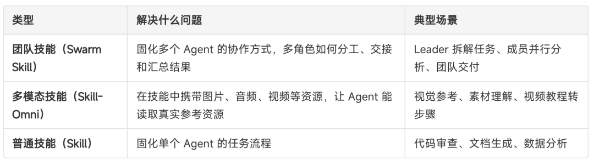

创建技能时，用户不需要关心底层目录和工具链。只要在统一入口 `skill-creator` 中描述需求，WorkSwarm 就会根据目标类型选择对应的创建方式，并生成可安装的技能资源：

* • **团队技能**：面向多角色协作，由 `swarmskill-creator` 生成角色分工、协作流程和依赖关系；如果需要可执行编排，还可以补充 SwarmFlow 脚本；
* • **多模态技能**：当素材来自 URL、网页或视频时，由 `skill-omni-creation` 抽取正文、图片或视频帧，并连同参考资源一起打包成技能，必要时生成配套脚本；
* • **普通技能**：面向单个 Agent 的流程、SOP、脚本和参考资料，由 `skill-creator-normal` 沉淀。

如果需求边界不清晰，系统不会强行选择路径，而是先确认用户到底要沉淀的是单 Agent 方法、团队协作流程，还是来自网页 / 视频的多模态经验。

openJiuwen 还提供了**本地技能自动演进能力**。Agent 使用技能完成任务后，WorkSwarm 可以根据执行过程、失败信号或用户反馈生成经验记录；这些记录不会直接覆盖原始技能，而是沉淀到本地经验文件和技能索引中，下一次使用时再被读取，帮助技能越用越贴近真实任务。

技能的获取方式也不止一种。成熟技能可以从 Hub 或技能广场安装；企业内部技能可以通过本地上传、本地路径或资源包导入；专家、插件和专家团也可以携带技能，让一套方法成为更大能力包的一部分。

如何使用 Skill：进入技能管理页 → 从技能广场安装或在我的技能中选择 Skill → 启用 / 关闭 Skill → 点击“去试试”进入会话 → 用自然语言触发 Skill 完成任务 → 任务经验在本地持续沉淀。

### 2、连接器：让 Agent 接入外部真实系统

Agent 要进入真实工作流，不能只停留在对话框里，它需要访问代码仓库、企业文档、数据库、内部服务或本地开发工具。连接器就是把这些外部系统变成可管理的接入资源，统一承载集成方式、认证信息和连接状态。

在 openJiuwen 中，连接器主要有两种获得方式：一种是从 Hub 获取成熟连接器，直接复用社区或组织已经适配好的外部系统能力；另一种是在 WorkSwarm 客户端配置自己的连接器，把企业内部系统、本地 CLI 或自定义 MCP 服务接进来。

连接器可以覆盖不同集成形态：

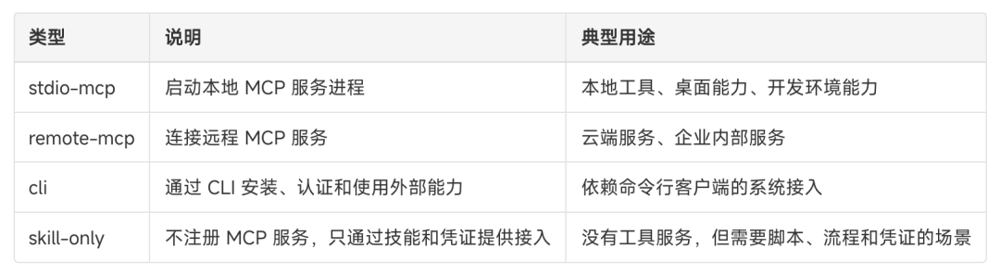

如何使用连接器：进入连接器管理页 → 从 openJiuwen Agentic Hub 获取成熟连接器 → 完成连接与认证 → 在 Agent 任务中访问外部系统。

### 3、插件：把一组能力打包给 Agent 使用

如果说技能沉淀方法，连接器打通外部系统，那么插件更像一组能力的打包方式。它可以**把提示词、工具、Rail、技能和 MCP 能力组织在一起**，让 Agent 在执行任务时获得一整套增强能力。

一个插件通常可以包含：

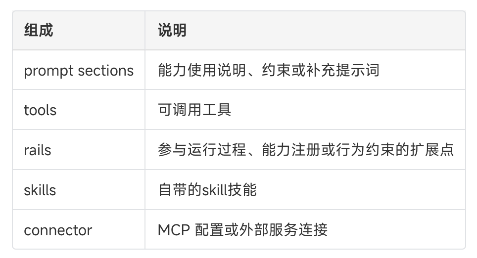

插件的价值在于复用。比如 Office 文档处理、鸿蒙工程构建、代码质量检查、知识库检索，都不应该只绑定在某一个专家身上。它们可以做成插件，被不同专家或基础 Agent 按需挂载。

创建和获取插件也有多种方式。比如可以通过聊天创建：用户只需要描述“想给 Agent 增加什么能力”，WorkSwarm 会自动使用 `plugin-creator`，把自然语言需求整理成可加载的 plugin 插件包，并完成初始化、填充、校验和注册。openJiuwen Agentic Hub 提供了丰富的成熟插件资源，用户可以直接安装使用；企业内部插件也可以通过本地上传导入。

如何使用插件：进入插件管理页 → 通过聊天创建插件，或从 openJiuwen Agentic Hub 安装成熟插件 → 查看插件包含的工具、技能或连接器能力 → 在 Agent / 专家任务中挂载并使用。

### 4、专家：带角色的能力包

专家解决的是“谁来做”的问题。更具体地说，它定义的是 Agent 在任务中的角色身份、职责边界、工作方式和可调用能力。

在很多 Agent 产品里，专家往往只是一段角色 Prompt，比如“你是架构师”“你是测试工程师”。这种方式可以快速起步，但角色设定、工具能力、工作规范和外部依赖都散落在不同地方，很难复用和管理。

openJiuwen中的专家更接近一个可安装的 Agent 模板。它把一个专业角色需要的身份、职责、输出标准和能力配置打包起来，让 Agent 不只是临时扮演某个角色，而是加载一套稳定的角色能力。

一个专家通常可以包含：

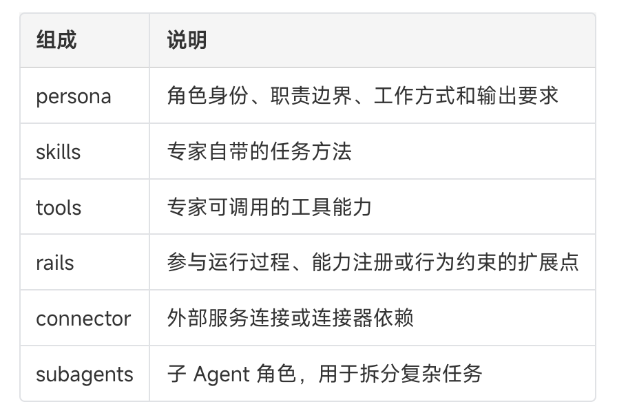

创建和获取专家也有多种方式。用户可以在专家管理页面直接通过聊天创建专家：描述“需要一个什么领域的专家、擅长什么任务、具备哪些能力”，WorkSwarm 会使用技能 `agent-creator`，把用户自然语言需求转成可加载的 Agent 模板包。用户也可以直接通过文件上传专家资源包；openJiuwen Agentic Hub 也提供成熟专家资源，用户可以直接安装使用。

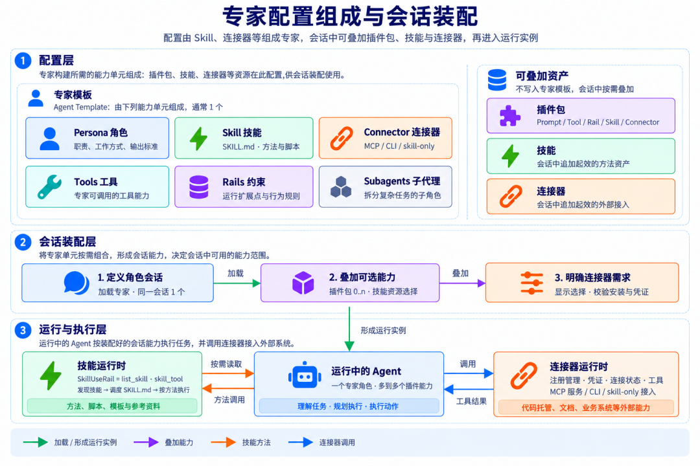

这张图可以帮助理解单 Agent 场景下的装配方式：专家提供角色基线，插件叠加能力，技能提供方法资源，连接器负责外部系统接入。最终进入会话的，是一个被角色、能力、方法和外部通道共同增强的运行实例。

需要注意的是，专家并不是一个已经运行起来的 Agent，而是一套可被会话加载的角色模板。只有当会话选择这个专家后，运行中的 Agent 才会获得相应的角色、规则和能力配置。

同时，openJiuwen 的专家体系也面向已有生态开放。**对于其他业界平台（如WorkBuddy、千问办公等）中已经沉淀下来的专家资产，可以将其转换为openJiuwen的专家资源，WorkSwarm可复用**。

如何使用专家：进入专家管理页 → 表单创建 / 自然语言创建专家 / 从 openJiuwen Agentic Hub 安装成熟专家 → 点击“使用”进入会话 → 按需叠加插件补齐能力 → 用自然语言下达任务，由专家按角色规范完成。

### 5、专家团队：让多个专家协同完成复杂任务

当这些专家资产被统一管理后，它们还可以进一步被组织成专家团队。

单个专家适合处理边界清楚的任务。但真实项目往往需要多个角色协作：有人拆解需求，有人实现，有人测试，有人交付。过去这类多 Agent 协作经常依赖临时 Prompt 编排，能演示，但很难复用。

openJiuwen 把协作本身做成资源。专家团队可以直接使用已有专家成团，由 Leader 负责理解目标、拆解任务和汇总结果，成员专家分别承担开发、测试、文档、审查等专业工作。团队还可以配置指令和共享技能，让协作流程不再依赖临场发挥。

一个专家团队通常可以包含：

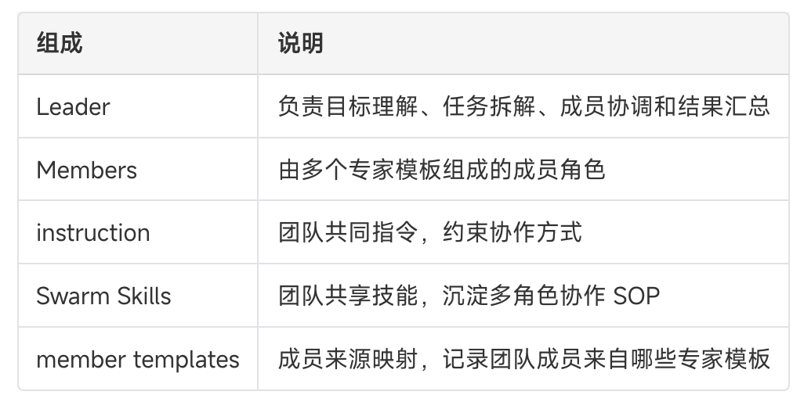

在 WorkSwarm 中，组建专家团队不需要从零开始。最直接的方式，是**把已有专家拉到同一个团队里**：选择一个专家担任 Leader，再选择多个专家作为成员，补充团队目标、协作说明和共享技能，一个面向复杂任务的专家团就可以被复用。

如果用户还没有想清楚团队应该如何分工，只需用自然语言描述任务目标，WorkSwarm 便可通过内置 `agent-group-creator` 技能自动生成完整专家团包：自动输出 Leader、成员角色定义、多方协作指令，以及可选用的共享技能集合。

对于已经沉淀好的团队配置，WorkSwarm 也支持通过文件上传导入；openJiuwen Agentic Hub 中的成熟专家团队，则可以安装后直接进入自己的工作流。

专家和专家团队的关系，是角色模板和协作配置的关系。创建专家团队时，系统会把所选专家组织进团队资源，加入团队指令和共享技能；运行时再装配成 Leader + Members 的协作形态。

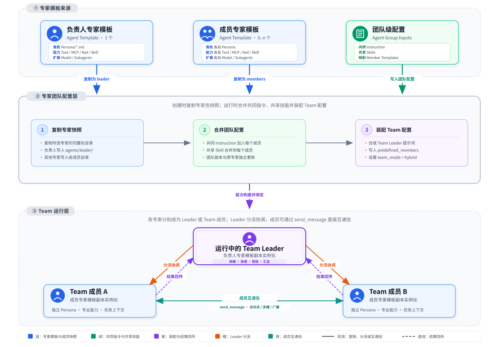

运行时，Leader 负责拆解、协调和汇总，成员专家分别承担专业环节。专家团队保存的是一组可复用的初始协作配置，而不是固定不可变的工作流步骤图。

因此专家团队不应被理解成一个“更大的专家”。它更像一套协作配置，把多个专家组织起来，让复杂任务可以被拆解、并行处理和统一交付。

如何使用专家团：进入专家管理页 → 表单创建：选择已有专家，直接组团 / 自然语言组团→ 点击“使用”进入团队会话 → Leader 拆解任务、成员专家协同执行 → Leader 汇总结果并统一交付。

# 资源发布：从本地能力到生态资产

openJiuwen 把发布做成资源生命周期的一环。本地验证过的能力可以上传至 Agentic Hub，成为可搜索、可安装、可共享的公共资源。发布入口有两种方式。

### 1 从 WorkSwarm 客户端直接发布

在 WorkSwarm 客户端，用户可以将本地验证过的技能、连接器、插件、专家和专家团发布到 Hub。

从日常使用环境发布：创建并验证技能、连接器、插件、专家或专家团 → 从资源详情页发布到 Hub。

### 2、在 Hub 上面向社区发布

直接在 Agentic Hub 网站提交已经整理好的资源包，把成熟能力放入社区分发。

在 openJiuwen Agentic Hub 直接发布资源。

# 从单专家到专家团，跑通真实任务

下面两个案例分别对应两种典型场景：当任务边界清楚时，一个带有 Skill 和连接器的专家可以完成端到端交付；当问题需要多种专业视角时，多个已有专家可以被组织成专家团，共同完成分析、判断和汇总。

### 案例一：用鸿蒙应用开发专家完成“吞噬黑洞”应用开发

这个案例展示单专家如何完成端到端应用开发。用户选择已经发布到 SkillHub 的 “鸿蒙 App 开发专家”，通过自然语言提出 “吞噬黑洞” 应用需求，专家会结合自身人设、开发 Skill 和连接器能力，完成鸿蒙 App 开发、真机部署、后端部署和二次调试优化。

鸿蒙 App 开发专家 Demo：设备确认 → 鸿蒙 App 开发部署 → 后端开发部署 → 二次优化调试。

### 案例二：把本地专家组合成“智囊天团”

这个案例展示专家团的协作能力。用户可以把本地已经沉淀的多个专家组合起来，形成一个面向复杂任务的 “智囊天团”：每个成员专家保留自己的角色、人设、Skill 和连接器能力，由 Leader 负责拆解任务、分派问题、汇总结论。

在这个模式下，专家团不是让一个 Agent 临时扮演多个角色，而是把已有专家资产组织起来协同工作。由于成员来自本地已有专家，每个专家原本携带的 Skill、工具和连接器能力，也可以在团队协作中继续发挥作用。

选择本地已有专家 → 组建专家团 → Leader 拆解任务 → 成员专家分别分析 → 汇总输出统一结论。

# 结语：Agent 能力正在变成可流通的资源

Agent 的价值，正在从一次对话中的即时响应，走向可沉淀、可装配、可发布的能力资产。

openJiuwen 将这些能力拆成五类资源：技能沉淀方法，连接器接入系统，插件组合能力，专家定义角色，专家团组织协作。它们共同构成一条完整生命周期：**创建 / 获取 → 安装 → 装配使用 → 发布 / 共享 → 再次获取**。

这也是 openJiuwen 想推动的 Agent 资源生态：开发者、企业和社区可以共同沉淀、发布和复用 Skill、连接器、插件、专家与专家团，让每一次任务经验都成为下一次智能协作的起点。

同时，当前已经有很多客户及伙伴也参与到openJiuwen共建。openJiuwen × FAB 智慧金融专区围绕开放架构、开放资产、开放算力，升级了金融智能体加速器FAB 2.0，推动工程工艺资产沉淀复用、共建共享；发布金融元枢Token全生命周期运营方案，构建高效、可持续的算力供给体系。以开源 openJiuwen 为底座、以资产沉淀复用为杠杆，加速生产级智能体规模化落地。

相关资源:

* openJiuwen官网：https://openjiuwen.com/
* Agentic Hub：https://swarmskills.openjiuwen.com/
* GitHub代码仓：https://github.com/openJiuwen-ai/jiuwenswarm
* AtomGit代码仓：https://atomgit.com/openJiuwen/jiuwenswarm
* 金融专区链接：https://www.huaweicloud.com/ai/finance.html
