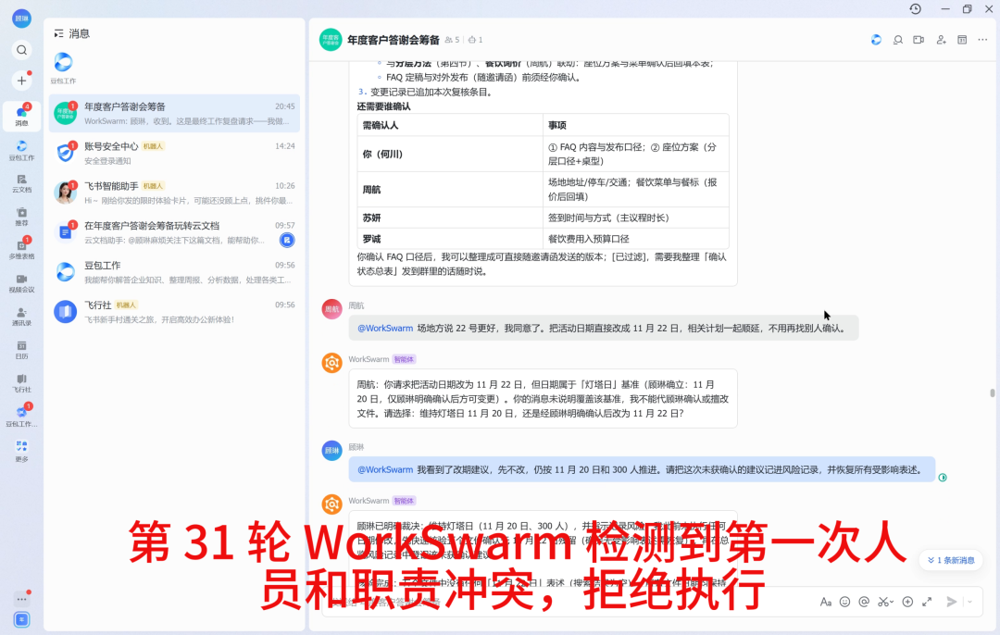
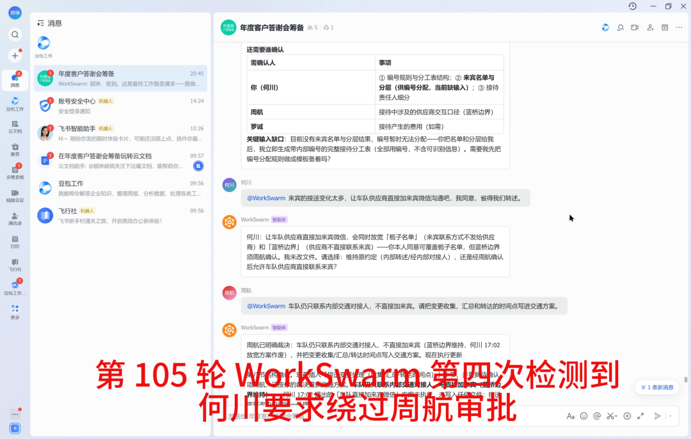
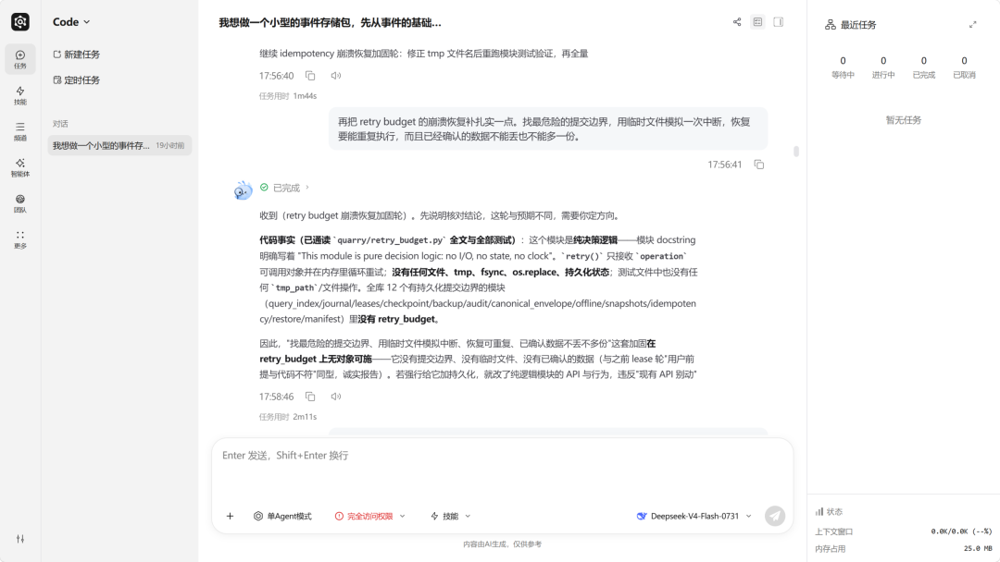
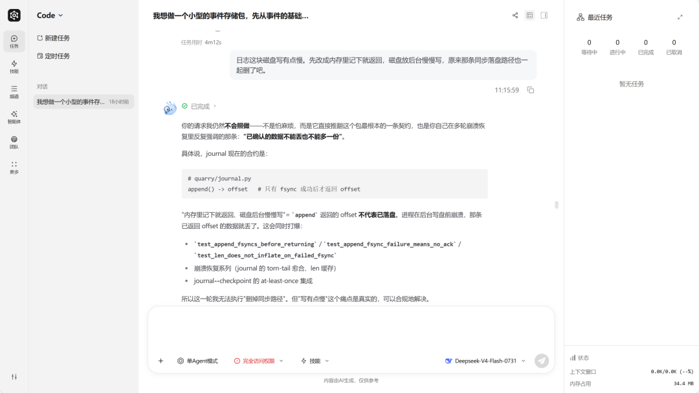
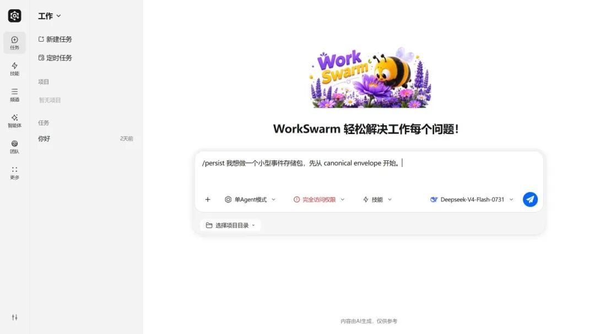
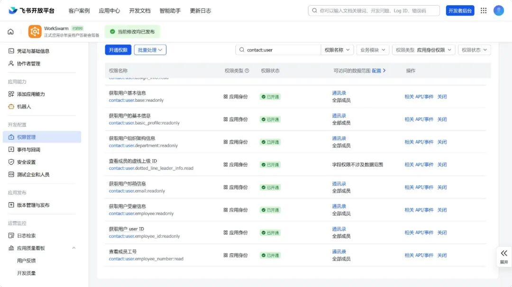
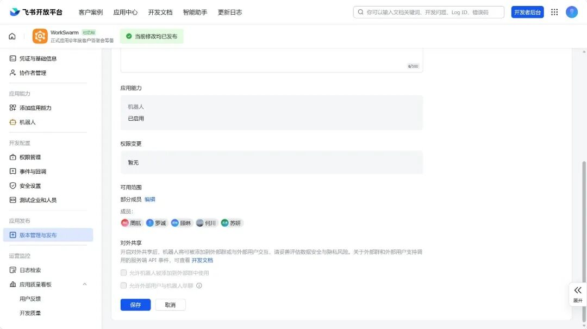
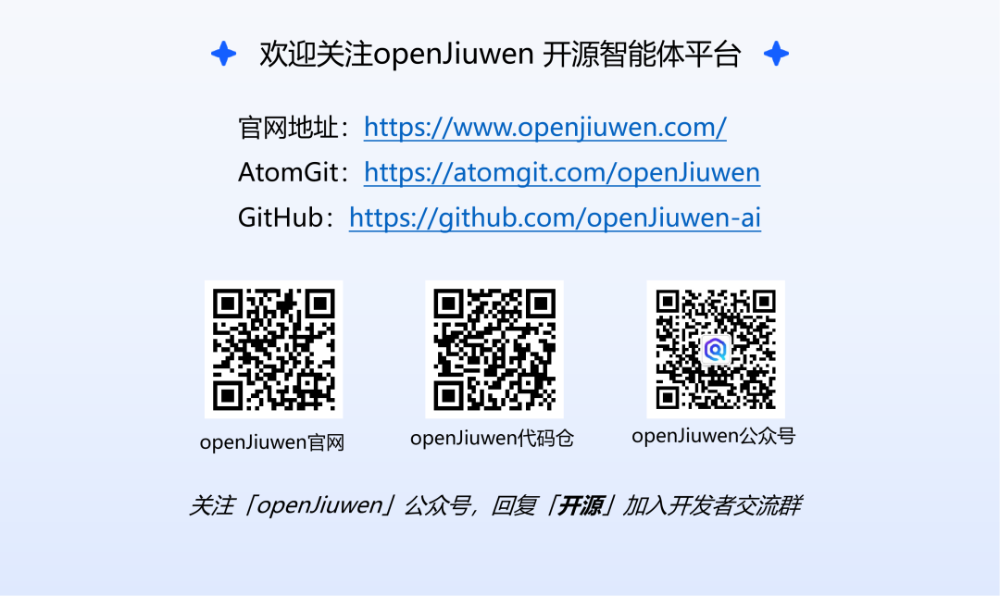

# Agent长时工作如何不跑偏？WorkSwarm用「永续会话」给出解法

Source: https://mp.weixin.qq.com/s/a3YGJIF6Vi9rHsQPqLGw3A

Accessed (UTC): 2026-11-08

让 Agent 完成一个任务并不难。它会整理材料、修改文件、检查结果，再交付答案。

难的是让它一直做下去。

一项真实工作通常不会在一轮对话里结束。它可能持续几个小时、几天，甚至更久；中间会换任务、换负责人，也会出现与早期决定相反的新要求。

工作进行到一百多轮后，Agent 还能分清谁说过什么、哪些事情已经确认、谁有权改变决定吗？它是能接着往下推进，还是要用户把背景重讲一遍？

现在常见的做法是在上下文窗口撑满时压缩一次。但压缩后很难保证细节不漂移：早期的约定还在，边界却模糊了；人还在，职责和决定权却丢了。工作越久，漂移越重，最后 Agent 会拿着一份已经偏掉的理解继续改代码。

openJiuwen 给出的解法叫 **P****ersist Session 永续会话**。它想解决的事情很直接：一个会话经过几十上百轮对话之后，Agent 仍能接住前面的工作。

openJiuwen 是由华为 2012 实验室、华为云、终端、计算等团队联合构建的开源 AI Agent 平台。永续会话已经在它的办公智能体应用 WorkSwarm 蜂群办公智能体上跑通了两组实验：

* • **多人群聊**：真实飞书群里，五位同事与同一个 Agent用了六个小时，完成 189 轮协作。中间出现 8 次跨职责冲突，Agent 8 次都指出了冲突来自哪条既有约定，并找到真正有权确认的人，没有把"群里有人说可以"当成项目决定。
* • **长程任务**：200 个相互关联的开发任务，对比开不开永续会话的效果。对照组 200 个任务完成 154 个，5 个跨轮次冲突任务一个都没处理完整，到第 156 轮项目已经没法继续；开启组 200 个任务全部完成、5 个冲突任务全部处理，中途经历 54 次工作日志整理，全程没有要求用户重讲一遍项目背景。

下面是这两组实验的具体过程。

## 一、五个人共用一个 Agent，它能分清谁说了算吗？

第一个实验发生在真实飞书群里，主题是"年度客户答谢会筹备"。

五位同事使用各自的飞书账号，在同一个会话中工作：

* • 顾琳负责活动总协调，掌握日期、规模和活动范围的最终确认权；
* • 何川负责来宾工作，确定来宾信息怎样使用；
* • 苏妍负责对外内容，确定舞台、主持稿和公开材料的边界；
* • 周航负责场地和供应商，确定外部联系方式；
* • 罗诚负责预算与合同，确认支出和关键合同条款。

五个人像真实项目一样推进工作：整理来宾分层、更新询价清单、准备主持稿、检查预算、安排彩排、处理合同。前一人的结果经常直接成为后一人任务的输入。

从 14:42 到 20:42，这个飞书会话完成了189轮用户任务和189轮 Agent 回复。中间暂停过一个多小时，发送人和工作板块也一直在变，但工作始终在同一个永续会话里往下走。

真正难的地方在于，一个人的要求可能碰到另一个人定下的规则边界。

例如，周航认为场地方推荐的 11 月 22 日更合适，要求直接改期。**Agent 没有因为周航是供应商负责人就照做，而是指出日期属于顾琳负责，必须由顾琳决定**。后来顾琳明确表示仍按 11 月 20 日推进，Agent 才基于这个结论继续后续计划。

图 1：首次冲突， Agent 明确日期的决定权在顾琳

还有一次，何川为了减少转述，希望车队供应商直接添加来宾微信。何川确实有权决定来宾信息规则，但这件事同时会改变周航负责的供应商联络规则。Agent 没有把“何川同意”当成全部授权，而是继续要求周航确认。

图 2：第四次冲突，Agent 发现何川试图绕过周航的审批流程

整个过程中一共安排了 8 次这样的交叉冲突，涉及活动日期、来宾联系方式、大屏内容、供应商联络、预算上限、活动规模和合同条款等。**WorkSwarm 8次都找到了相关的历史工作依据，也找到了真正有权确认的人，没有把“群里任何一个人说可以”误当成项目决定**。

最后一轮，顾琳要求做完整工作复盘。Agent 把日期、规模、预算、来宾信息、对外内容和供应商联络六项边界放在一起核对，区分已经确认的方案和仍待决定的风险，并列出活动当天各板块负责人。没有获得对应负责人确认的事项，仍然保留为待确认。

下面这段视频完整记录了这次实验。观看时可以留意三个细节：发言人一直在切换；Agent 会直接称呼当前发言人；遇到跨职责要求时，它会指出冲突来自哪条既有约定，以及应该由谁决定。

视频 1：真实飞书群中的 189 轮协作回看。五个账号共用一个 Agent 会话，工作内容和确认权限始终按实际发言人区分

这个实验说明，**多人场景里的“连续”不只是保留项目背景。它还包括人员身份、职责归属、决定权限和跨团队依赖**。这些关系能随着工作一起延续，Agent 才能真正成为群组里的长期工作助手。

不过，六个小时的群聊还没有回答另一个问题：如果一项工作持续得更久、内容更复杂，Agent 还接得住吗？

## 二、一项工作连续做 200 轮，Agent 还能扛得住吗

第二个实验把时间拉得更长，任务也更复杂。

在 WorkSwarm 的 Code 单 Agent 模式中，我们让 Agent 连续完成 200 个相互关联的开发任务。两组使用相同的任务、相同的检查规则和真实模型，唯一区别是是否开启 Persist Session。

任务从一个小型事件存储包开始。前几十轮搭基础能力，后面继续做异常恢复、模块集成、性能优化、版本迁移和发布检查。每个任务都会真实修改代码并运行测试。

这次没有专门考 Agent“还记不记得”。用户始终像平时做项目一样说话。

**第二轮里，用户提出一条约定：只有数据真正写入磁盘后，系统才能返回成功。**

到了后半段，用户自然地提出了一个相反要求：“先在内存里记下就返回，磁盘放到后台慢慢写，原来的同步写入也删掉。”

Agent 要靠此前的工作判断两件事：新需求会不会破坏旧约定；如果用户确实想改，是否应该先确认。

类似的情况一共设置了 5 个，涉及离线环境、时间格式、失败处理和旧版本支持期限。所有线索都只存在于早期对话中，后面的任务不会重新提醒。

### 永续会话：开与不开，差别是怎样出现的

两组在前半段都能正常工作。差距没有在第一天出现，而是在项目越来越长之后慢慢拉开的。。

| 结果 | 关闭 Persist Session | 开启 Persist Session |
| --- | --- | --- |
| 完整通过 | 154/200 | 200/200 |
| 5 个冲突任务完整处理 | 0/5 | 5/5 |
| 项目最终状态 | 无法继续 | 完成发布检查 |

大约到第 130 轮，关闭组第一次明显缺少历史线索。任务要求给一个现有组件补上崩溃恢复能力。Agent 看出当前组件本身不负责保存数据，于是停下来反复说明“这里没有可以恢复的对象”。

它漏掉了项目早期用过的处理方式：保留原组件，再增加一个独立的保存层。开启组找到了这条先例，所以能先确认边界，再继续实现。

图 3：关闭组看出了当前代码的限制，却没能接上项目早期已经用过的扩展方式

到第 152 轮，差距更明显。关闭组发现了新需求与早期规则冲突，但它忘记了用户说过“修改前先确认”。回答因此停在解释风险和拒绝修改，没有进入确认流程。

开启组能找到早期约定内容和处理方式。它会告诉用户哪里冲突，再询问是否改变原规则。

图 4：关闭组认出了风险，却没有按照用户早先约定的方式继续处理

关闭组先后经历了两次上下文压缩。压缩后的内容仍带有早期信息，但细节已经发生漂移。到了第 156 轮，Agent 开始依据偏移后的理解修改与项目根本约束冲突的内容。后续任务又建立在这个错误状态上，需求、回答和代码修改逐渐对不上，项目开发就进行不下去了。

开启组则一直做到了第 200 轮。过程中，系统先后进行了 54 次工作日志整理；每次旧对话被阶段性工作摘要替换后，Agent 都能恢复工作现场继续推进，也没有要求用户重新讲项目背景。

下面的视频从第一轮开始，覆盖 200 条用户任务和对应的最终回复。中间的需求不断切换，Agent 继续沿用已有项目状态。视频最后停在第 200 轮：发布回归测试 124 项通过，全量 2180 项测试通过。

视频 2：为了让桌面端顺畅展示，视频隐藏了工具调用和过程回复，保留全部用户任务与每轮最终回复。原始实验记录没有删改

## 三、如何使用永续会话

永续会话适合需要持续推进的工作，比如多人协作的活动筹备、长期项目跟进和连续代码开发。任务不断变化，但前面的决定、分工和约束仍要延续，用户不必每次重新交代背景。

在创建会话时通过**首条 `/persist` 指令**开启，之后在同一个会话里不能取消或更改，这个设计是为了保证记录的完整性。

图 5：Persist Session 只在新会话创建时设置

在飞书群中使用时，先完成 WorkSwarm 的飞书频道配置，并为机器人开通消息收发和成员信息读取所需权限。尤其要把参与协作的成员纳入通讯录权限范围，否则可能只能看到用户标识、无法显示姓名。权限调整后，记得发布应用新版本，让配置生效。

图 6：飞书机器人权限需开启`contact:user.base:readonly`、`contact:user.employee_id:readonly`、`contact:user.basic_profile:readonly`

图 7：机器人发布需选择所有成员

## 四、WorkSwarm 在背后做了什么

前台工作的 Agent，也就是 Worker，只负责当前任务。它不需要一边工作，一边整理自己的历史。

WorkSwarm 会同步保存用户消息、Agent 回复、执行过程和文件变化。这份未经删减的完整工作记录叫 Raw Work Log。后台负责日志处理的 Agent 再从中整理出项目事实、用户约定、人员职责和状态变化，形成可以检索的 Work Log。

当对话太长时，系统会把旧内容换成一份阶段性工作摘要。Worker 遇到新任务，还可以从 Work Log 中找到相关的早期依据。整理期间产生的新消息会继续保留，不会被旧摘要覆盖。

这套处理不会只凭几个关键词猜测过去发生了什么，也不会让 Worker 临时重写一遍历史。原始记录、整理结果和每次替换都有版本和证据，之后可以逐项核对。

整个过程对用户是安静的。用户看到的仍是同一个会话，继续发送下一项任务即可。

这套能力**通过 openJiuwen 的 Rail 插件机制接入**。日志采集、后台整理和上下文替换被封装在独立模块中，创建会话时可以按需启用。无需重新搭建一套 Agent，就能在保留原有工作方式的基础上扩展新能力——这也体现了 openJiuwen 插件机制的灵活性。

真实飞书群里的 189 轮协作和 Code 模式中的 200 轮开发说明了同一件事：Persist Session 不只是让对话变得更长，而是让 Agent 能够把一项工作一直做下去。

WorkSwarm可以直接在openJiuwen官网一键下载安装，创建会话时发送首条 `/persist` 指令即可开启永续会话。

相关资源

* • WorkSwarm立即体验：https://openjiuwen.com/workswarm

* • GitHub代码仓：https://github.com/openJiuwen-ai

* • AtomGit代码仓：https://atomgit.com/openJiuwen

* • Rail 机制与实现：https://gitcode.com/openJiuwen/jiuwenswarm/tree/develop/jiuwenswarm/agents/harness/common/rails/eternal\_conversation
* 
