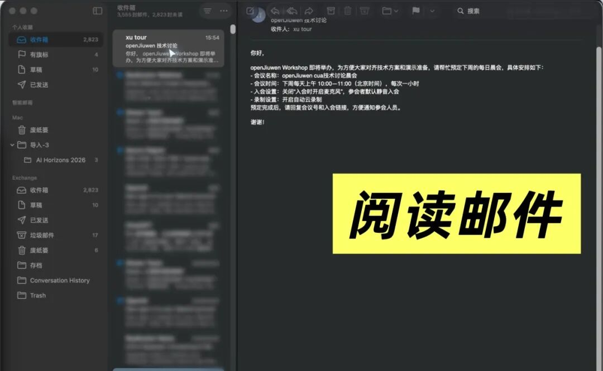
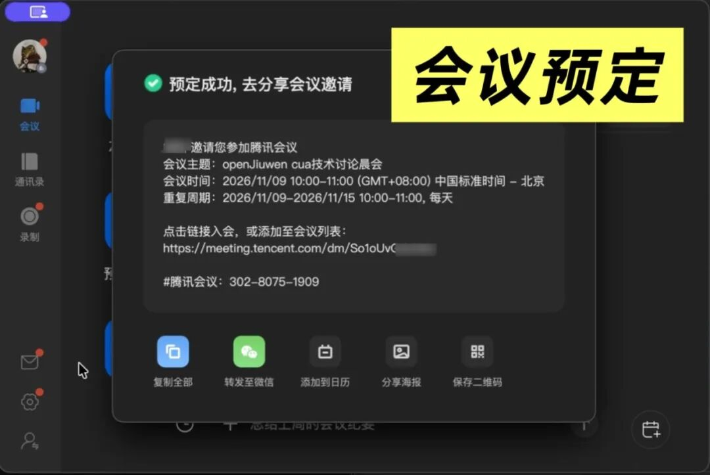
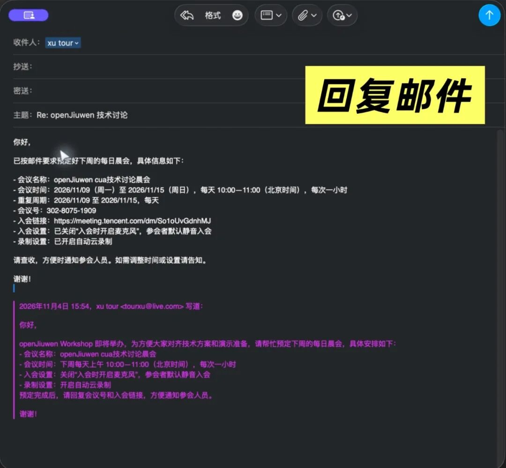
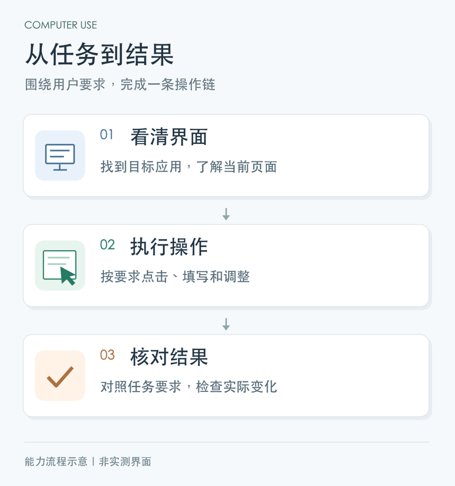

# openJiuwen 开源 Computer Use：让智能体真正“上手”用电脑

Source: https://mp.weixin.qq.com/s/zJXEhOHHgGlBupSdElbeKw

Accessed (UTC): 2026-11-08

打开应用、输入框填内容、点击按钮——这些简单琐碎的电脑操作，却是打工人的日常。

当我们希望 Agent 接手这些任务时，每一步都是具体的问题：应该操作哪个窗口？文字会输入到哪里？按钮点击后，任务是否完成？

通过屏幕界面操作软件和系统，是智能体连接真实工作的必经之路。

openJiuwen刚刚开源了**智能体系统服务组件computer-use（简称Jiuwen-CUA），为智能体提供观察和操作电脑的能力。** 这套能力拆成清晰的三环：

* • **看得清**：查看当前应用与窗口，定位按钮、输入框等控件；
* • **点得对**：执行点击、输入、填写等真实桌面操作；
* • **核得准**：读取界面变化反馈给 Agent，核对执行结果，全程可回溯。

Agent 负责理解任务、组织步骤、判断结果；Computer Use 负责把每一步落实到真实的软件界面里。

 

**这条路，全球头部玩家正在汇合。** 2026 年以来，“让智能体操作真实电脑”成为行业共同的方向：Meta 的个人智能体 Muse 已经能直接操作 Mac 上的原生应用；xAI 为每个 Grok Bot 配备了一台专属云电脑，没有 API 的软件就走界面操作；OpenAI 也把“后台电脑操作”装进了编程智能体 Codex，让 Agent 自己打开应用、点击按钮、验证结果。三家路径不同，指向却一致——**智能体的下一阶段，是越过 API，直接面对图形界面。**

openJiuwen Computer Use 要做的，是把这套能力带进开源社区：不绑定某个模型、某个 Agent 或某个平台，任何开发者都可以把它接进自己的智能体，让“用上电脑”成为每个 Agent 都能具备的基础能力。

 

下面，从一项日常安排开始，到跨应用的长程任务，再到已有 Agent 的能力扩展，看TA如何实现屏幕操控。

## 01 日常任务交给 Agent，从 WorkSwarm 开始

openJiuwen Workshop 即将举办，一封邮件提出了接下来的会议安排：下周每天上午 10 点，召开一小时的“openJiuwen CUA 技术讨论晨会”，入会时关闭麦克风，并开启自动云录制。

收到邮件后，用户只需在 WorkSwarm 中交代一句：

> “请查看刚收到的 Workshop 会议安排邮件，根据其中的要求预定晨会，核对后把会议安排、会议号和入会链接回复给发件人。”

接下来发生的事，可以分成三步。

**第一步，读邮件，把安排弄清楚。** Agent 打开邮件应用，找到对应邮件并阅读正文，确认会议名称、时间、重复周期，以及入会静音、自动云录制等要求。

**第二步，订会议，把要求逐一落实。** Agent 进入会议应用，填写会议主题、日期和时间，设置每日重复及结束日期，调整入会与录制选项。完成预定后，再逐一核对每天 10:00—11:00 的安排和相关设置，获取会议号与入会链接。

**第三步，回到邮件，把结果交付给对方。** Agent 返回原邮件，将会议时间、重复安排、会议号和入会链接整理成回复，确认无误后发送。对方打开邮件，即可获得参会所需的全部信息。

**从读取需求、落实安排到回复结果，用户交代的一项日常工作被完整衔接起来。** 值得注意的是，对于关闭美颜选项这类隐藏较深的按钮，Jiuwen-CUA也能轻松解决。

## 02 面向长程任务，让多步操作连续推进

真实的桌面工作远不止三步，任务越长，需要衔接的界面和状态变化就越多。

这时，每一步都必须依据当前界面继续推进：页面是否加载完成、目标窗口是否正确、上一项内容是否填写到位——任何一个环节判断失误，后面的操作都会跟着错。

**Jiuwen-CUA**的后端能力正是为这种连续操作而设计：**查看当前应用和窗口 → 将点击、输入等动作准确落实到目标 → 把界面变化交回 Agent 判断**，如此循环，直到任务完成。

下面这段录屏展示了日历、邮件、会议及表单等界面中的查看与操作过程，呈现长程任务中的多个步骤如何在真实软件里环环衔接。

**长程任务的本质，是把每一步的操作与反馈接起来。** Agent 依据实际界面决定下一步，Computer Use承担具体的查看和操作，让每一步都建立在前一步的真实结果之上。

整个执行过程也会留下完整记录，便于查看任务推进到了哪里、哪些操作已经完成，以及出现问题时应该从哪里检查——这对调试和复现至关重要。

## 03 插件化接入：让你的 Agent 也能 “长出手”

如果你已经有了自己的Agent，那你也能通过插件化接入，轻松获得操作桌面应用的能力。

以 DeepSeek Harness（DSH）为例：接入 Computer Use 后，用户无需改变习惯，仍从熟悉的任务入口发出指令，由现有 Agent 调用桌面能力，完成读取邮件、预定会议、回复邮件等跨应用工作。

**为现有 Agent 增加桌面能力，让电脑操作成为原有工作流程的一部分。**

## 04 结语

我们已经习惯让 AI 帮忙写内容、整理资料、生成计划。但工作经常还剩下最后一段：把结果送进真正使用的软件。

这段距离看似只是复制、点击和保存，却占据了大量日常时间。

openJiuwen提供的Computer Use能力，让我们可以尝试把这些动作重新组织成任务：

> 把确认后的文字写进文档，把整理好的数据填入表单，把一段需要反复切换窗口的工作交给专门的执行者。

我们仍然需要办公软件、业务系统和桌面应用，也仍然需要对关键结果作出判断。

**但不一定每一次点击，都必须由我们亲手完成。**

当 Agent 能沿着任务进入软件，执行操作，再带着可核对的结果回来，人和电脑之间的分工，也就开始发生变化。

 

## 开源开放，欢迎一起完善

Computer Use 采用 Apache 2.0 协议开源。安装步骤、桌面权限配置和接入示例，均可在仓库 README 中查看。

欢迎开发者体验试用，反馈应用兼容性问题，并贡献可复现的场景与改进。

 

访问 openJiuwen Computer Use 项目仓库：

AtomGit：https://atomgit.com/openJiuwen/computer-use

GitHub：https://github.com/openJiuwen-ai/computer-use

了解与下载 WorkSwarm：https://www.openjiuwen.com/workswarm
