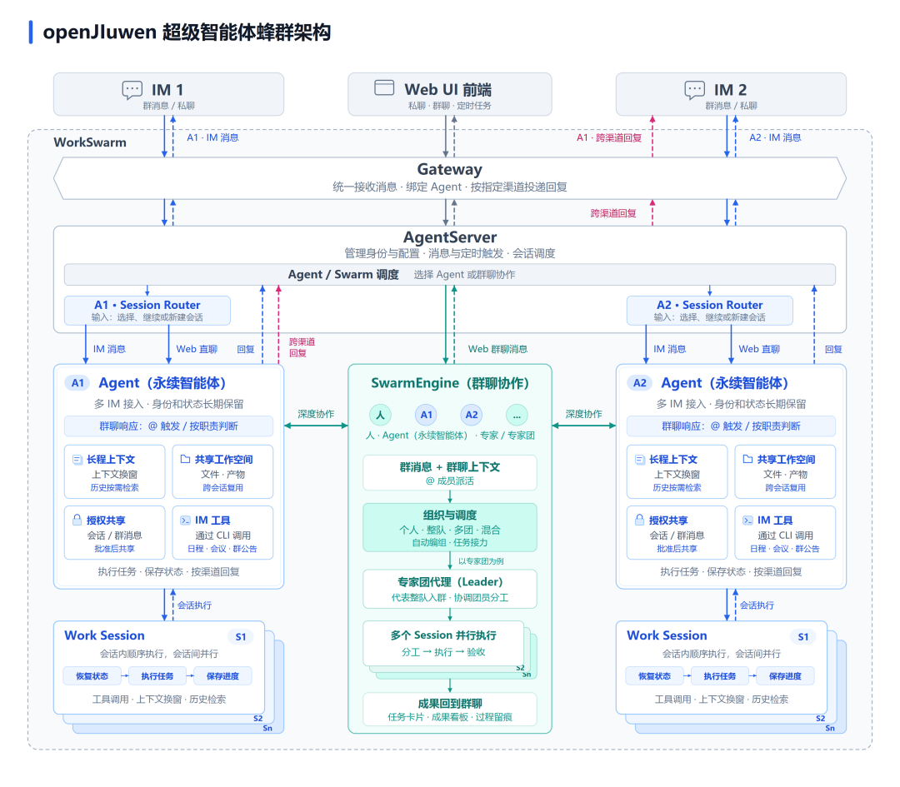
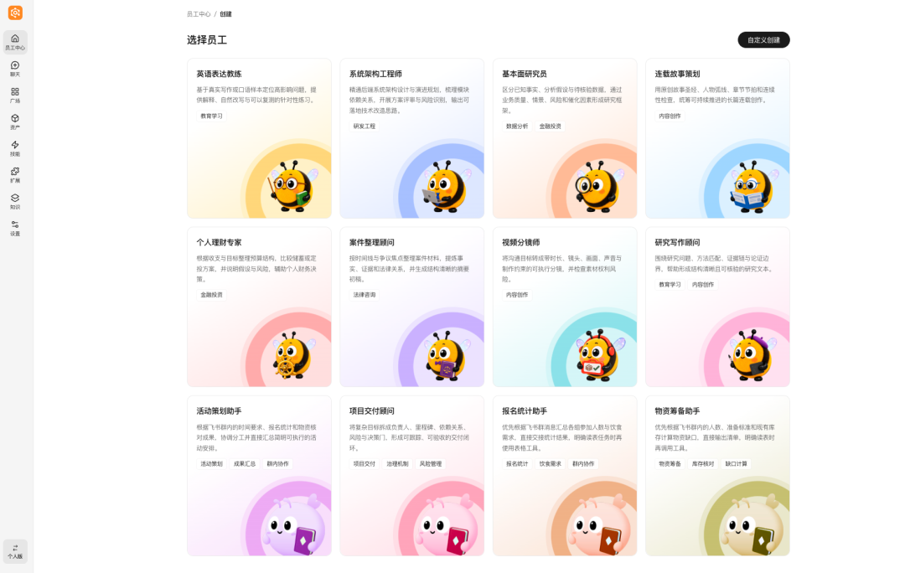
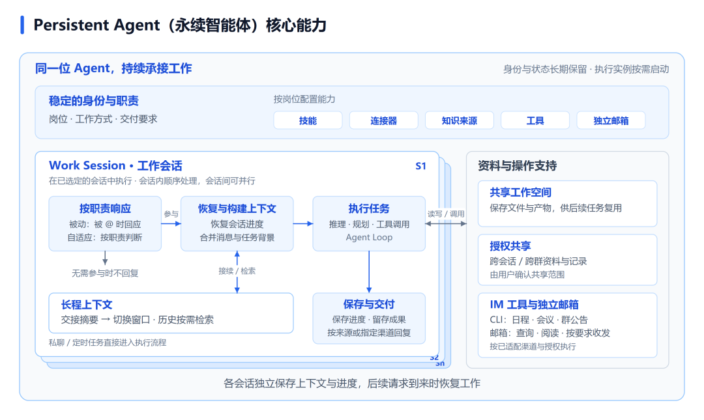
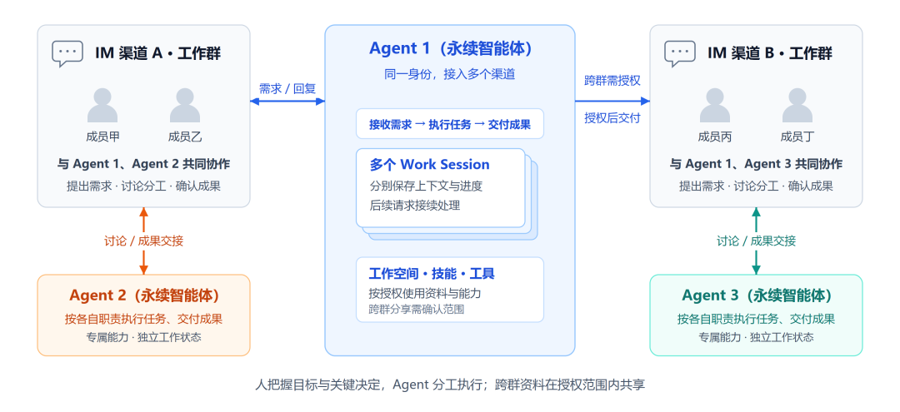
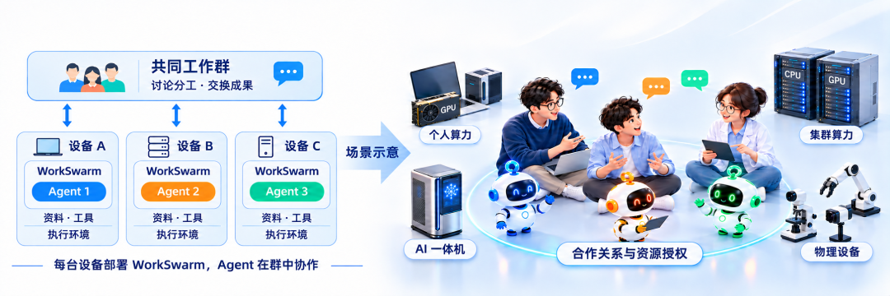
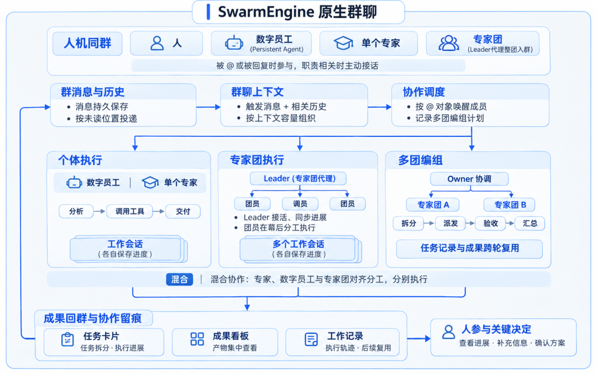
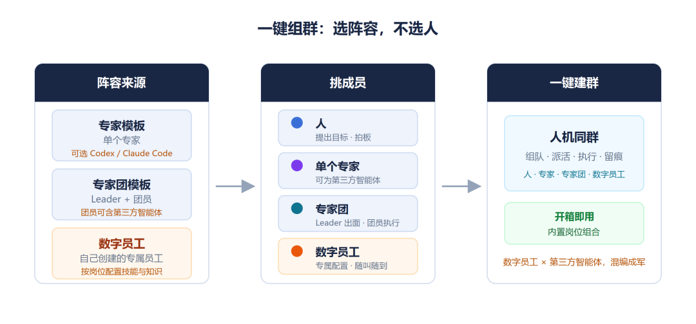
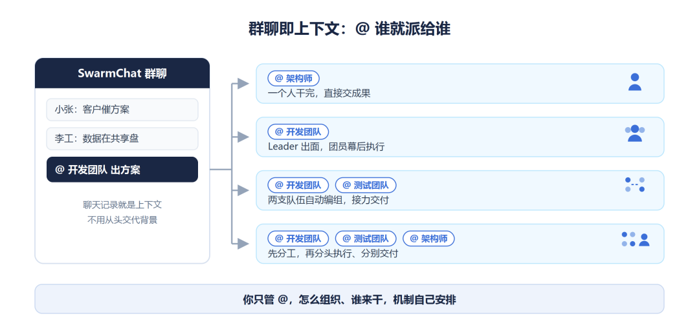

# openJiuwen首发蜂群架构Hyper-Agent，开启Agent组织级协作新范式！

Source: https://mp.weixin.qq.com/s/mHQF2gxOaj9VMAebWqVg9g

Accessed (UTC): 2026-11-08

两个月前，openJiuwen 提出 [Persistent Session（永续会话）](https://mp.weixin.qq.com/s?__biz=MzYzMjM3MjgyOQ==&mid=2247486891&idx=1&sn=616d738f935316122f398f208aa88b1c&scene=21#wechat_redirect)时，就认为：Agent 不应与某个 Session 绑定，持续推进工作也不应受会话边界限制。一项任务可能持续多天，经历多轮沟通与调整，Agent 需要记住已有约定、保留工作进度，并在需要时找回历史依据。永续会话通过保存工作记录、管理长程上下文，让任务能够接续推进。在智能体自我改进方面，openJiuwen 还推出了[双维度 RSI 框架](https://mp.weixin.qq.com/s?__biz=MzYzMjM3MjgyOQ==&mid=2247486961&idx=1&sn=604a8c4d5ce63828817f7e493a9bddec&scene=21#wechat_redirect)，让智能体基于任务反馈生成改进方案、验证效果并保留有效经验，持续优化工作方法与交付成果。

如今，openJiuwen **进一步提出超级智能体**蜂群**架构**，将设计重心从会话转向智能体：Agent 持续承接工作，Session 作为底层调度资源，由系统负责会话分配、并发调度与上下文接续，让用户专注于任务本身。在 WorkSwarm 团队版中，用户可以将智能体派发到三方 IM 跨渠道协同，也可以在 SwarmEngine 原生群聊中组织深度协作，由人把握目标与关键决定，Agent 分工执行、共同交付。

# 一、超级智能体蜂群架构：让永续智能体跨渠道协同，在原生群聊中深度协作

同一个 Persistent Agent（永续智能体）可以接入多个三方 IM 的多个群聊和单聊，持续跟进不同工作，并与其他 Agent 协作。超级智能体蜂群架构围绕这一工作方式展开：Agent 保留身份与状态，在相应的 Work Session 中执行任务，各会话分别保存上下文与进度，并借助 Persistent Session（永续会话）的历史记录接续推进；SwarmEngine 原生群聊则支持多个成员分工协作。

*△ 图1 openJiuwen 超级智能体蜂群架构：Gateway 连接 IM 与 Web UI，AgentServer 调度 Agent 与工作会话；永续智能体保留身份与状态，在多个会话中执行任务，也可按要求跨渠道回复，并与 SwarmEngine 原生群聊中的成员深度协作。*

让 Agent 摆脱单次会话的限制，持续承接跨渠道、多任务的工作，是 openJiuwen 与 DeepSeek Harness 等业界超级智能体架构探索的共同关注。在实现智能体持续工作的基础上，**openJiuwen 超级智能体蜂群架构进一步聚焦团队协作，让多个拥有独立身份与专属能力的永续智能体分工配合、共同交付：**

* • **独立承担职责，共同推进工作：** 每个永续智能体保留各自的身份、专属能力和工作状态，持续跟进任务，并与其他 Agent 交流分工、交换成果。
* • **派发到三方 IM 参与协作：** 同一个 Agent 可以接入多个 IM 的群聊和单聊，与不同成员及其他 Agent 配合，从一个渠道接收需求，再按要求向另一个渠道交付结果，让工作跨群接续推进。
* • **在 SwarmEngine 原生群聊中深度协作：** 人、永续智能体、专家和专家团在同一群中对齐任务与分工。单个成员可独立执行，专家团由 Leader 协调，多支队伍可临时编组、接力交付。任务卡片、看板和执行记录呈现进展与成果，方便人补充要求、确认关键决定。
* • **共享协作信息，保留状态与权限边界：** 群内上下文帮助成员理解共同任务，各 Agent 的会话分别保存执行状态，跨会话、跨群的资料与成果在授权范围内共享。

基于这套架构，WorkSwarm 团队版将永续智能体呈现为用户可创建、配置的“数字员工”，支持单独对话、接入办公群，以及跨渠道、跨设备协作。需要专家或专家团共同处理任务时，用户可在 SwarmEngine 原生群聊中组织团队分工、共同交付成果。

*△ 图2 WorkSwarm 团队版数字员工创建界面：在“员工中心”按职责选择数字员工模板，查看能力介绍与标签，也可通过“自定义创建”配置专属智能体；左侧导航提供聊天、资产、技能、扩展和知识等入口。*

# 二、永续智能体（Persistent Agent）：拥有独立身份和专属能力，长期保留工作状态，在多个会话中持续推进任务

团队协作的基础，是每位 Agent 既能承担明确的职责，也能持续跟进手头的工作。在 WorkSwarm 团队版中，Persistent Agent（永续智能体）凭借以下核心能力，成为能够长期配合用户的工作搭档：

* • **稳定的身份与职责：** 用户可以按岗位需要设定职责、工作方式和交付要求，配置技能、连接器、知识来源及独立邮箱，形成专属的工作能力。身份配置与工作状态长期保存，执行实例按需启动，任务完成后保存进展；后续请求到来时，恢复相应会话，继续跟进工作。
* • **长程上下文与任务接续：** Agent 可按任务需要申请切换上下文窗口，系统也会在接近容量上限时触发换窗。任务目标、当前进展和后续安排被整理为交接摘要，带入新窗口；需要核对细节时，再检索历史归档中的片段与来源。各会话分别保留记录，跨会话使用资料需遵循授权范围。
* • **按职责响应：** 被动模式在被 @ 时回复；自适应模式结合职责和群聊背景，判断应当忽略、回应还是主动介入。先判断是否参与，再恢复状态、执行任务，减少无关回复。私聊和定时任务则直接进入执行流程。
* • **资料复用与工具执行：** 共享工作空间保存文件与产物，后续任务可按权限复用；跨会话、跨群共享资料和记录，由用户确认范围。Agent 可在渠道适配和授权范围内，通过 CLI 使用日程、会议、群公告等 IM 工具，也可配置独立邮箱，查询、阅读自己的邮件，并按用户要求发送或回复。
* 

*△ 图3 Persistent Agent 的身份、会话与执行机制：在已选定的工作会话中，按职责响应、恢复上下文、执行任务，再保存进度、交付成果；各会话分别保留上下文与进度。*

在“员工中心”中，用户可以从专家模板创建数字员工，也可以自定义身份与职责，配置模型、技能、连接器、插件和知识来源，并按需设置邮箱。完成后先单独对话试用，再通过“渠道”设置接入办公软件；参与群内讨论所需的消息权限也在接入时配置。

【视频1 创建专属数字员工，接入飞书群并通过独立邮箱交付成果】

▷ 从专家模板或自定义方式创建数字员工，配置专属能力、绑定 Agent 邮箱并接入飞书；在群内围绕研究任务持续沟通，按要求通过独立邮箱发送整理结果，并反馈发送状态。

创建后，可在“员工中心”调整配置、查看职责、进入对话，或单独启用、停用员工。停用后保留渠道绑定，仍可在 WorkSwarm 内对话，再次启用无需重新接入。需要按时执行的工作，可在“员工中心”的“任务中心”创建和查看定时任务。

“活跃数据”支持查看全员或单个员工的活跃情况、Token 消耗和最近响应时间，并进一步了解参与群聊、产物数量及各群消耗。需要核对执行过程时，可打开轨迹查看模型与工具调用、耗时和用量。

【视频2 统一管理数字员工，查看活跃数据、设置定时任务并回查工作记录】

▷ 在员工中心查看全员与个体的活跃情况、Token 消耗和最近响应信息，并在任务中心创建定时任务；演示数字员工的停用与重新启用、IM 渠道响应恢复，以及在 WorkSwarm 中回查渠道对话与相关工作成果。

# 三、将永续智能体作为数字员工派发到三方 IM，参与团队日常协作

### 3.1 跨渠道协作，让人与多位 Agent 跨群接力，共同推进任务

同一个 Persistent Agent 可以接入多个渠道，从一个渠道接收需求，再按要求向另一个已接入渠道交付结果。各渠道群聊中的成员与多位 Agent 可以讨论分工、交换成果、接续任务；人把握目标与关键决定，Agent 按职责执行，跨群资料在授权范围内共享。

*△ 图4 多渠道、多人、多 Agent 协作示意：同一个 Agent 连接两个 IM 渠道，在获准跨群分享后向另一侧交付成果；两侧成员分别与其他 Agent 讨论分工、交换成果，各会话独立保存上下文与进度。图中省略接入与调度层。*

跨群分享前，所有者需在 WorkSwarm 私聊的“跨群分享审批”中核对来源群、接收方及内容，选择“一次批准”或“永久批准”；长期授权可在“权限”页撤销，文档和附件仍需相应访问权限。

【视频3 从飞书到钉钉，多个 Agent 协同筹备活动并按授权共享成果】

▷ 将智能体绑定到飞书与钉钉，演示策划助手与预算助手在飞书群中接力调整人数增加、预算不变的活动方案；随后从钉钉群请求相关成果，在 WorkSwarm 中审批跨群分享，展示授权后的文档交付及拒绝分享后的处理。

### 3.2 跨设备协同，让分散的资料、工具与计算环境共同服务于任务

团队成员可以在各自设备上部署 WorkSwarm，让 Persistent Agent 使用本地已配置、获授权的资料、工具和计算环境，在同一工作群中讨论分工、交换成果。人通过群聊提出目标、补充要求并确认结果，Agent 分别执行、接力推进任务。未来还将探索沿着团队、项目和社区的合作关系，由资源所有者明确开放范围，让 Agent 协调 GPU、CPU 等个人与集群算力、AI 一体机及物理设备，并探索主动学习、更多维度的历史检索和故障恢复，支持更长时间的协同工作。

△ 图5 跨设备协同架构与资源协同场景：左侧展示各设备独立部署 WorkSwarm、通过工作群协作的关系；右侧展示后续资源协同的构想，以合作关系与资源授权为前提。

【视频4 跨设备协作，云端与个人 PC 上的 Agent 协同筹备活动】

▷ 分屏展示三位成员邀请各自助手加入同一办公群，云端服务器上的报名统计助手、物资筹备助手与个人 PC 上的活动策划助手接力配合；成员补充报名信息、确认物资缺口，助手汇总活动安排，最终由人确认。

# 四、SwarmEngine 原生群聊：让人与永续智能体、专家及专家团深度协作，共同交付复杂任务

永续智能体可以在三方 IM 中与团队成员协作；随着任务变得复杂，协作也需要更有组织地展开：由整支队伍接手任务、多项工作并行推进，或让人和多个 Agent 持续对齐分工，这也是dsh-superagent提出的开放问题之一，针对这个问题openjiuwen给出了答案。WorkSwarm 提供了 **SwarmEngine 原生群聊**，将成员组织、任务分派、进展跟踪与成果交付整合在同一个协作空间。

在这个空间里，人、Persistent Agent、单个专家和专家团可以同处一群，借助群内上下文理解共同任务，边讨论、边执行。任务既可交给单个成员，也可由专家团整队接手，多支队伍还可临时编组、接力配合，各自的会话状态与权限边界仍然保留。协作过程中，任务卡片呈现目标、步骤与执行成员，成果回到群聊并统一进入看板，执行记录可回查，方便人随时了解进展、补充要求并确认方案。

*△ 图6 SwarmEngine 原生群聊架构与多 Agent 团队执行机制：群消息与历史形成协作上下文，系统组织个体、专家团、多团编组及混合协作；Leader 代表专家团接活，Owner 协调多团分工与验收，任务卡片、成果看板和工作记录支持查看进展、复用成果与人类介入。*

### 4.1 从专家与专家团模板中选择阵容，一键组建人机协作团队

逐个创建 Agent，需要分别定义职责、配置工具并调试；把它们组织成队伍，还要决定谁进群、谁牵头、成员如何配合。SwarmEngine 原生群聊提供专家与专家团模板，可以按任务选择已有岗位组合，邀请人类同事，一键建群，减少从头搭建和手工编组的工作。

在产品使用上，群内成员有四类：人、单个专家、专家团，以及用户创建的数字员工，也就是 Persistent Agent。专属 Agent 可以带着已配置的职责和工具直接进群，与其他成员共同工作。

专家团由 Leader 和多名团员组成。入群的是 Leader，由它接任务、同步进展、组织交付；团员在幕后执行分派的工作。团队成员在群里与一个负责人沟通，同时获得整支队伍的执行能力。

单个专家也可以来自已有的第三方智能体，例如 Codex、Claude Code。专家团支持混合编组：Leader 统一调度，自建数字员工、负责代码验证的 Claude Code、用于核对技术资料的 Codex 可以按各自专长参与任务。

△ 图7 一键组群：专家与专家团模板提供可选阵容，自建数字员工和第三方智能体可按任务需要加入，组成混合团队。

【视频5 从模板一键建群，支持第三方智能体混合编组】

▷ 演示点击“发起群聊”、选择成员并确认建群的操作。

### 4.2 群聊即上下文，通过 @ 组织成员与专家团协作，共同交付任务

建群后，用户说明要做什么、@ 到执行者，系统便将触发消息与群内相关历史一起交给成员。群历史持续保存，执行时依据成员的已读位置和上下文容量组织近期内容，减少重复交代背景。   

△ 图8 @ 派活与执行路由：群内消息提供任务背景，@ 对象决定由单个成员、一个专家团、多支专家团或混合阵容参与；成员按各自分工执行并交付，群聊中的讨论帮助协作持续衔接。

系统按被 @ 的对象组织执行：

* • **@ 一位专家或 Persistent Agent**：由这位成员分析任务、调用工具、交付成果，适合边界清楚的个人任务。
* 【视频6 群内派活，单 Agent 执行与成果交付】

▷ 以大学城咖啡店的市场调研为例，在群中说明调研需求并 @ 单个专家，将边界明确的任务交给一位成员执行。通过任务卡片查看任务描述与任务分解，了解专家如何组织调研工作；随后阅读群内回复，并在右侧成果看板打开交付文档，核对调研结论，为后续开店规划提供依据。

* • **@ 一个专家团**：由 Leader 接下整件事，安排团员分工并同步进展，成果进入右侧看板，具体执行留在团内。
* 【视频7 群内派活，专家团执行与成果交付】

▷ 沿用前一轮咖啡店的市场调研结果，将开店规划交给一个专家团整体承接。由 Leader 作为群内负责人接收需求、组织团员按专业分工，围绕品牌、选址、财务等方面形成开店计划。演示中查看专家团的群内交付及相关成果文档，展示从单项调研到多专业综合规划的任务接续方式。

* • **@ 多支专家团**：系统记录编组计划，将队伍组织为临时项目组，由 Owner 协调拆分、派发与验收，任务在组内接力，汇总后向群里交付。任务记录、输出和团内上下文可以在后续轮次继续使用。
* 【视频8 群内派活，多专家团协作与成果交付】

▷ 在已有开店计划的基础上，将任务进一步推进到开业筹备，组织门店运营、品牌营销和财务等多支专家团共同参与。各团围绕各自负责的工作形成方案，并由 Owner 协调分工、衔接成果，汇总为开业筹备方案。演示中查看群内交付与相关文档，了解多支专业队伍如何沿着同一任务接力，把规划细化为后续可执行的安排。

* • **@ 混合阵容**：被点到的成员先在群里对齐分工，再分别执行、交付，过程对全群可见。
* 【视频9 群内派活，混合成员协作与成果交付】
* ▷ 围绕咖啡店开业筹备，展示包含第三方智能体在内的混合阵容如何参与同一任务。被 @ 的成员结合群内已有背景对齐分工，再按各自专长推进工作、向群内交付成果。通过查看开业执行计划、预算及客户沟通等文档，展示不同类型成员如何共享任务背景、交换工作成果，并让人能够在群内继续补充要求、核对交付内容。

这几种方式共享同一个群聊入口。用户选择协作对象，系统据此路由到个人、整队或多团编组；需要改变分工或补充要求时，仍可在群里继续沟通。

# 结语

从一位长期配合的搭档，到一支分工协作的人机团队，WorkSwarm 团队版让 Agent 带着各自的身份与专长走进日常办公。数字员工在熟悉的工作群中持续跟进任务，与不同渠道、不同设备上的伙伴交换成果；面对更复杂的工作，还可以在 SwarmEngine 原生群聊中组织专家与专家团，共同完成交付。

人把握目标和关键决定，Agent 按职责执行，在授权范围内接力推进，进展与成果可查。团队由此减少反复交代背景、居中转述的工作，把更多精力放在方案取舍和成果验收上。欢迎从下一项团队任务开始，创建一位专属数字员工，带上你的 Agent 伙伴，一起进群开工。

* • WorkSwarm 官网与下载：https://openjiuwen.com/workswarm
* • GitHub 开源仓库：https://github.com/openJiuwen-ai/jiuwenswarm
* • AtomGit 开源仓库：https://atomgit.com/openJiuwen/jiuwenswarm
