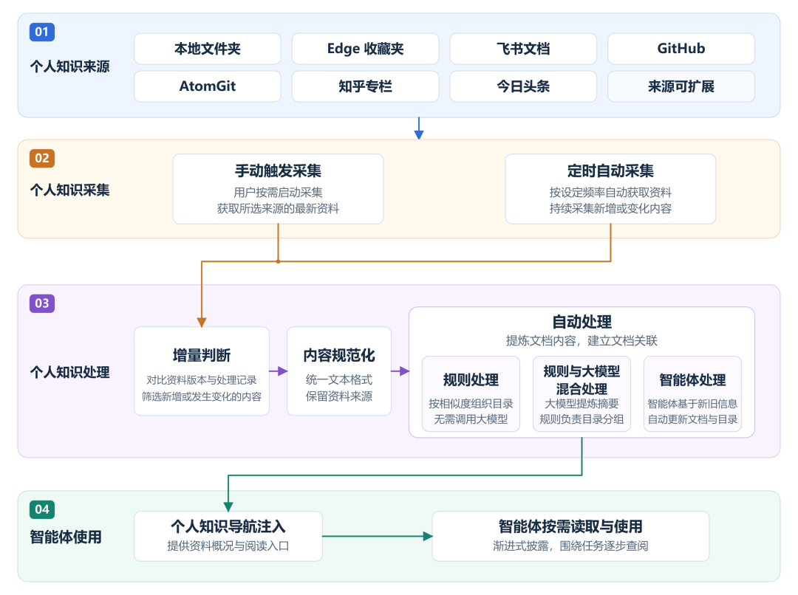

# 告别资料散落，让知识持续积累：openJiuwen 首发个人知识空间，重塑个人办公智能体新体验！

Source: https://mp.weixin.qq.com/s/ViVOhJGLd5azXDujgIIWDg

Accessed (UTC): 2026-11-08

空间 

让 Agent 写周报、分析方案，已经是许多人的日常。但每次开始，用户还得翻找资料、交代背景，智能体也要经过查找、阅读、整理等多个步骤，才能真正开始任务。换个任务，这套流程又得重来。反复处理这些已有资料，既费时间，也增加 token 消耗。资料越多、步骤越长，还越容易遗漏信息或出现偏差，影响任务完成的准确率。

为了解决这些问题，**WorkSwarm 首次原生支持个人知识空间**。

“个人知识空间”基于用户配置的多个资料来源，自动采集内容，通过规则处理、规则与大模型混合处理或智能体处理，将资料整理成**有目录、有联系、有出处**的个人知识，并以渐进式披露的方式提供给智能体使用。

WorkSwarm 将个人资料整理为可长期复用的个人知识，实现 **“一次采集，反复使用”**，让智能体更容易找到并用好相关信息，提升任务完成的准确率，同时缩短任务准备时间，减少 token 消耗。

## openJiuwen 个人知识空间：自动采集个性化多源知识，办公智能体按需使用

个人知识空间围绕来源、采集、处理和使用四层，把用户日常积累的个人资料转化为可持续复用的任务背景知识。

个人知识空间四层流程，展示多源资料配置、手动和定时采集、三种处理方式及智能体按需使用。

用户先选择个人知识来源与采集范围，系统按需或定时获取内容。采集到的资料经过格式统一和增量判断，识别本轮需要处理的新内容与变化，再按配置选择规则、规则与大模型混合或智能体方式，整理为主题目录和 Markdown 页面，并维护文档关联与出处。目录结构和来源引用检查通过后，整理结果供用户查阅。

用户开启任务使用时，系统将个人知识概况和阅读入口提供给智能体，由它围绕当前问题逐步读取相关页面，让已有知识成为完成任务的背景。

## 个人知识空间配置与采集：自主选择个人知识来源，支持手动/定时增量采集

在“设置”中的“知识”页面启用个人知识空间后，用户可以添加**本地文件夹、Edge 收藏夹、知乎专栏、今日头条、飞书文档、GitHub 和 AtomGit**等来源。不同来源可以分别配置，用户自主决定哪些个人资料进入个人知识空间。

配置完成后，用户可以**手动发起采集**，主动更新个人知识空间，也可以设置**定时自动采集**，按设定频率持续获取内容。系统结合来源标识、版本和采集进度识别新增或发生变化的资料，结合已有个人知识，处理新增或发生变化的资料。

来源管理页面展示采集进度与最近状态，用户可以调整更新频率，查看本轮结果，也可以停止正在进行的采集。

在“设置”的“知识”页面开启个人知识空间，再进入“知识”页面的“来源管理”。视频以今日头条为例，添加作者主页链接、手动启动采集，并查看来源的运行状态。

## 个人知识处理：提供三种整理方式，让分散资料成为可复用的知识

网页、文档和代码的结构各不相同，同一主题的内容也可能分散在多个来源中。个人知识空间先统一资料格式，再提炼内容，按主题组织成目录和页面，方便智能体先了解概况，再逐步读取相关内容，同时保留原始文档的链接与出处。

采集到新资料后，系统会结合已有的个人知识进行补充和更新，让知识在同一套纯文本文件中持续积累。

用户可以在“设置”的“知识”页面，根据资料特点和整理需求，选择以下三种处理方式：

* • **规则处理**：利用 BM25 词项权重和内容相似度，将相关页面按主题归类，并维护目录与页面之间的链接，无需调用生成式模型。
* • **规则与大模型混合处理**：先由大模型提取新资料的标题、摘要和关键词，再由规则完成主题分组和目录组织，最后由大模型生成目录标题与简介，方便理解和查阅。
* • **智能体处理**：由智能体分析新资料与已有个人知识的关系，优先更新或合并已有主题页面，必要时新增文档，并同步维护目录说明和文档间的交叉引用。

采用后两种方式时，用户可以配置用于整理资料的模型。整理完成后，系统会检查目录结构和来源引用，通过检查的内容即可供用户查阅和智能体使用。

用户还可以通过文件树、图谱或搜索查找相关内容，打开文档阅读正文，并通过“来源”标注追溯原始资料。

采集完成后，已经采集到“jev”相关内容。用户可以在“知识”页面搜索 Jev，在右侧阅读整理后的正文，也可以通过图谱查看相关节点及其关联。

## 按需使用：渐进式披露，让智能体带着已有知识开始工作

资料整理为个人知识后，用户可以通过任务输入区的“+”菜单将智能体接入个人知识空间。收到用户输入后，智能体先获取个人知识空间的资料概况和阅读入口，了解已有知识的范围，再根据当前任务沿目录和文档链接逐步查阅，补充所需背景。

这种渐进式披露的方式，类似接手工作时先看目录和项目介绍，再翻阅相关文档，让每次任务按需读取已有知识。

采集与任务使用可以分别控制。用户可以让系统持续采集和整理资料，在需要时开启智能体使用。关闭任务使用后，资料仍可继续采集，用户也可以直接浏览和搜索已有文档。

用户决定哪些资料进入个人知识空间，以及智能体何时可以使用。发起任务时，只需聚焦本次要解决的问题，已有的知识积累则为智能体理解和完成任务提供背景。

开启个人知识空间后，输入“介绍一下 jev”并发送。WorkSwarm 随后查阅个人知识空间中的 Jev 文档，生成涵盖核心机制、落地案例等内容的介绍。

## 效果对比：提升任务通过率，减少任务耗时与 token 消耗

启用个人知识空间后，智能体可以先了解已有资料的范围，再定位和读取相关文档，减少任务中反复查找、整理原始资料的工作。

团队先通过2条对比测试，观察这一变化对任务完成效果、耗时和 token 消耗的影响。

对比可以看出，有了个人知识空间，WorkSwarm 能够结合客户档案、项目资料和工作计划，整理出具体的项目总结与下一步安排；缺少相关个人知识时，智能体多次查找仍未获得项目背景，只能先给出通用的会议准备框架，并请用户补充资料。

对比可以看出，开启个人知识空间后，WorkSwarm 能够利用从用户浏览器收藏夹、知乎专栏等来源积累的知识，更快完成任务。

此外，我们自建了一套包含 25 道题目的测试集，基于本地论文、浏览器收藏、飞书文档、GitHub、AtomGit、知乎和头条七类来源的资料，覆盖单来源检索、跨来源综合、换题复用、缺失事实和无关任务等场景，并为每道题预先设定验收点。测试结果显示，启用个人知识空间后：

* • 任务通过率提高 32%。个人知识空间让智能体更容易定位所需资料，并结合不同来源的个性化信息作答，减少因找不到资料或遗漏信息而未能完成任务的情况。
* • 任务总耗时减少 76.2%。资料提前完成采集和整理，任务中可以直接查阅相关文档，减少临时查找、阅读和整理原始资料的步骤。
* • 任务阶段 token 总消耗减少 84.1%。整理后的知识可以在不同任务中复用，智能体围绕任务按需读取相关内容，减少重复整理原始资料和传入无关内容的 token 消耗。

本次实验采用智能体处理方式，虽然预处理阶段也会消耗 token，但这部分成本可以通过选用适合资料整理、价格较低的模型来控制，并随着整理结果在多个任务中反复使用而逐步分摊。

## 结语

openJiuwen 个人知识空间将分散的个人资料整理为可持续复用的知识。用户自主选择来源，系统持续采集与更新，让资料既方便查阅，也能被智能体按需读取，为不同任务提供背景。

未来，openJiuwen 个人知识空间计划结合用户使用轨迹，识别工作目标与知识缺口，主动补充资料，让知识积累更贴近实际需求，让办公智能体在使用中越来越懂你。

**个人知识空间，让你积累的资料，成为下一次 Agent 协作的起点。**

个人知识空间已在 WorkSwarm 上线，感兴趣的用户可前往官网一键下载，立即体验：

* • WorkSwarm 官网：https://openjiuwen.com/workswarm
* • GitHub 开源项目： https://github.com/openJiuwen-ai/jiuwenswarm
* • AtomGit 社区项目：https://atomgit.com/openJiuwen/
