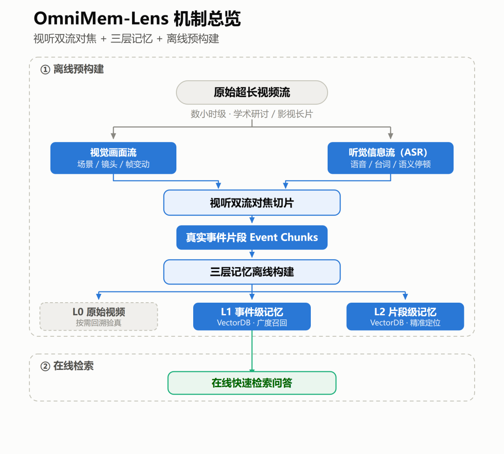
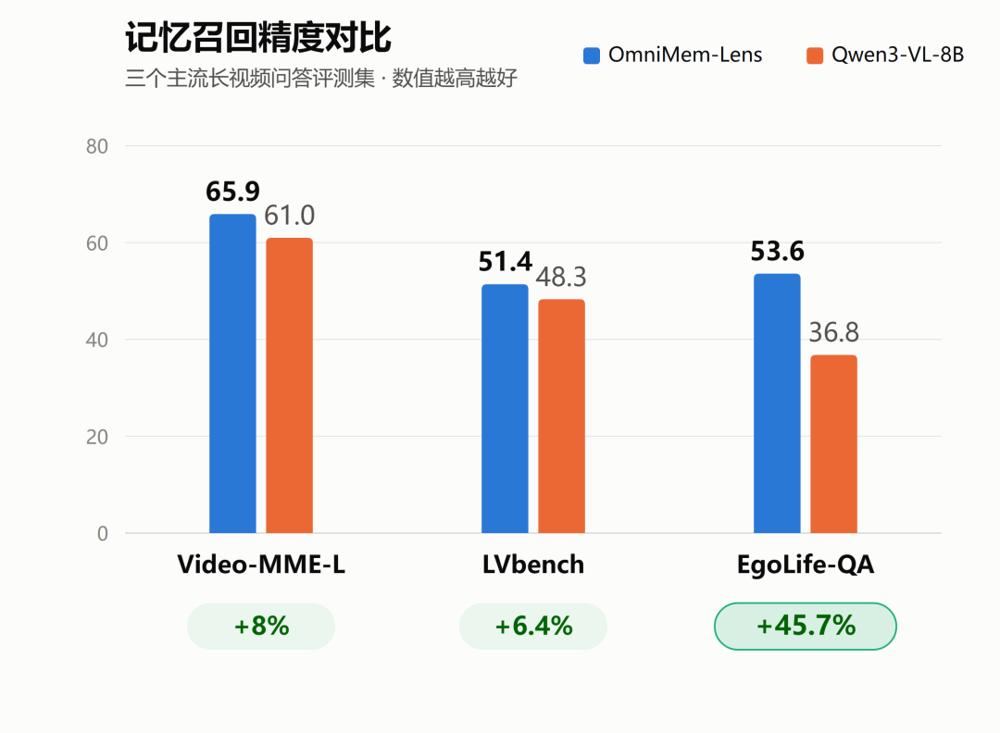
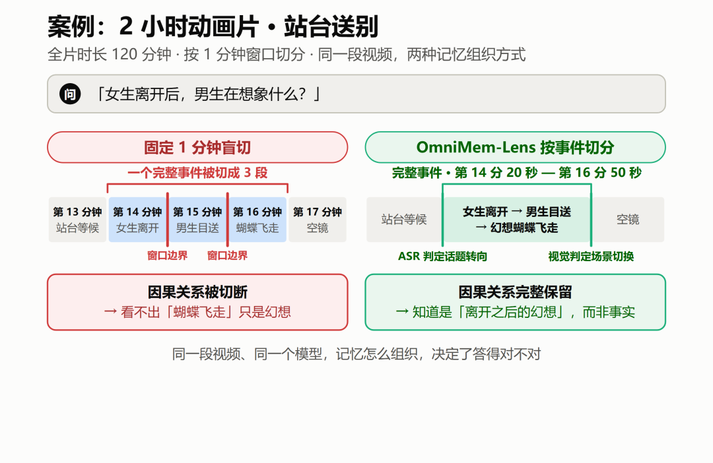
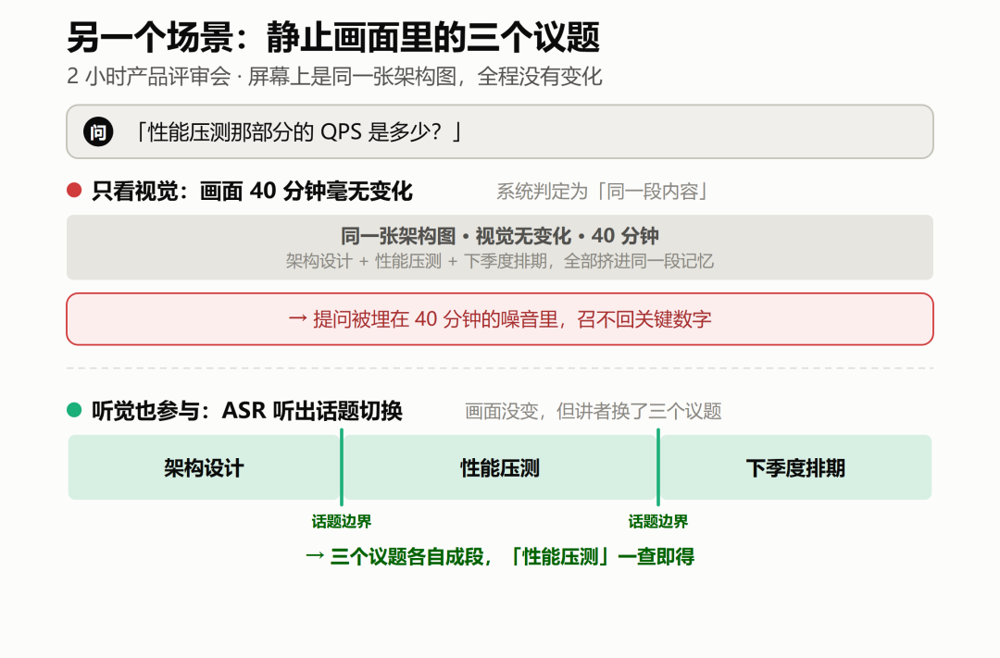

# 让 Agent 首次拥有“视听双流记忆”：openJiuwen Agent-Memory 看懂长视频，关键事件一个不落

Source: https://mp.weixin.qq.com/s/-egoHzADLLF8Gku5ZIsQ4g

Accessed (UTC): 2026-11-08

> **openJiuwen AgentMemory** 正式上线了多模态记忆能力 **OmniMem-Lens**：按秒盲切是记忆碎片化的元凶，按真实事件记忆才是正解——召回精度最高提升 **45.7%**，在线问答时延最高降低 **97%**。

---

### 一、一个让所有 Agent 头疼的问题：3 小时的视频，怎么“记”？

在 AI 智能体（Agent）与多模态模型（VLM）快速演进的今天，我们已经不满足于让 Agent 处理单一的文本工作了，而是让它干更复杂的活儿——

比如“看完 3 小时的新品发布会并找出所有产品亮点”，或者“分析一整天的监控视频并标记出异常事件”。

然而，现有 Agent 面对超长视频时，海量信息会瞬间超出其上下文限度，导致处理能力和准确度大大下降。

目前业界的通行做法，是粗暴地把长视频按固定时间窗口（如一分钟）切分成一小段一小段，让智能体分开去记忆。

这种方式如同**盲人摸象**，给智能体记忆带来了两个致命伤：

**① 记忆被切碎——证据碎片化**

一个原本连贯的老师讲解，在中间被切断，前半段和后半段被智能体分开处理、分开存储。当用户提问时，智能体只能拿到半个“断章取义”的证据，于是胡编乱造、幻觉频出。

**② 记忆被稀释——证据淹没**

一个几秒钟的关键动作，与前后几分钟无关的背景画面强行打包。智能体检索细节时，关键信息被大量噪音淹没，召回精度断崖式下跌。

问题的根源只有一句话：**Agent 是“按秒”在记视频，而人是“按事件”在理解视频。**

> 打个比方：你回忆昨天看过的电影，会按“主角相遇 → 误会 → 和解”这样的情节去记，而不是拿秒表每 60 秒存一段。可现在的 Agent，恰恰是拿秒表在记电影。

更棘手的是，市面上大多数视频事件分割方案只依赖**单一模态**——只看画面，或只听语音。可这两条路都会失灵：画面长时间不动时，它看不见内容其实换了议题；没有台词时，它听不到任何线索。

这不是算力不足，而是记忆在切分源头就失去了“焦点”。

---

### 二、OmniMem-Lens：让 Agent 像人一样“按事件”记忆

为了让智能体像人类大脑一样真正处理长视频，我们在 **openJiuwen AgentMemory 0.2.0** 版本中正式上线了 **OmniMem-Lens（多模态记忆透镜）** 能力。

作为 AgentMemory 针对视频多模态记忆处理的核心技术，OmniMem-Lens 开创性地通过**视觉**和**听觉**两条轨迹来理解视频中的事件，并以此完成记忆内容的组织，让 Agent 的视频记忆第一次真正做到——**按事件存，按事件取**。

一句话概括它的定位：给智能体装上一个懂得“自动定焦”和“分层整理”的**超级海马体**。

它做对了三件事：**按真实事件切、分层存记忆、离线建好在线查**。

OmniMem-Lens 机制总览：视听双流对焦 + 三层记忆 + 离线预构建

---

#### 1️⃣ 视觉听觉联动：像人类大脑一样，按真实事件记忆

OmniMem-Lens 给智能体同时装上了“眼睛”和“耳朵”：**眼睛看画面**，画面切换时判断出变化并标记；**耳朵听语音**，画面没动但说话人换了话题时，通过 ASR 语音转录分辨出来。

双证据交叉对焦，长视频被切分在真实事件边界上，智能体对视频的理解从此不再“断章取义”。

#### 2️⃣ 三层记忆结构：不同颗粒度分层存，细节回溯与整体理解兼得

用户的每次提问，需要的证据颗粒度可能都不一样。OmniMem-Lens 在后台建立了一个三层记忆单元：

| 层级 | 内容 | 用途 |
| --- | --- | --- |
| **L0 原视频层** | 保留原始长视频 | 智能体需要验证事实时，重新调看 |
| **L1 事件层** | 每个事件的整体总结、粗粒度大纲 | 广度召回，快速锁定范围 |
| **L2 片段层** | 秒级片段切分，视觉动作画面 + 关键台词 | 细粒度精准定位关键信息 |

要大纲有大纲，要细节有细节，检索时按需取用，互不干扰。

> 就像一本带目录和索引的书：目录（L1）帮你翻到大致章节，索引（L2）帮你定位到具体某一句话，原文（L0）随时可以翻回去核对。

同时，L1 与 L2 记忆单元完全**文本化与向量化**，可以无缝接入主流向量数据库——对已有 RAG / Agent 技术栈的开发者来说，几乎零改造即可用上。

#### 3️⃣ 记忆离线建，回答在线查：慢功夫提前做，快响应留给用户

如果每次不同角度的提问，都需要智能体把几个小时的视频重新看一遍，不仅反应极慢，还会消耗巨大算力。

OmniMem-Lens 把繁重的记忆整理工作**提前在离线做完**；智能体面对提问时直接查记忆，做到**秒级响应**，问什么答什么。

在线检索的链路并不复杂：用户 Query 先与 L1/L2 的记忆单元做语义匹配，快速定位到精炼的多模态记忆；只有当明确需要视觉细节验证时，系统才按需调取 L0 层的精确视频帧。这种“**轻量级文本索引 + 延迟调取原始视频**”的架构，大幅提升了视频记忆检索的效率。

OmniMem-Lens 的设计哲学在于：像专业摄像机一样**双焦定格**事件边界，像三棱镜一样**分层**折射记忆结构——让智能体对长视频的理解，从盲目切割，走向精准透视。

---

### 三、实测数据：精度全面领先，时延最高降 97%

说得再好，不如跑一遍数据。我们选取三个主流长视频问答评测集，将应用了 **OmniMem-Lens** 能力配合 Qwen3-VL-8B 模型处理视频记忆问答与直接使用 VLM 模型 **Qwen3-VL-8B** 处理视频内容问答进行对比。

> 💡 一句话看懂下面的表：**“召回精度”越高 = 找到的证据越准；“在线时延”越低 = 等答案的时间越短。**

**① 记忆召回精度：三个评测集全面领先**

| 评测集 | OmniMem-Lens + Qwen3-VL-8B 处理后问答 | Qwen3-VL-8B直接问答 | 提升幅度 |
| --- | --- | --- | --- |
| Video-MME-L | **65.9** | 61.0 | **+8%** |
| LVbench | **51.4** | 48.3 | **+6.4%** |
| EgoLife-QA | **53.6** | 36.8 | **+45.7%** |

在通用长视频基准 Video-MME-L 上提升 8%，长视频理解基准 LVbench 上提升 6.4%。

最亮眼的是 **EgoLife-QA 上的 +45.7%**——这个评测集以第一人称视角记录一整天的日常生活，事件密集、细节琐碎，恰恰是固定切分最容易失效的场景，也最能体现“按真实事件组织记忆”的价值。

记忆召回精度对比：OmniMem-Lens vs Qwen3-VL-8B

**② 在线问答时延：从“重新看一遍视频”到“直接查记忆”**

| 评测集 | OmniMem-Lens + Qwen3-VL-8B 处理后问答 | Qwen3-VL-8B直接问答 | 时延降低 |
| --- | --- | --- | --- |
| Video-MME-L | **0.69s** | 22.8s | **-97%** |
| LVbench | **1.72s** | 34.5s | **-95%** |
| EgoLife-QA | **3.26s** | 9.6s | **-66%** |

视频越长，VLM 直答需要“啃”的画面就越多，时延也就越长——LVbench 上 Qwen3-VL-8B 要等 34.5 秒，OmniMem-Lens 只需 **1.72 秒**，快了整整 **20 倍**。

> 换成生活场景：VLM 直答像每次都把 3 小时的电影从头到尾重看一遍再回答你；OmniMem-Lens 像一位看片时就已经做好笔记的影评人——你问哪段，他翻笔记直接答。

---

### 四、两个例子，看懂“失焦盲切”与“精准透视”的差距

#### 例一：因果关系被切断

同一段视频不同切分的对比

以一段 2 小时的动画片为例：站台上，女生离开、男生目送，女生离开后，男生幻想她变成蝴蝶飞走。

**固定 1 分钟盲切**把这段 120 分钟的视频切成 120 个片段。而“女生离开 → 男生目送 → 幻想蝴蝶”这个完整事件，从**第 14 分 20 秒**持续到**第 16 分 50 秒**，恰好横跨第 14、15、16 三个窗口，被窗口边界连切两刀。

于是碎片变成了三段互不相干的记录：**第 14 分钟「女生离开」、第 15 分钟「男生目送」、第 16 分钟「蝴蝶飞走」**。当用户查询 “在女生离开后，男生在想象什么？” 时，检索到的片段里只有“男生目送”和“蝴蝶飞走”，**却没有任何线索说明这蝴蝶只是幻想**——智能体把它当成了真实发生的事，答非所问。

**OmniMem-Lens** 则把这个事件作为完整的一段（第 14 分 20 秒 — 第 16 分 50 秒）存进记忆：ASR 流听出话题转向、视觉流捕捉到场景切换，双流对焦在真实边界落刀。“女生离开后再幻想”的因果关系被完整保留，事实与幻想分得清清楚楚，准确回答。

同一段视频，不同的记忆组织方式，就是“答不出”和“答得准”的差距。

#### 例二：画面静止时，耳朵才是关键

上面这个例子靠视觉线索就能解决——而下面这个场景，**光有眼睛是不够的**。

静止画面里的三个议题：ASR 听出话题切换

一场 2 小时的产品评审会，屏幕上始终是**同一张架构图，40 分钟没有任何变化**。但这 40 分钟里，讲者先后讲了三个独立议题：架构设计、性能压测、下季度排期。

**只看视觉的方案**（以及固定窗口盲切）看到的是“一段静止画面持续 40 分钟”，于是判定为同一段内容，把三个议题打包进同一条记忆。当用户问“性能压测那部分的 QPS 是多少”，关键数字被埋在 40 分钟的噪音里，召不回来。

**OmniMem-Lens** 的 ASR 语音流听得出来：画面没变，但讲者在换话题。语音一旦转向，系统立即落刀——三个议题各自成段，提问时一击即中。

这正是**视听双流**的价值所在：视觉失灵时，听觉顶上；听觉失灵时（比如无台词的镜头切换），视觉顶上。任何单独一路都可能漏判，两路交叉才靠得住。

---

WorkSwarm即将支持对接使用openJiuwen AgentMemory，将日常对话中的视频内容帮你记住，讨论时帮助你快速回忆。

---

### 写在最后

智能体要想真正替人类干复杂的工作，就不能只有“执行力”，更要有“好记性”。

OmniMem-Lens 通过让智能体“按真实事件记”与“分层高效查”，解决了长视频场景下智能体记忆碎片化、找不准、反应慢的问题，为多模态智能体打造了一套高精度、极速响应的记忆底座，让智能体在面对长视频时，真正做到“过目不忘、对答如流”。

技术开发团队联合北京邮电大学展开密切合作、共同探讨，已完成方向拓展和算法验证，基于相关核心算法技术撰写成衍生学术论文：EMMA:Event-Driven Multimodal Memory System with Multi-Agent Retrieval，该论文已经由Findings of EMNLP 2006正式接收，受到相关领域专家关注讨论。

**OmniMem-Lens 已在 openJiuwen AgentMemory 0.2.0 版本正式上线**，欢迎体验、共建。

如果这篇文章对你有帮助，欢迎**点赞、在看、转发**三连，也欢迎在评论区聊聊：你的 Agent 是怎么处理长视频记忆的？
