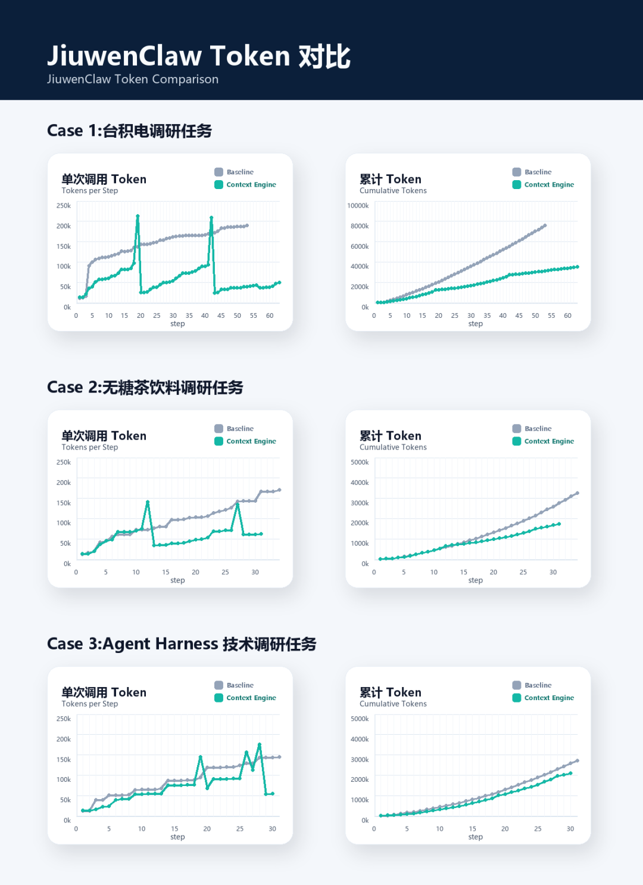
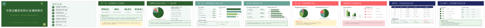
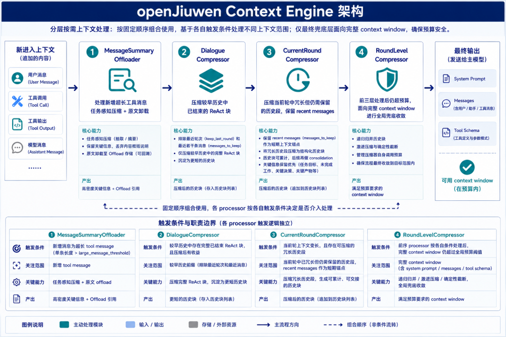
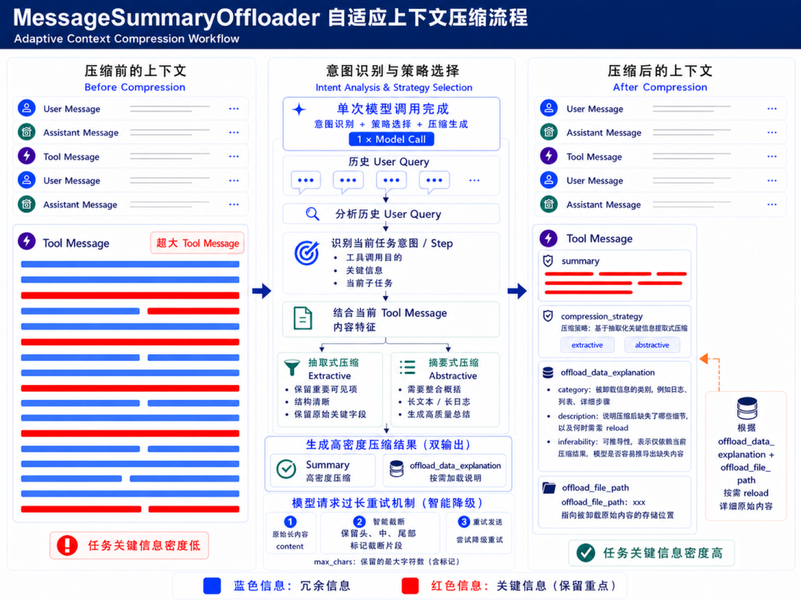
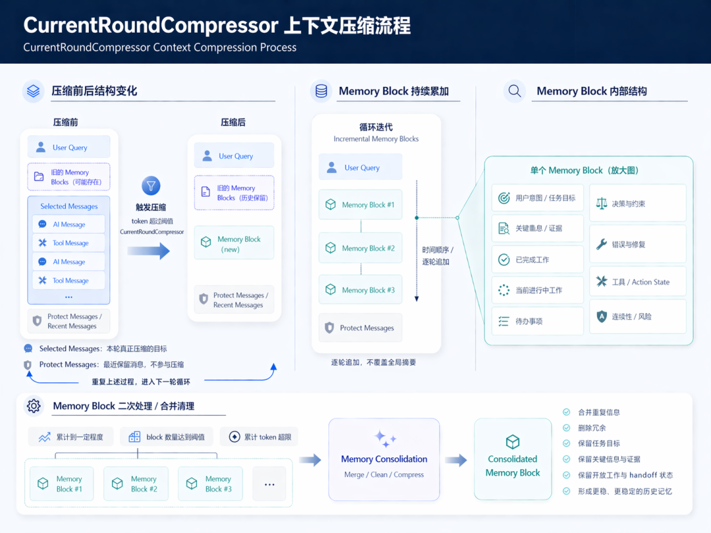
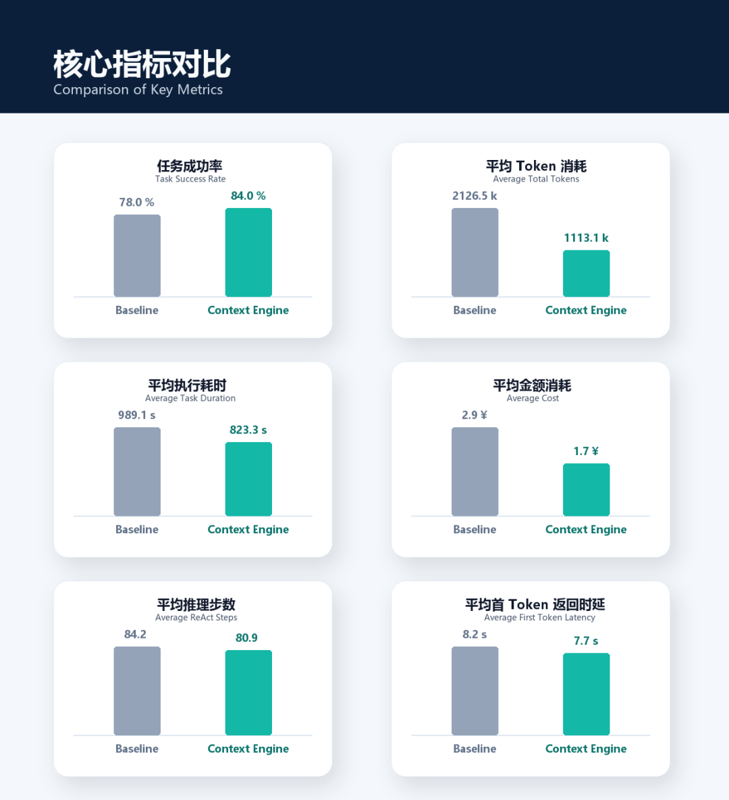
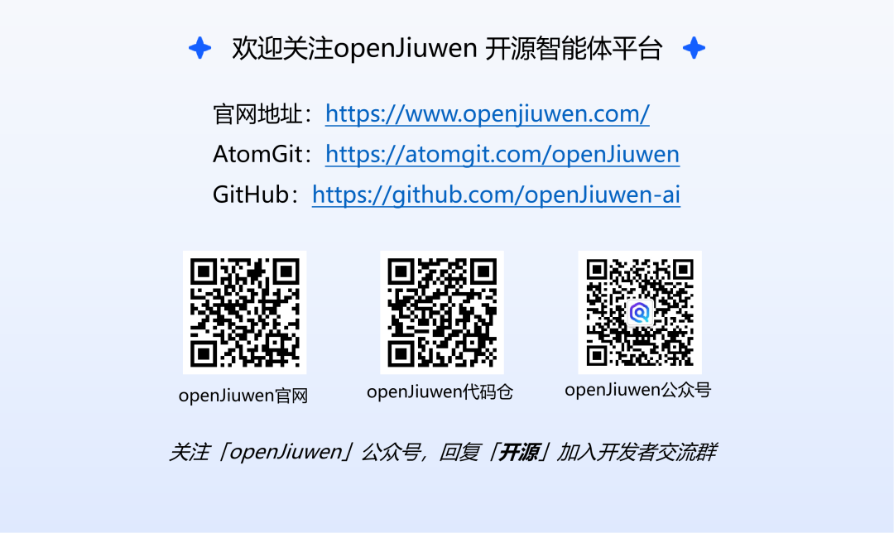

# 技术博客 | openJiuwen Harness 上下文引擎如何让 JiuwenClaw 实现“更强、更快、更省”

Source: https://mp.weixin.qq.com/s/_-9qI7v1CV8FL_3iTRiqAw

Accessed (UTC): 2026-11-11

# 摘要

多步骤复杂任务里，上下文不是越长越好。随着任务推进，冗余信息会越来越多，响应会变慢，成本会升高，最后还可能影响结果。对 `JiuwenClaw` 这类面向复杂任务的 Agent 来说，这个问题尤其明显：任务往往要跨过资料检索、分析归纳、内容生成和结果校验多个阶段，任何一段上下文失真或过长，都会影响后续步骤。

为了解决这个问题，我们开发了 `openJiuwen上下文引擎`。我们先在 `JiuwenClaw` 的实际任务场景里做了多组对照实验。结果很直接：启用 `openJiuwen上下文引擎` 后，Agent 在长周期复杂任务中的 **token 消耗明显下降**，而最终任务完成效果整体持平。这意味着收益不只是上下文变短，更重要的是后续轮次里保留下来的信息更有用、组织得更合理。

随后我们又在 `SWE-bench Verified` 上做了标准化对照评测。启用 `openJiuwen上下文引擎` 后，任务成功率从 **`78.0%` 提升至 `84.0%`**，token 消耗下降 **`47.66%`**，执行耗时下降 **`16.76%`**，API 模型调用费用下降 **`40.52%`**。放在一起看，这套上下文处理机制带来的提升很明确：**结果更稳，执行更快，成本更低**。

# 1. JiuwenClaw 实际任务验证

首先，我们在 `JiuwenClaw` 的实际任务场景中对多组 case 做了对照实验，本文选取其中三组作为展示。这里主要观察两个问题：启用上下文引擎后，token 消耗是否能下降；最终结果是否还能保持可用。

### 1.1 token 消耗对比

下图展示了三组代表性 case 的 token 变化情况。每组 case 分别给出了“单次调用 token”与“累计 token”两类曲线，用于观察开启与不开启 `openJiuwen上下文引擎` 时的消耗差异。整体上看，随着任务步数增加，启用上下文引擎后的 **单次 token 维持在较低水平，累计消耗增长更加平缓**。



其中，`Case 1` 对应台积电调研任务。

> Query：`请帮我做一份中文 PPT，分析台积电未来几年的营收增长逻辑。希望能拆清楚它的营收结构、先进制程和不同下游应用的贡献，重点判断 AI/HPC 和 CoWoS 会带来多大增量，同时看看 Apple、NVIDIA、AMD 这些核心客户的需求变化、海外扩产会怎样影响产能利用率和成本，并和三星、Intel 做对比，最后给出收入预测和增长归因等分析。`

`Case 2` 对应无糖茶饮料行业调研任务。

> Query：`请帮我做一份中国下沉市场（三四线城市及县域）无糖茶饮料行业的 PPT 调研报告，重点分析消费者偏好、价格敏感度，以及主流竞品的定位、价格和渠道策略，并结合用户评论或公开数据做情绪分析，内容尽量丰富，并标明数据来源。`

`Case 3` 对应 agent harness 技术调研任务。

> Query：`请帮我做一份关于 agent harness 的技术调研 PPT，结合 Anthropic、OpenAI、LangChain 和相关论文/开源项目，系统分析它的背景、定义、关键设计、执行流程、架构边界、演进路线，以及它和 context engineering 的关系，同时总结不同体系的共性与差异，最后形成一套完整的 agent harness 分析框架和统一架构模型。`

从图中可以看到，启用上下文引擎后，累计 token 曲线增长更平缓，与基线之间的差距会在多轮推进后逐渐拉开。这说明上下文引擎能够减少冗余上下文在后续轮次中的持续累积。

`openJiuwen上下文引擎` 的生效关键是提升**任务相关信息密度**：后续轮次继续携带真正有用的信息，减少已经过时、重复或与当前步骤关系不大的内容。

### 1.2 案例展示

下面展示的是上述三组 `case` 在开启 `openJiuwen上下文引擎` 后由 `JiuwenClaw` 生成的 PPT 结果（截取前10页展示）。

**Case 1：台积电调研任务**


**Case 2：无糖茶饮料调研任务**



**Case 3：Agent Harness 技术调研任务**


这几组结果说明，在实际任务中，启用 `openJiuwen上下文引擎` 后，Agent 的 **token 消耗明显下降**，最终任务完成效果仍然稳定。台积电调研任务尤其典型：未开启上下文引擎时只生成了内容残缺的 20 页 PPT，开启后能够生成内容完整的 60 余页 PPT 调研报告。

这个变化并不是某一次“大压缩”带来的，而是来自一套面向不同上下文膨胀来源的分层处理机制。下面先介绍 `openJiuwen上下文引擎` 的整体架构，再通过 `SWE-bench Verified` 的标准评测说明它在标准 benchmark 上的效果。

# 2. 上下文引擎架构介绍

要理解前面的实验结果，关键是先看清楚上下文到底是怎么变长的。对多步骤 Agent 来说，超长工具输出、已经结束的历史 ReAct、当前正在推进的 ReAct，以及完整上下文窗口的总预算，本来就不是同一类问题。它们出现的时机不同、对后续步骤的影响不同，适合的处理方式也不同。把这些内容混在一起统一压缩，往往会顾此失彼。

`openJiuwen上下文引擎` 的做法很直接：把这几类问题拆开，分别处理。对应的 4 个处理模块是 `MessageSummaryOffloader`、`DialogueCompressor`、`CurrentRoundCompressor` 和 `RoundLevelCompressor`。它们按上下文进入和累积的顺序工作：先处理刚进来的大块工具消息，再整理已经结束的历史 ReAct，再压缩当前正在推进的 ReAct，最后检查完整上下文窗口的预算。

整体架构如下图所示：



它们的实际顺序是：`MessageSummaryOffloader -> DialogueCompressor -> CurrentRoundCompressor -> RoundLevelCompressor`。  
如果刚进入的是超长工具输出，就先由 `MessageSummaryOffloader` 处理，避免大块工具消息直接占满主上下文。接着系统会看较早历史里已经结束的 ReAct，这部分通常比当前正在执行的 ReAct 更适合先压缩，所以交给 `DialogueCompressor`。如果历史部分压完以后上下文还是太长，再由 `CurrentRoundCompressor` 处理当前轮里已经拖长、但后面还要继续使用的信息。最后，如果前面几层都没有触发，或者触发后还是没有把完整窗口压到安全范围内，再由 `RoundLevelCompressor` 做最后一层预算保护。

这套设计的好处在于，每个处理模块都只处理自己该处理的那一类问题。前一层如果已经把上下文长度控制住，后一层就不会介入；只有预算压力还在，系统才会继续往下走。这样做的结果很朴素：能早处理的就早处理，能局部处理的就不做全局压缩，只有到了最后才动完整上下文窗口。前面几层尽量保留关键信息、尽量少改动原始上下文，最后一层再负责把整体长度控制在可用范围内。

### 2.1 MessageSummaryOffloader

`MessageSummaryOffloader` 主要处理超长的工具输出消息。它解决的核心问题，是工具调用虽然带来了大量原始信息，但真正与当前任务直接相关的往往只是其中一部分，如果全部原样保留，代价极高。其核心机制是在工具消息进入上下文时即执行任务感知压缩，仅保留与当前任务直接相关的信息，并将原始内容卸载至可回溯存储，并对丢弃内容进行概括，便于后续按需加载。这一过程将工具输出从“原样堆积在上下文中的长文本”转变为“高密度保留关键信息、原文可按需回溯”的结构，从源头抑制输入规模的持续增长。

`MessageSummaryOffloader` 将工具输出处理从被动清理变成主动分流。对软件工程任务来说，搜索结果、日志、错误栈、代码片段这类工具输出往往输出较长，但其中真正和当前任务直接相关的部分只占一部分，即任务关键信息密度较低。`MessageSummaryOffloader` 在消息进入上下文时就做任务感知压缩，优先保护高价值证据，减少低价值冗余对主上下文的占用。

该处理模块的整体处理流程如下图所示：



它有三个关键优化点：

* • **精准触发**：只处理本次新增的超长工具消息，不回扫整段历史上下文，降低额外处理开销
* • **任务感知压缩**：结合当前用户意图、工具调用参数和工具输出本身，自动选择抽取式或摘要式压缩，尽可能保留当前任务真正需要的信息
* • **卸载可回溯**：原始消息会完整保留在 offload 存储中，同时对未保留信息生成概括性说明，便于后续 Agent 按需取用

该设计将工具输出改造成“高密度关键信息 + 可回溯原文”的形态。主上下文里保留当前任务真正需要的信息，原文仍可在需要时回溯，从而兼顾压缩效率和证据完整性，把最容易冲垮上下文窗口的大块工具输出变成可管理、可追溯的工作材料。本次实验中使用的关键配置为 `tokens_threshold=30000`、`large_message_threshold=4000`、`enable_adaptive_compression=True`、`offload_message_type=["tool"]`

### 2.2 CurrentRoundCompressor

`CurrentRoundCompressor` 面对的是 ReAct Agent 多步骤执行中的另一类上下文长度压力：随着任务不断推进，当前轮上下文会持续累积，消息数量和消息长度都会不断增长。尤其在需要多次工具调用、多轮执行和反复修正的任务中，后续每一步都需要携带越来越多的历史信息，最终导致输入规模持续变大，推理变慢，成本上升，也更容易让关键信息被冗余历史淹没。

但这类上下文不能简单做一次整体总结。ReAct Agent 的执行过程依赖前后步骤之间的连续性，当前轮中的很多消息仍然会影响后续流程。如果压缩方式过于粗糙，把仍有执行价值的信息混成一段普通回顾，后续 Agent 就可能难以恢复当前状态，出现流程接不上、重复执行、误读上下文或偏离任务目标的问题。

`CurrentRoundCompressor` 因此采用当前轮选择性压缩的方式，只处理已经冗长、但后续仍需保留的消息段，同时保留最近消息作为短期参考。压缩结果会被组织成可累计、可继续接续的历史摘要块，使上下文在变短的同时，仍能支撑后续流程顺利延续。

该处理模块的整体处理流程如下图所示：



与工具输出处理不同，该处理模块面对的是 Agent 执行过程中的内部上下文增长。`CurrentRoundCompressor` 的核心在于明确哪些消息仍具有后续执行价值，以及这些消息应以什么形式进入后续上下文。它将压缩结果组织为结构化表达，用来支撑后续流程继续推进。

这一层主要围绕四件事展开：

**1. 增量历史摘要块设计**

* • 把压缩结果组织成可累计的历史摘要块
* • 目的在于降低历史内容被误读、被重复改写以及压缩后 agent 重复执行的风险

**2. 分层输入建模**

* • 明确区分历史摘要块、当前真正待压缩的 `selected messages`，以及仅用于边界理解的 `recent messages`
* • 这样做的价值在于提升关键信息保留的完整性、压缩稳定性以及压缩前后 agent 策略的连贯性

**3. 结构化与二阶段压缩**

* • 压缩结果带有明确的结构化语义，并在历史摘要块持续累积后再做 consolidation
* • 这样既避免历史摘要被误当成当前指令，也避免摘要本身重新成为上下文负担

**4. 关键信息保留优先**`CurrentRoundCompressor` 会优先保留那些直接影响后续执行的状态信息。

重点保留的信息类型：

* • 任务目标与用户意图
* • 关键事实基础
* • 未完成工作
* • 轮次交接状态
* • 关键决策、约束与变更
* • 关键文件、结果和输出

在实际压缩结构中，这些保留原则会进一步被写入明确的信息保留约束，用来指导模型在压缩时先保留哪些内容、如何组织这些内容，以及哪些信息不能因为压缩而丢失。其核心提示如下：

```
## 关键信息保留要求  
  
Task goals and user intent  
 # - 保留任务目标、用户意图，以及继续执行所需的原始要求与约束  
  
Critical factual basis for continuation  
 # - 保留继续推进任务所依赖的关键事实、证据、发现与结论  
  
Open work / unfinished work  
 # - 保留尚未完成、后续必须继续推进的工作项  
  
Work in progress at the handoff boundary  
 # - 保留当前推进到哪一步，以及交接边界上的在途状态  
  
Key decisions, constraints, changes  
 # - 保留关键决策、限制条件与过程中的重要变更  
  
Important files, artifacts, resources, and outputs  
 # - 保留后续执行依赖的文件、结果、资源与输出内容
```

这些内容共同构成了任务继续推进所需的“可执行状态”。因此，压缩结果更像一块可直接接续工作的历史摘要块，可以支持后续 Agent 恢复状态并继续推进。

这意味着它会在当前轮上下文变长后启动压缩，同时固定保留最近消息，并优先按整段语义连续内容统一压缩。对软件工程任务而言，这种策略更有利于在显著缩短上下文的同时，尽量不破坏后续求解连续性。压缩结果从自由形式的历史回顾变成可累计、可再次压缩、可继续接续的历史摘要块，既降低了多轮压缩后信息漂移的风险，也避免摘要本身继续无限变长，重新成为新的上下文负担；而最近消息的保留，又让 agent 在压缩后仍然保有当前工作的短期参考。与此同时，它只压缩真正值得压缩的 `selected span`，并要求压缩结果必须真正变短，避免为了“看起来在压缩”而引入新的上下文负担。本次实验中使用的关键配置为 `tokens_threshold=30000`、`messages_to_keep=3`、`single_multi_compression=True`。

### 2.3 DialogueCompressor

`DialogueCompressor` 处理的是较早历史中已经结束的 ReAct 内容。多步骤任务执行一段时间后，历史上下文里会保留大量已经完成的中间过程；这些内容仍然可能包含后续需要引用的结论、证据和结果，但它们对当前下一步决策的即时重要性通常低于正在进行的 ReAct。如果这部分历史长期以原始消息形态留在主上下文中，会持续占用窗口预算，并挤压当前任务推进所需的空间。

它的处理方式是先识别历史中已经闭合的 ReAct 块，再选择其中值得压缩的长 ReAct 块进行替换。实现上，`DialogueCompressor` 会根据 `keep_last_round` 和 `messages_to_keep` 排除最近轮次或最近若干条消息，在较早历史前缀中寻找完整 ReAct 块；当存在消息数足够多、确实有压缩收益的目标块时，会执行压缩和替换。压缩后的 ReAct 块会被去除其中的所有 tool 消息，只保留压缩后用于替换的 user 和 assistant 消息，作为更短的历史块存在于上下文中。

这种设计让历史压缩尽量少改动原始上下文。它只处理已经结束、边界相对清晰、且具备压缩收益的长过程内容，将其整理成更短的历史摘要块。这样既能尽早降低历史对话持续变长的速度，也能为后续的 `CurrentRoundCompressor` 和 `RoundLevelCompressor` 留出更多预算空间。

### 2.4 RoundLevelCompressor

`RoundLevelCompressor` 是整个上下文引擎里的最后一层预算保护。前面的 `MessageSummaryOffloader`、`DialogueCompressor` 和 `CurrentRoundCompressor` 都有自己的触发条件和关键信息保留边界：工具消息不够长时，`MessageSummaryOffloader` 不会处理；历史里没有合适的已结束 ReAct 块时，`DialogueCompressor` 不会处理；当前轮中可压缩区间不足、或者真实用户 prompt 与最近消息必须保留且过长时，`CurrentRoundCompressor` 也可能无法把上下文压到目标范围内。因此系统还需要一层面向完整窗口的预算安全机制。

这一层直接面向最终要发给主模型的完整上下文窗口。它会把系统提示、上下文消息、重载提示以及工具定义等因素一起纳入预算判断，通过 `trigger_total_tokens` 和 `target_total_tokens` 控制何时介入，以及压缩后需要把完整窗口控制到什么范围内。同时，它还单独管理压缩器自身的调用预算，避免出现“为了压缩上下文，压缩调用本身先超限”的问题。

在执行上，`RoundLevelCompressor` 会在消息追加后检查完整窗口预算，并尽量提前完成预压缩。如果常规压缩路径仍然无法满足目标预算，它会继续通过递归归并、更激进的压缩和确定性截断逐级缩短上下文，确保极端情况下流程仍然能够结束，并返回一个可用的上下文窗口。

因此，`RoundLevelCompressor` 补齐了完整窗口层面的确定性保证。前三层优先采用尽量完整保留关键信息、同时尽量少改动原始上下文的压缩方式；最后一层负责在预算压力真正到达上限附近时把系统重新控制在安全范围内，使多步骤 Agent 在异常长上下文、复杂工具定义或多轮累积场景下仍然具备可控的运行边界。下面我们进一步通过 `SWE-bench Verified` 的标准评测，来看这套分层架构在成功率、成本和效率上的整体表现。

# 3. SWE-bench Verified 标准评测

### 3.1 数据集与评测设置

SWE-bench(https://www.swebench.com/) 是面向真实软件工程问题的公开评测基准，要求 Agent 在给定仓库快照和问题描述的前提下，自主完成问题定位、跨文件修改、测试验证与补丁提交。`SWE-bench Verified` 则是在原始 SWE-bench 基础上进一步人工筛选得到的高质量子集，于 2024 年 8 月正式发布，共包含 500 条人工验证样本，更适合作为系统能力验证基准。

本次实验在 `SWE-bench Verified` 上进行，比较使用上下文引擎和不使用上下文引擎的效果差异。两组实验均使用相同模型配置、相同任务集合、相同数据采样结果与一致执行流程，唯一差异在于是否启用 `openJiuwen上下文引擎`。

本文将两种方法分别记为未启动 CE（Baseline）和启动 CE（Context Engine）。其中，未启动 CE 指不启用 `openJiuwen上下文引擎` 的标准 ReAct Agent 配置；启动 CE 指在相同 Agent 框架上额外启用 `MessageSummaryOffloader`、`DialogueCompressor`、`CurrentRoundCompressor` 与 `RoundLevelCompressor` 四个处理模块。模型服务统一采用百炼平台计费口径，KV Cache 命中部分按输入 token 标准单价的 20% 计费。

### 3.2 整体结果

整体结果如图所示。在相同模型与运行配置下，启用 `openJiuwen上下文引擎` 后，任务成功率、token 消耗、执行耗时与模型调用费用都出现了明显改善。这套上下文处理机制没有靠牺牲结果质量来换效率，而是在保持结果稳定的同时，把成本和耗时一起压了下来。



从整体结果看，`openJiuwen上下文引擎` 的收益同时落在**准确性、效率和成本**三个维度上。它处理的不只是上下文长度本身，还包括上下文里哪些信息该留下、哪些信息该被压缩、哪些信息该在后面继续用。

### 3.3 上下文处理提升 Agent 任务成功率

启用 `openJiuwen上下文引擎` 后，成功率由 **`78.0%` 提升至 `84.0%`**。从这组评测结果看，上下文压缩没有削弱 Agent 的解题能力，也没有因为信息丢失带来明显的系统性退化。

从样本级配对结果看，两种方法在大多数任务上的判定结果是一致的，只有少量样本出现差异，而且整体上是启用上下文引擎的一侧更好。这更像是在多数任务里提升了模型对关键信息的利用能力，而不是单纯用信息损失去换效率。

### 3.4 上下文处理显著降低模型 API 调用成本

在所有指标中，token 消耗与模型调用成本的改善最为稳定且幅度最大。具体而言：

* **`72%`** 样本的累计 token 消耗低于未启用上下文引擎
* 平均 token 消耗从 **`2126.5 k` 降至 `1113.1 k`**（**`-47.66%`**）

对应地，在相同计费口径下，单样本平均成本由 **`2.89 ¥` 降至 `1.72 ¥`**。

token 和成本的收益不是靠少数极端样本拉出来的，在多数任务上都能稳定看到。更直接地说，进入模型的冗余输入少了，同样的 token 能承载更多真正有用的信息。

### 3.5 时延与推理步数总体改善

在执行效率方面，启用上下文引擎后，平均执行耗时从 **`989.06 s` 降至 `823.32 s`**（**`-16.76%`**），平均推理步数从 **`84.16` 降至 `80.92`**（**`-3.85%`**），首 token 返回时延从 **`8.25 s` 降至 `7.65 s`**（**`-7.22%`**）。

不过，时间收益并不是每个任务都完全一样。原因也比较直观：上下文压缩和重组织本身会带来额外计算开销，在上下文本来就不长、任务流程本来就不复杂的样本里，这部分开销可能会抵消一部分收益。但从整体趋势看，把上下文长度控制在更合理的范围内，还是明显减轻了推理过程的运行负担。

# 4. 结论

无论看 `JiuwenClaw` 的实际任务，还是看 `SWE-bench Verified` 的标准评测，结论都比较清楚：这套上下文引擎确实带来了稳定收益。

在 `JiuwenClaw` 的复杂业务任务中，它能明显降低 token 消耗，同时把结果保持在可用水平。

在 `SWE-bench Verified` 上，启用 `openJiuwen上下文引擎` 后，任务成功率从 **`78.0%` 提升至 `84.0%`**，token 消耗下降 **`47.66%`**，执行耗时下降 **`16.76%`**，API 模型调用费用下降 **`40.52%`**。

这些数字放在一起看，指向的是同一件事：**结果更稳，执行更快，成本更低**。

这套效果来自四个处理模块的分工配合。`MessageSummaryOffloader` 先处理超长工具输出，`DialogueCompressor` 处理已经结束的历史 ReAct，`CurrentRoundCompressor` 处理当前正在推进的 ReAct，`RoundLevelCompressor` 负责最后的整体预算。

这样拆开以后，哪些信息该早处理，哪些信息该晚处理，哪些信息必须尽量原样保留，就清楚很多了。

对 Agent 系统来说，这件事不只是省钱。任务越长、步骤越多，系统越依赖上下文里的信息能不能被保留下来，能不能在后续步骤里继续用上。`openJiuwen上下文引擎` 把这件事从经验性的 prompt 技巧，变成了一套可以稳定复用的处理机制。

---

 

---


