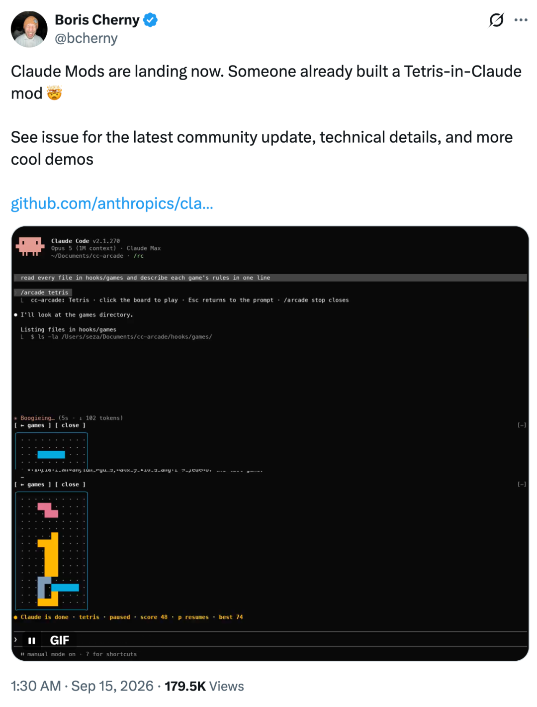
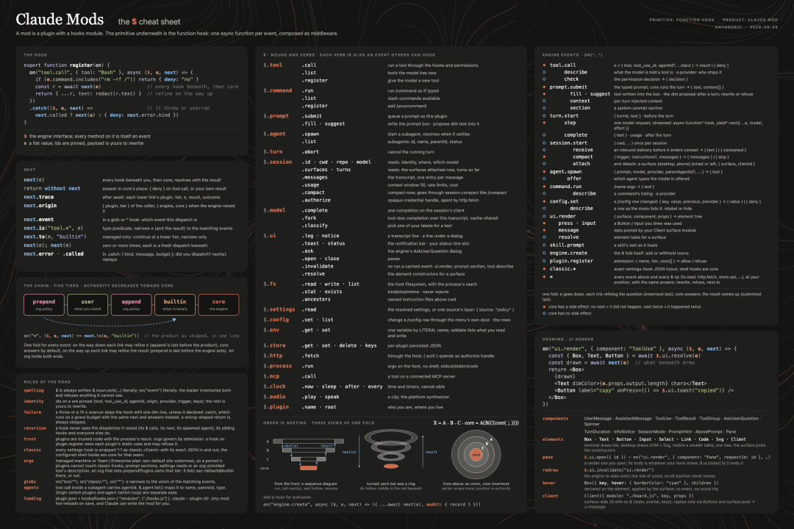
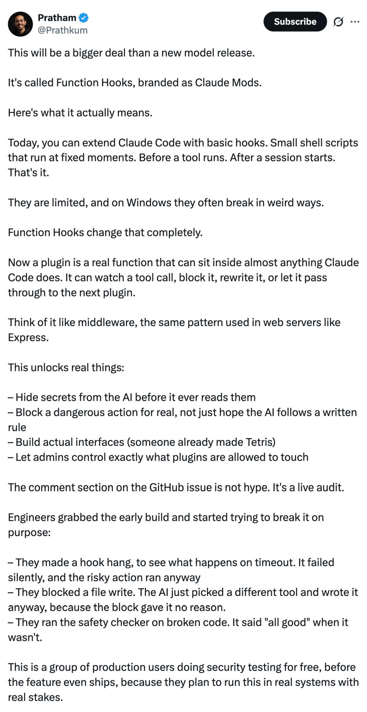

# Claude Mods陆续上线，社区用插件「魔改」Claude Code

Source: https://mp.weixin.qq.com/s?__biz=MzA3MzI4MjgzMw%3D%3D&mid=2651057018&idx=2&sn=14a3c85a952a76aae17c0d48c3475023&poc_token=HJ7X7mqjXuCK-veLIviZ9T9YgnuWH1WNh8MKgwD7

Accessed (UTC): 2026-11-08

机器之心编辑部

Claude Code 里，已经有人玩起了俄罗斯方块。不是另外打开一个游戏窗口，游戏直接出现在 Claude Code 的界面里。

今天一早，Claude Code 负责人 Boris Cherny 在 X 上宣布，Claude Mods 正在开始落地。社区已经有人利用这套新机制，做出了一个运行在 Claude Code 里的 Tetris Mod。

看上去像一个有趣的 Demo，背后的变化要大得多。有了 Mods，开发者可以更深入地改变 Claude Code 的行为和界面，比如拦截一次工具调用，检查和修改它；或者给 Claude Code 增加新的交互组件。更进一步，用户甚至可以直接告诉 Claude 自己想改什么，再让 Claude 帮忙写出对应的 Mod。

换句话说，Claude Code 正在把自身越来越多的能力开放成可编程接口。这并不意味着 Claude 可以修改自己的模型权重，也不意味着它可以随意重写 Claude Code 的核心程序。它做的事情更接近于：在 Anthropic 开放的扩展边界内，Claude 可以帮用户生成、测试和加载改变自身行为的插件。

而这套机制，很可能成为 Claude Code 接下来最值得关注的一次架构变化。

从 Function Hooks 到 Claude Mods

这件事最早公开于 9 月 3 日。Anthropic 工程师在 Claude Code GitHub 仓库发起了一项提案，名字叫 Function Hooks。

Claude Code 此前已经支持 Hooks。开发者可以在工具调用前、调用后、会话开始等节点运行程序。例如，在 Claude 准备执行一条 Bash 命令之前检查命令，或者在它准备写文件时进行额外判断。这类机制已经可以完成不少自动化工作，但扩展能力主要围绕预先定义好的事件展开。

Function Hooks 把这层接口继续往 Claude Code 内部推进。Hook 可以直接写成带完整类型定义的 TypeScript 函数。一次事件经过多个 Hook 时，它们按照注册顺序层层嵌套，行为很像 Express、Koa 等 Web 框架中的 middleware。一个 Hook 收到事件之后，可以先检查发生了什么，然后决定如何处理，再把执行权传给下一层。

这意味着插件开始进入 Claude Code 的关键执行路径。例如，一个工具调用发生时，插件可以查看它；发现不符合规则，可以拒绝执行；满足条件，可以继续向下传递。

这种机制还扩展到了 UI。Anthropic 展示的 Demo 中，插件可以挂到 Claude Code 的 React 组件上，修改组件属性，或者包装组件最终返回的界面节点。甚至一次按钮点击，也可以被 Hook 捕获。终端和桌面端中的相同交互，可以进入同一套处理逻辑。管理员同样可以处在这条调用链的上游，对后续插件能够使用的能力进行限制。

到了 9 月 9 日，Anthropic 正式给这个功能确定了产品名称：Claude Mods。官方给出的定义很直接：一个 Mod，本质上就是一个使用 Function Hooks 的插件。

Function Hooks 继续作为底层工程机制存在，Claude Mods 则成为用户真正看到的产品形态。Anthropic 当时表示，功能将在「数周」内发布，同时开放了首批内置 Mods 的源代码，并允许开发者通过实验开关提前测试。几天后，事情明显加速了。

Claude Code 主仓库开始密集出现 Mods 相关提交。当前代码中已经可以看到 diff、sec-default 和 telemetry 等内置 Mod，以及对应的测试框架。diff 尤其值得注意：Claude Code 原本已有的 diff 面板，正在被重新实现成一个 Mod。

Anthropic 的意图也写得很清楚：未来会继续把 Claude Code 已有的一部分功能迁移到 Mod 形态。

网友热评

有网友表示， 「Claude Mods 的影响，可能会比发布一个新模型还大。」

目前，Claude Code 已经支持一些基础 Hooks。它们本质上是小型 Shell 脚本，只能在几个固定节点运行，比如某个工具调用之前、某个会话开始之后。能力比较有限，而且在 Windows 上还经常会出现各种莫名其妙的问题。Claude Mods 会彻底改变这一点。

以后，一个插件可以作为真正的函数，嵌入 Claude Code 几乎任何一个执行环节。它可以监听一次工具调用，也可以拦截、修改，或者放行，让请求继续交给下一个插件处理。

我们可以把它理解成中间件，和 Express 这类 Web 服务器里常见的 middleware 模式很像。这会带来很多真正有用的能力：

- 在 AI 读取信息之前，先把密钥等敏感内容隐藏掉
- 真正阻止危险操作，而不是只靠写一条规则，希望 AI 自觉遵守
- 做出真正的交互界面，现在已经有人直接在 Claude 里做出了俄罗斯方块
- 让管理员精确控制每个插件能够访问和修改哪些内容

GitHub issue 下面的评论区也不是单纯在吹捧这个功能，更像是一场公开进行的实时审计。一些工程师拿到早期版本之后，已经开始主动想办法「搞坏」它，看看系统在各种异常情况下到底会怎么表现：

- 他们故意让一个 Hook 一直卡住，测试超时会发生什么。结果 Hook 静默失败，原本存在风险的操作还是继续执行了。
- 他们拦截了一次文件写入。结果 AI 换了另一个工具，照样把文件写了进去，因为拦截并没有告诉它具体原因。
- 他们拿有问题的代码去跑安全检查，结果安全检查仍然判断「一切正常」，实际上并没有。

这群人基本都是实际生产环境里的用户，他们在功能正式发布之前已经免费替 Anthropic 做安全测试了。原因也很简单：他们真的准备把这套东西接进真实系统里，而这些系统里的操作是有实际风险和实际后果的。

Coding Agent 的下一场竞争，

可能发生在模型外面

从更大的行业趋势看，Claude Mods 出现的时间点很有意思。大模型能力仍然在快速进步，但 Coding Agent 已经开始进入另一个阶段。越来越多差异来自模型外围。

上下文组织、工具设计、权限控制、记忆保存、子 Agent 协作、失败恢复、组织内部的规则进入执行链，这些共同组成了 Agent 的 Harness。

Claude Mods 相当于把 Harness 的一部分控制权交给开发者。这可能带来一个很有意思的结果：未来开发者选择 Coding Agent 时，考虑的不再只有「哪个模型代码能力最强」，还会考虑哪个平台拥有更强的插件生态、更细的控制能力、更成熟的企业策略体系，以及自己的工作流能不能真正长在上面。

从这个角度看，Anthropic 正在做一件很典型的平台化动作。先开放扩展接口，再用自己的产品功能验证这套接口，然后让社区开始填充生态。目前 Claude Code 仓库中已经出现了第一批内置 Mods。社区也已经开始制作自己的实验项目。

如果这套机制最终稳定下来，Claude Code 的升级节奏也会发生变化。过去，一个开发者想要某项能力，需要等 Anthropic 做。以后，很多时候可能只需要对 Claude 说一句：「我想让 Claude Code 这样工作。」剩下的事情，Claude 可以开始自己写。

参考链接：

https://x.com/bcherny/status/2099551291601248485

https://x.com/Prathkum/status/2099570590701252897

https://github.com/anthropics/claude-code/issues/91870#issuecomment-5666255143

© THE END 

转载请联系本公众号获得授权

投稿或寻求报道：liyazhou@jiqizhixin.com
