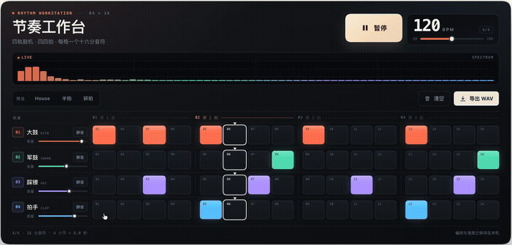
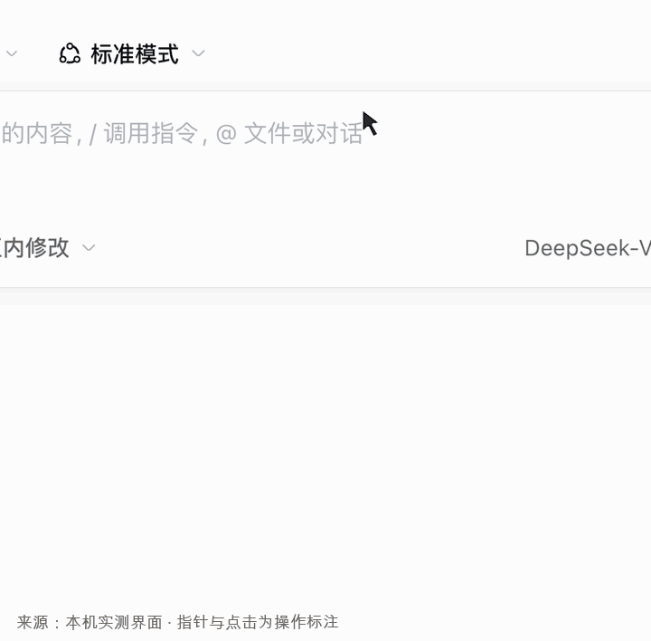
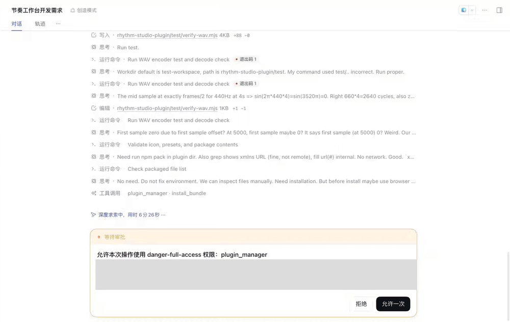
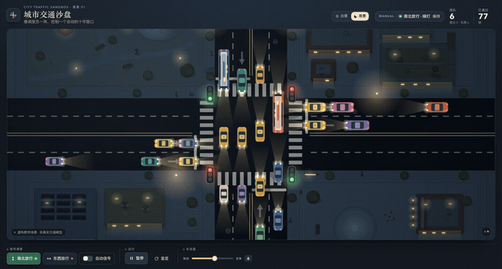
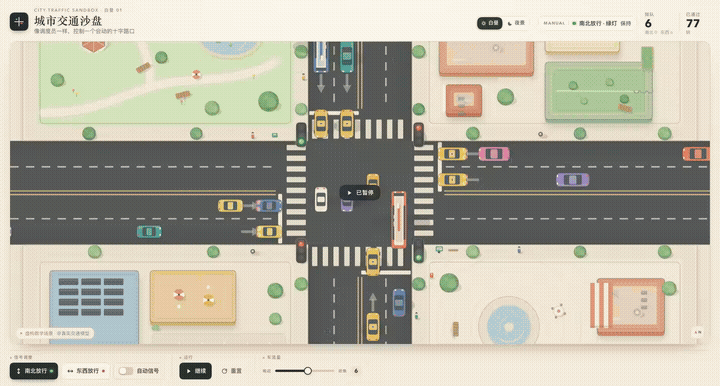
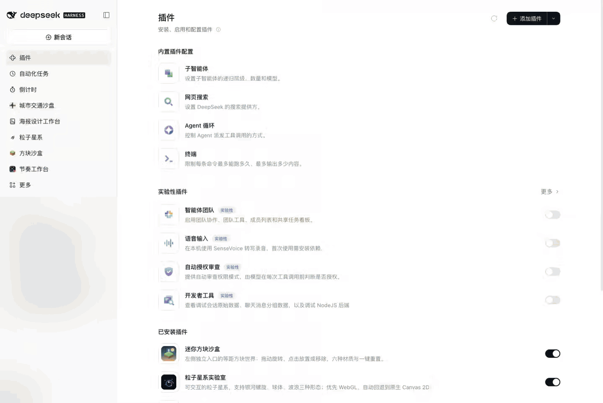
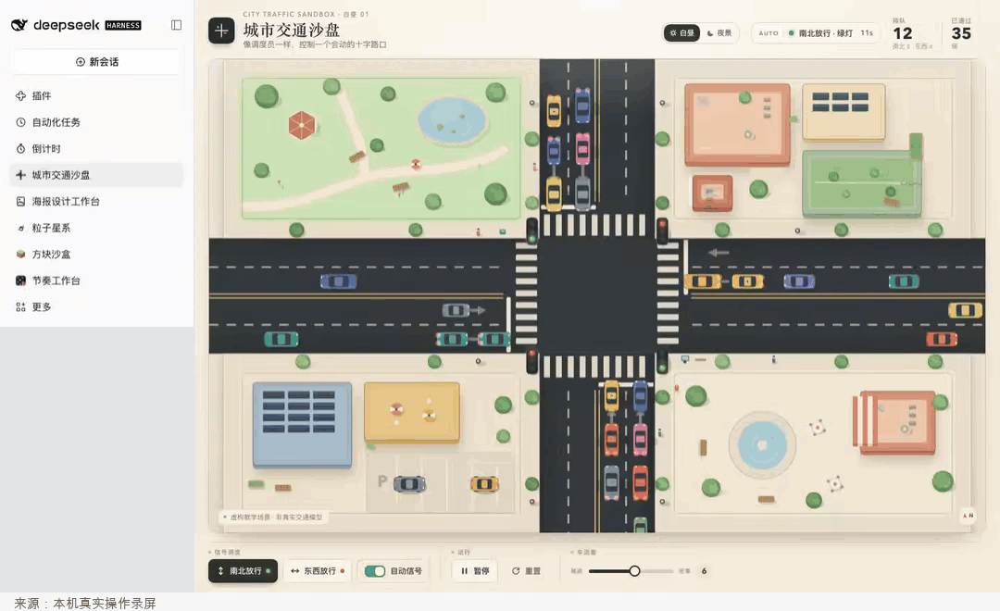
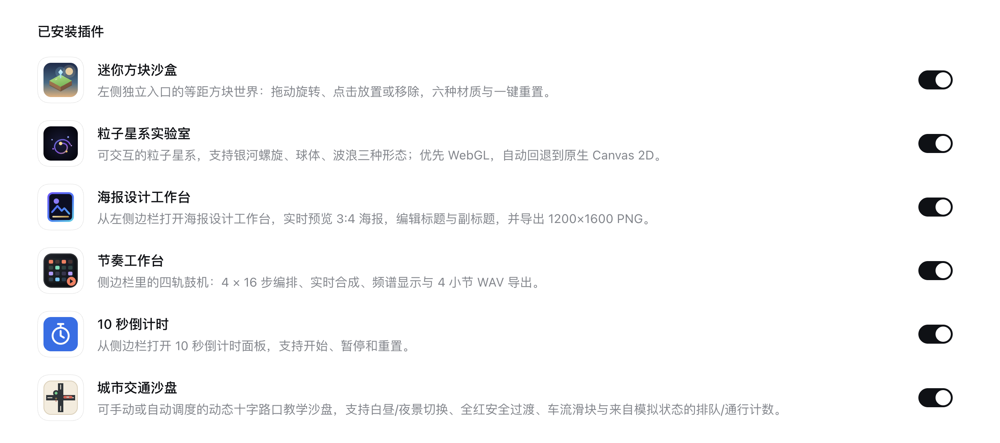

# DeepSeek Harness创造模式：让AI给自己加功能、换界面

Source: https://developer.cloud.tencent.com/article/2774827

Accessed (UTC): 2026-11-08

DeepSeek Harness （DSH）和一般的 Hareness 有一个很大的不同点是，他有一个「创造模式」。

这个模式可以让我们来定制自己的 DSH。

你想要什么界面、什么新功能、什么按钮以及什么插件，都可以简单的通过对话的方式来定制。

一切皆可 DIY。

此前官方宣传 DSH 最大的特点是：一切皆插件。

做个官方特别放出了一个新的版本，重点介绍了怎么在 DSH 里面自己写插件、用插件。

这次介绍的创造模式，让 Agent 按需求制作插件。比如给 Harness 加页面、给 Agent 添工具，或者把工具和提示词组合成任务模式。

插件就是装进 Harness 的一块功能。想反复使用的操作，可以做成按钮和面板；装好以后，从对应入口打开。

我们也做了自己的插件。先看看这台能编鼓点、导出声音的「节奏工作台」。

▲ 图：点格子编鼓点

## 自己做一个插件

我想做一台能点格子编鼓点、播放并导出声音的鼓机。

先打开 DeepSeek Harness。如果你还没安装，可以从官网 deepseek.com/en/harness/ 下载。登录或配置好模型后，新建会话。

点开输入框上方的「标准模式」，选择「创造模式」。

▲ 图：从模式菜单进入

这次使用的完整提示词是：

请在 Harness 侧栏做一个可直接打开的原创“节奏工作台”，让我用鼠标编一段真正能听、能导出的节奏。 功能：4 轨×16 步鼓机（大鼓、军鼓、踩镲、拍手），点击格子开关音符，播放时逐步扫过；用 Web Audio 原生合成不同鼓声，不是只有动画。支持播放/暂停、清空、60–180 BPM 调速、每轨静音和音量、3 个听感不同的预设（House、半拍、碎拍），默认加载好听的 House。四四拍，每步十六分音符；导出当前节奏重复4小节的标准 WAV，120 BPM 时8秒，不包含播放提示音。导出后要能正常解码。 视觉要像经过设计的音乐设备：深石墨底、漂亮清晰的大标题、珊瑚橙/薄荷/淡紫/天蓝四轨、16步按4拍分组，有真实音频频谱或波形，大播放按钮和醒目的 BPM；布局紧凑、舒服，主要内容在一屏内。不要用大堆说明和默认表单凑界面。所有按钮有清晰中文和 aria-label，方便操作和截图。保存当前编排和速度，重新打开仍在。 请直接在工作区的 rhythm-studio-plugin 子目录实现并安装，参考工作区已验证的 countdown-plugin 的插件骨架和本机官方开发文档，不要改已有插件。无新增依赖、无网络/远程图片/音频、Host 保持空实现；不读取工作区外文件、账户信息或任何凭据。需要安装授权时正常请求单次批准，不修改整体权限。完成后说明入口、如何播放和导出，请实际检查语法和导出WAV实现。

我还用 Codex 写了开发说明和已验证插件骨架。说明是接口资料，“骨架”就是可运行的代码样例，都是给模型看的，读者不用自己手写。

这次演示有这些预备材料；只发上面的需求、不提供样例能做到哪一步，我们还没有验证。

发送后，它读取说明、写代码，再请求安装。核对插件名称和安装请求，点击「允许一次」；这次没有改整体权限。动图剪去了等待，并延长了授权画面的停留；灰色区域已作脱敏。

▲ 图：[代码检查](https://copilot.tencent.com/chat?fromSource=gwzcw.9316673.9316673.9316673&utm_medium=cpc&utm_id=gwzcw.9316673.9316673.9316673&from_column=20421&from=20421)、单次安装到打开工作台（实录剪辑）

装好后，从侧栏打开「节奏工作台」。选一个预设，按播放就能听；点格子增减鼓声，拖动 BPM 调速度，最后导出 WAV。

120 BPM 下，我们导出的四小节 WAV 长 8 秒，能解码且有声音；换成半拍预设后也能导出。

## 换个场景，指挥一个路口

接着做一个能控制路口车流的城市交通沙盘。完整提示词是：

请在 Harness 侧栏做一个原创“城市交通沙盘”，让我像调度员一样控制一个会动的路口。打开看到精致城市街区俯视图：大十字路口、双向车道、停止线、斑马线、小汽车与公交、路边建筑/公园/树。车沿车道行驶，红灯前排队并保持车距，绿灯通过；不是静态图。提供“南北放行”“东西放行”、自动信号、暂停/继续、车流量滑块、重置，实时显示排队和已通过车辆数量，计数必须来自模拟状态。切灯要有短暂全红安全过渡，不能两边同时绿灯。视觉像漂亮的城市信息插画：奶油底、清晰深色道路、彩色小车、有层次的建筑和柔和阴影；路口与车流占画面主体，控件精致紧凑，一屏可读，不要几块方框加默认按钮。先只做白天，后面我会追加修改。用Canvas2D避免WebGL兼容问题，无外部依赖/地图/网络/个人数据，场景是虚构教学玩具，不宣称真实交通模拟。请在工作区traffic-lab-plugin子目录实现并安装，可参考已验证countdown-plugin骨架和本机插件文档。Host为空，不改已有插件，不读取工作区外文件或任何账户凭据；安装时请求单次批准，不改整体权限。完成后告知入口和操作方式。

需求发出后，它先在独立插件目录里写代码，再请求安装。核对并批准后，从侧栏打开「城市交通沙盘」。

点「南北放行」「东西放行」切灯，拖滑块调车流；暂停会停住画面，继续后车辆恢复行驶。

▲ 图：切灯后，换一边通行

白天版做好后，我们回到同一段对话追加需求，核心是：

加一个“白昼/夜景”切换。夜间道路和建筑用深蓝灰，窗户发暖光，小车开灯。切换不重置车流，保留原来的控制功能。

更新安装后，面板多出「白昼」「夜景」按钮。我们在暂停时切换，排队和通过数量没有变化，恢复后车流继续。

▲ 图：同一个路口，追加夜景

下次直接从侧栏打开，再切换昼夜：

▲ 图：从侧栏打开，再切换昼夜

这里的车辆和道路都是本地生成的虚构场景。这是用来观察控制效果的互动玩具，不是现实交通预测。

## 变成自己的工作台

我还做了一个「[海报设计](https://cloud.tencent.com/product/taidc?from_column=20421&from=20421)工作台」。

打开「海报设计工作台」，就能在这个界面里直接操作。把标题和副标题换成自己的文字，点选主题看效果，再点导出，保存为 1200 × 1600 的 PNG。

▲ 图：编辑文案、换主题并导出（真实录屏）

已安装的插件，可以在「插件」里的「已安装插件」中查看、打开或删除。

▲ 图：已安装的插件

## 最后

前面说了，除了写插件，还能改 DSH的界面，我也试了试，把 DSH 默认的界面改成了下面这个。

▲ 图：蓝白界面里，鲸鱼在游动

Harness 我相信大家已经很熟悉了，从 Claude 、Codex 到国内的 Workbuddy、各种办公等都是。

但说实话，它们的界面和功能越做越趋同，像 DSH 这么能定制的实属罕见。

这些定制就很有意思。自己的使用习惯，可以一点点变成软件里的按钮、面板和功能。

这让我想起前一阵子，因为焦虑 Codex / Claude 的用量，最后干脆自己做了一个 macOS 工具栏插件，让它实时显示用量。那些现成工具没法按我的想法 DIY，我就自己补一个。

创造模式把这样的定制放进了 DSH：通过对话加功能、改界面，做好以后再接着用、接着改，操作成本也低了。

实际上，有了这些 AI 能力，我已经把之前用过的很多软件，按自己需要的功能重新做了一版。有些要付费的功能，我自己做；用着不顺手的，也自己做。

比如，我觉得 ChatGPT 的浏览器操作插件太烂了，昨天干脆自己做了一个，好用到爆。

自己做，也不一定要复刻整套软件。先把最需要的那一小块功能做顺手，再慢慢往上加。软件怎么用、功能怎么摆，都可以按自己的习惯来。

这或许才是我们真正需要的软件：可以自己定制，也可以随着使用继续修改。感兴趣的话，我建议大家都去试试。

真的是一个完全不一样的时代了。

## 参考资料

DeepSeek Harness 产品页

[https://www.deepseek.com/en/harness/](https://developer.cloud.tencent.com/tools/blog-entry?target=https%3A%2F%2Fwww.deepseek.com%2Fen%2Fharness%2F&objectId=2774827&objectType=1&contentType=rich)

创造模式与插件管理说明

[https://github.com/deepseek-ai/deepseek-harness/blob/master/packages/boot/plugin-manager/README.md](https://developer.cloud.tencent.com/tools/blog-entry?target=https%3A%2F%2Fgithub.com%2Fdeepseek-ai%2Fdeepseek-harness%2Fblob%2Fmaster%2Fpackages%2Fboot%2Fplugin-manager%2FREADME.md&objectId=2774827&objectType=1&contentType=rich)

官方创造模式演示

[https://x.com/DeepSeekHarness/status/2117256196227019194](https://developer.cloud.tencent.com/tools/blog-entry?target=https%3A%2F%2Fx.com%2FDeepSeekHarness%2Fstatus%2F2117256196227019194&objectId=2774827&objectType=1&contentType=rich)

0.2.1-rc.1 更新说明

[https://github.com/deepseek-ai/deepseek-harness/releases/tag/dsh-v0.2.1-rc.1](https://developer.cloud.tencent.com/tools/blog-entry?target=https%3A%2F%2Fgithub.com%2Fdeepseek-ai%2Fdeepseek-harness%2Freleases%2Ftag%2Fdsh-v0.2.1-rc.1&objectId=2774827&objectType=1&contentType=rich)

测试环境：DeepSeek Harness 0.2.1-rc.5，本机 Web 界面；DeepSeek-V4.1-Flash-1017，High。鼓机和交通沙盘均为本次自行提出需求、生成和操作；海报工作台沿用此前实测并补录操作；鲸鱼界面使用本地插件骨架，实际安装并核验。
