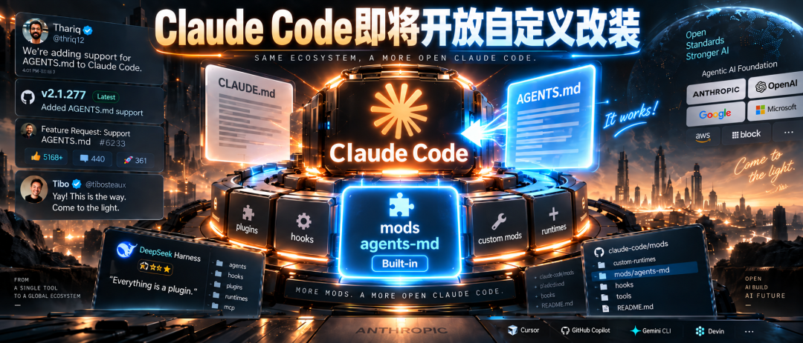
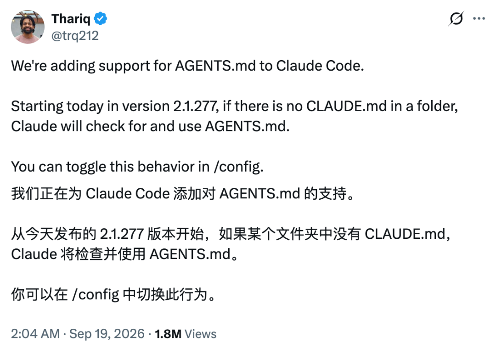
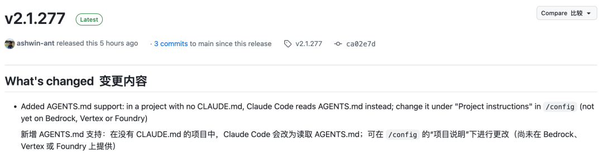
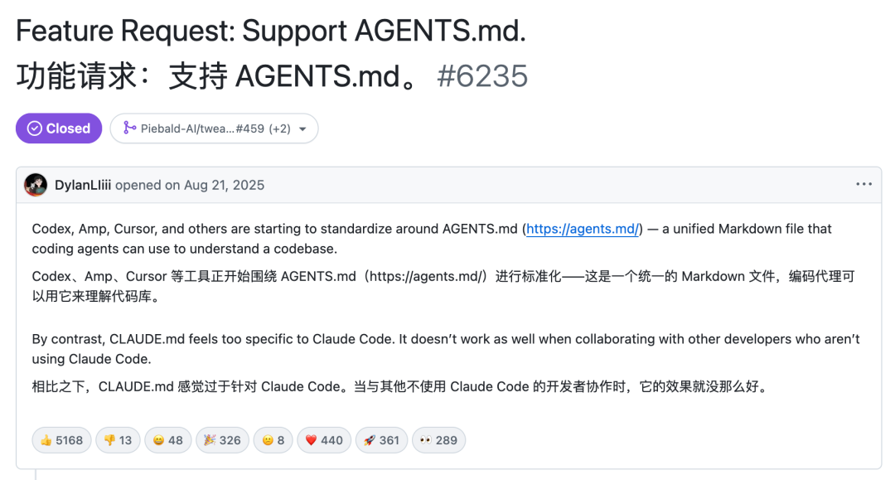
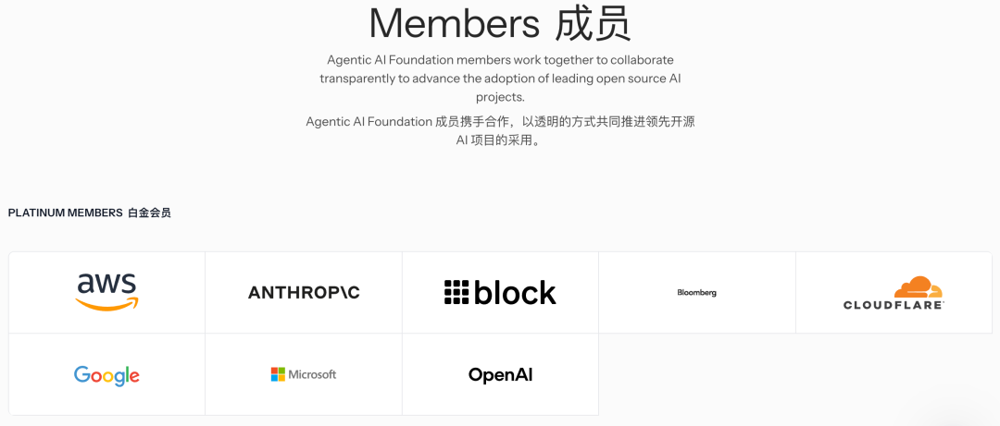
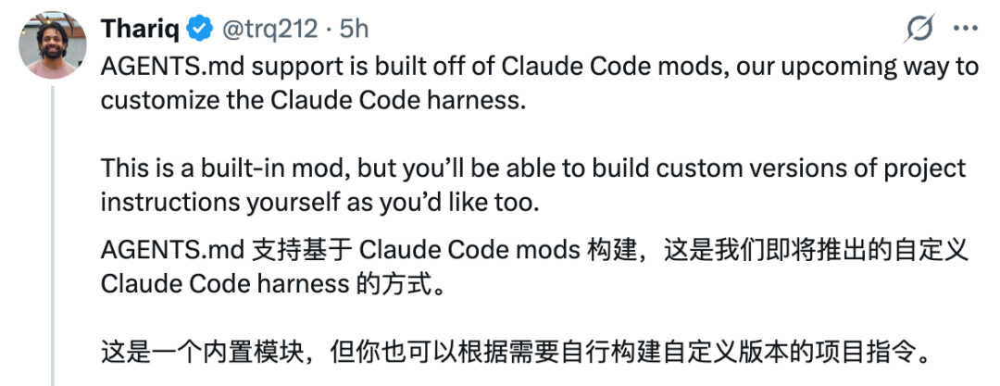
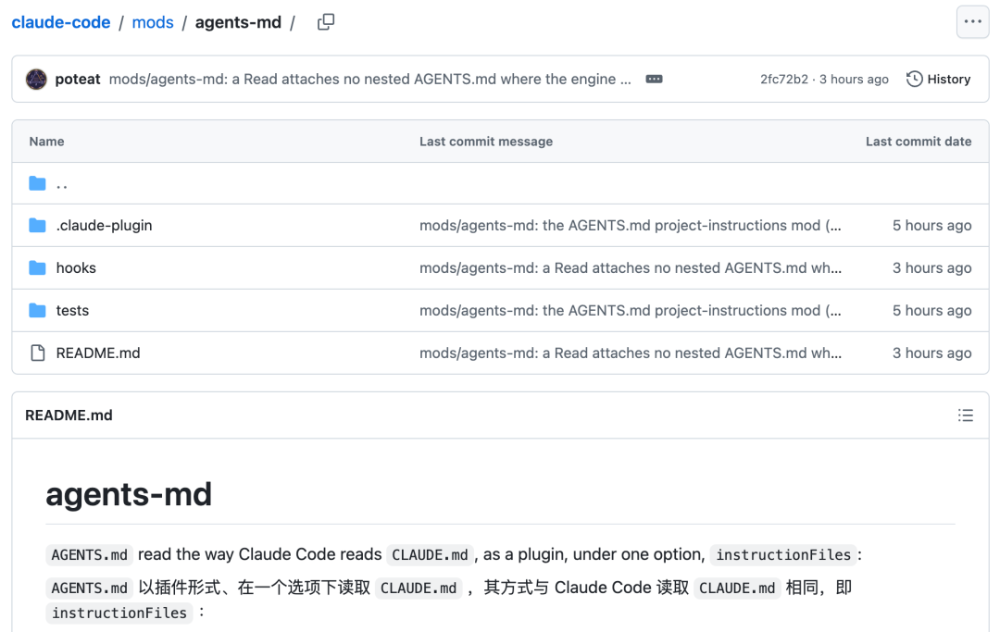
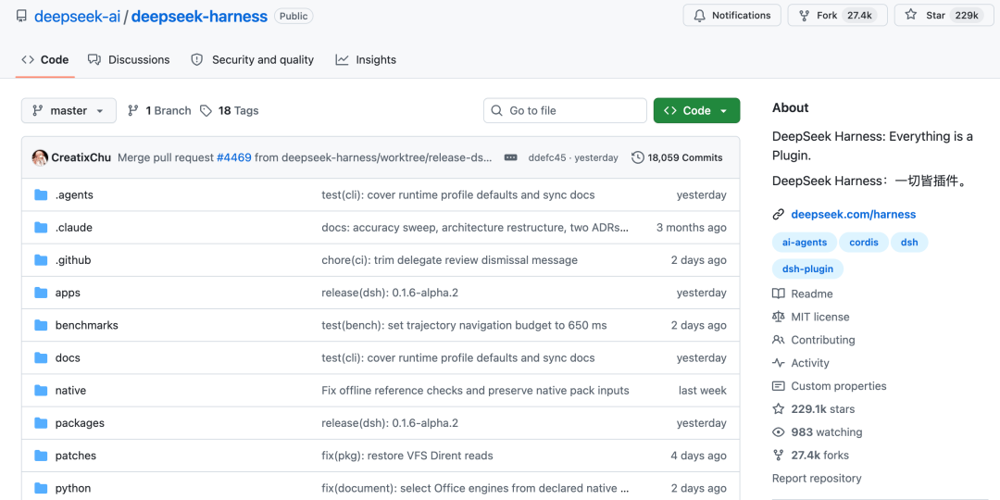
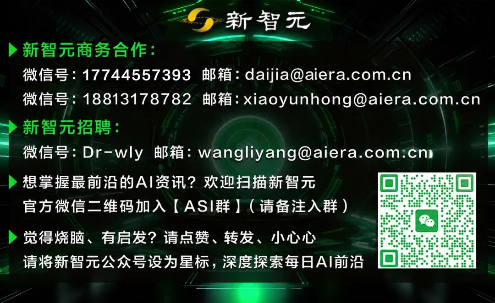

# 突发！Claude Code全面开放，接入AGENTS.md

Source: https://mp.weixin.qq.com/s/ntd77VHn2tisZocKwASKIA

Accessed (UTC): 2026-11-08

### 

### **新智元报道**

Claude Code终于低头了。

就在刚刚，Claude Code团队核心工程师Thariq在X上发了一条帖子，浏览量一个小时冲破百万。

**从当天上线的2.1.277版本起，项目文件夹里要是没有CLAUDE.md，Claude会自己去找AGENTS.md来读。**

GitHub上这个版本的更新记录，第一行就写了这件事。

这条更新，开发者等了一年多。GitHub仓库里那条「请支持AGENTS.md」的Issue，从2025年8月挂到现在，累计5200多个点赞、300多条留言，是整个Claude Code仓库里票数最高的功能请求，高出第二名四倍。

消息一出，Codex团队负责人Tibo第一时间跑来留言：

Yay! This is the way. Come to the light.

**AGENTS.md到底是什么**

CLAUDE.md和AGENTS.md，本质上都是写给AI的「项目说明书」。

它们躺在代码仓库里，告诉编程智能体：这个项目怎么编译、测试怎么跑、代码按什么规矩写。每次你和AI开一轮新对话，它先把说明书读一遍，然后再动手干活。

区别在于谁认。

CLAUDE.md是Anthropic的自留地，只有Claude Code读。而AGENTS.md是OpenAI在2025年8月推出的通用格式，Codex用它，Cursor用它，GitHub Copilot用它，Gemini CLI用它，Devin也用它。

到今天，全球超过六万个开源项目已经用上了AGENTS.md。

去年12月，OpenAI把AGENTS.md捐给了Linux基金会新成立的智能体AI基金会（AAIF）。

搞笑的是，这个基金会的铂金会员名单里，赫然有Anthropic的名字，Anthropic把自家的MCP协议也捐了进去。

两家坐在同一个基金会里搞开放标准，自家最火的编程工具却一直不读对方说明书。

这个别扭，拖了十三个月，直到这周才解开。

****

**开发者被两份说明书折腾了一年**

麻烦出在哪？出在现实中，团队不只用一个工具。

张三用Claude Code，李四用Codex，王五用Cursor，同一个项目就得备两份几乎一模一样的说明书。

改了这份忘了那份，AI就照着过期的那份干活，写出来的代码风格跟团队规范南辕北辙。

开发者被逼出了一堆土办法。有人把CLAUDE.md软链接到AGENTS.md，有人在CLAUDE.md里写一行@AGENTS.md把另一份导进来。

还有人挂个启动钩子，每次开会话把AGENTS.md的内容打印一遍塞给Claude。

AI能替人写代码，人却还得替AI处理说明书的兼容问题。这个荒诞场景，持续了整整一年多。

现在，这些土办法可以统统撤了。

一个已经给其他编程智能体配好AGENTS.md的仓库，不用加CLAUDE.md，不用写导入，也不用改设置，打开就能用。

**真正的伏笔，藏在mod里**

如果故事到这里就结束了，那它最多算一个迟到的兼容性修复。

但Thariq发了第二条帖子，信息量比第一条大得多。

他说，mods是Anthropic接下来要推出的定制方式，用来改Claude Code自身的运行框架harness。

**AGENTS.md的支持是用Claude Code mods做出来的**。

AGENTS.md是第一个内置mod，源码已经放在官方仓库的`mods/agents-md`目录。

什么是mod？你可以把它理解成给Claude Code装的「插件」。

这次是官方自己先装了一个样板，Thariq的原话是：以后项目说明怎么读，开发者也能按自己的需要做一个版本。

**也就是说，Claude Code读什么、怎么读，往后不全由Anthropic一家说了算了。**

社区的反应证明了这一点。已经有人在AGENTS.md上线当天就动手拆源码，研究mod的钩子机制和生命周期。

有人精辟地总结道：mods才是这次更新真正的主角，AGENTS.md只是它的第一个演示。

说到harness的定制化，绕不开一个月前刚开源的DeepSeek Harness。

DeepSeek和V4 Pro模型同一天发布了Harness开发者预览版，喊出了一个极其霸气的口号——**「Everything is a plugin」**（一切皆插件）。

模型、工具、技能、会话、沙箱、界面……全部拆成可插拔的组件。它甚至可以把Claude Code和Codex当成自己的子智能体来调度，不是竞品，是零件。

DeepSeek Harness拿下了GitHub 22.9万颗星，开发者社区的热情说明了一件事：大家不只想要一个好用的编程AI，还想要一个**能改装的**编程AI。

那Claude Code的mods和DeepSeek Harness的插件系统，走的是同一条路吗？

不完全是。

DeepSeek Harness是一个从头设计的开源框架，底层基于Cordis内核，整个系统就是一堆插件的集合——包括界面本身都是插件。自由度极高，但学习曲线也陡。

Claude Code的mods则是另一个思路：**在成熟产品上开窗口**。

Claude Code本身是一个完整的、打磨过的产品，mods是在不拆掉外壳的前提下，让你能在特定环节插入自己的逻辑。

一个是「从零搭积木」，一个是「在成品上开改装口」。

两条路线各有取舍，但**编程智能体的运行框架，开始不再是一个黑箱了。**

参考资料：

https://x.com/trq212/status/2101009392611278961

https://code.claude.com/docs/en/changelog

https://code.claude.com/docs/en/memory.md

claude-code/mods/agents-md%20at%20main%20%C2%B7%20anthropics/claude-code

编辑：所罗门

**秒追ASI**

**⭐****点赞、转发、在看一键三连****⭐**

**点亮星标，锁定新智元极速推送！**

