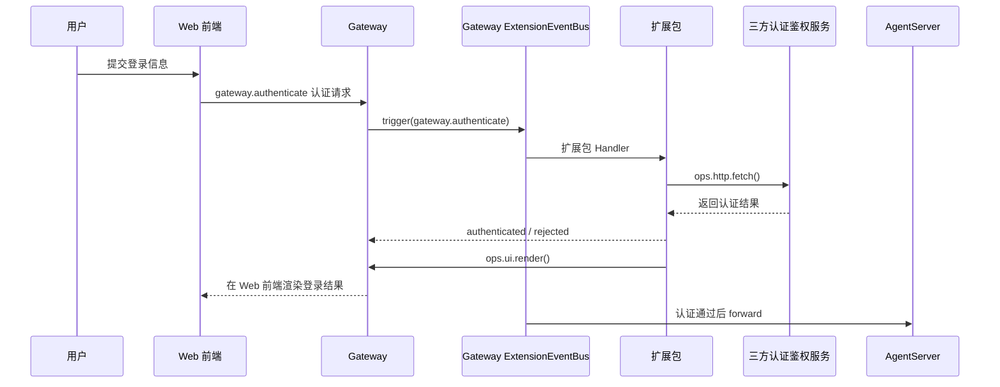
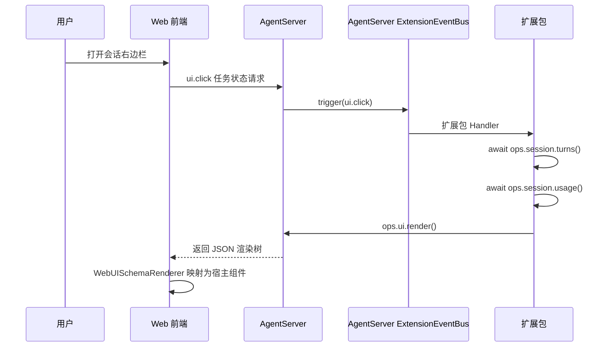

# openjiuwen 扩展性架构设计与开发指南

## 0. 扩展性架构设计理念

openjiuwen 以分层、可插拔和受控扩展为设计理念，在不侵入宿主业务边界的前提下，允许从 Client、Gateway 到 AgentServer 逐层补充或替换默认能力。

![[0.【开头】扩展性架构图.svg]]


## 1. 从两个扩展场景看 openjiuwen 分层架构如何实现扩展性

扩展性设计的引入概念：

| 概念 | 回答的问题 | 扩展开发者主要做什么 |
| --- | --- | --- |
| Event | 业务运行到了哪个可扩展节点 | 为平台已经提供的事件注册 Handler |
| Ops | Handler 可以调用哪些宿主能力 | 在 Handler 中调用已有方法 |
| Package | 扩展如何声明、依赖、加载和退出 | 编写 manifest、入口、测试和发布包 |

### 1.1 场景目标、参与进程和边界

两个场景的最终结果都显示在Web前端，但扩展的宿主进程不同。判断依据不是“页面长什么样”，而是“谁拥有这段业务的状态和决策权”。先用一张表把两个场景要达到的效果、进入点和出点放在一起：

| 场景         | 预期效果                                                | 事件                     | Ops 方法                               | 前端槽位                       |
| ---------- | --------------------------------------------------- | ---------------------- | ------------------------------------ | -------------------------- |
| 应用入口第三方登录  | 用户在应用入口完成第三方登录；未认证请求留在 Gateway，认证通过后才进入 AgentServer | `gateway.authenticate` | `ops.http.fetch()`；`ops.ui.render()` | `application.entry`        |
| 会话右侧任务状态面板 | 会话打开后显示已提交的用户输入次数、上下文占用和最近回合用量；用户点击刷新后重新读取并替换面板内容 | `ui.click`             | `ops.ui.render()`；`ops.session.turns()`、`ops.session.usage()` | `conversation.panel.right` |


### 1.2 场景使用的事件与 Ops

下面只保留两条数据流中的关键调用，不把每个转发步骤展开成操作清单。

#### 1.2.1 Gateway 服务的扩展场景：在应用入口扩展第三方登录页面

预期效果：用户在应用入口完成第三方登录；登录过程由 Gateway 本地闭环处理，认证通过后，业务请求才进入 AgentServer。

用户在Web 前端中填写并提交登录信息后，触发 `gateway.authenticate` 事件，向 Gateway 发送认证请求。Gateway ExtensionEventBus 触发扩展包定义的 `gateway_authenticate_handler` 逻辑，扩展包通过 `ops.http.fetch()` 调用第三方认证鉴权服务；认证成功时 Gateway 放行后续请求，认证失败时向 Web 前端返回失败结果。扩展包调用 `ops.ui.render()`，在 Web 前端渲染登录结果。




#### 1.2.2 AgentServer 服务的扩展场景：通过扩展渲染会话右侧任务状态面板

预期效果：会话打开后，右侧面板显示已提交的用户输入次数、上下文占用和最近回合用量；用户点击刷新后，面板用最新信息重新渲染。

用户打开右边栏后，Web 前端触发 `ui.click` 事件，向 AgentServer 发送状态查询请求。AgentServer ExtensionEventBus 触发扩展包定义的 Handler 逻辑，Handler 调用 `ops.session.turns()` 和 `ops.session.usage()` 方法读取会话信息，再调用 `ops.ui.render()` 向 Web 前端返回 JSON 渲染树；Web 前端通过 `WebUISchemaRenderer` 将 JSON 树映射为宿主组件。




## 2. ExtensionEventBus 事件机制

本章介绍 ExtensionEventBus 事件机制的设计理念和关键概念。扩展包开发者不需要深入理解 ExtensionEventBus 的内部实现。

![[5-第2章-ExtensionEventBus核心概念.svg]]

### 2.1 Event 和 Ops 的定位

Event 表示一次事件调用的输入，包含事件名和本次输入。ExtensionEventBus 会先根据事件类型和匹配规则找到适用的 Handler，再按层级执行，例如：

- `ui.click`：用户点击了扩展渲染出的组件；
- `session.append`：一条消息即将写入会话历史；

Handler 表示“扩展或平台遇到这个事件时怎么处理”。它接收 `event`、当前调用的 `ops` 和控制事件链的 `next_handler`。

Ops 表示“当前 Handler 可以调用框架提供的哪些能力”。每个实际进入的 Handler 都会获得一份独立的 `EventHandlerOps` 视图；这份视图绑定了 Handler 的包身份、当前会话上下文和平台能力目录。例如：

```python
cwd = await ops.session.cwd()
result = await ops.ui.render(request)
```

### 2.2 Handler：USER、BUILTIN、CORE 的洋葱模型

一条事件链按 USER → BUILTIN → CORE 的层级向内推进，返回时再反向退出；每一层可以有多个匹配的 Handler：

```text
进入：USER 前置 → BUILTIN 前置 → CORE
                                 └─ 原生关键路径
                                    └─ 原有 Rail / 真实执行 / 状态回写
返回：USER 后置 ← BUILTIN 后置 ← 结果
```

扩展包通常为平台已经登记的 Event 注册 USER Handler，可以在调用 `next` 前修改输入，在 `next` 返回后加工结果，也可以在契约允许时直接返回，接管后续处理。

| 层级 | 主要注册方 | 职责 |
| --- | --- | --- |
| USER | 扩展包 | 修改输入、补充逻辑、加工结果或按契约短路 |
| BUILTIN | 平台 | 提供宿主通用逻辑和能力适配 |
| CORE | 平台 | 完成事件的默认动作；每种事件只有一个 CORE |

进入阶段从外到内执行，返回阶段从内到外返回。同一层按注册顺序进入。扩展包不能登记 CORE Handler，也不能用 USER Handler 覆盖事件类型定义。

一个最小 Handler 如下：

```python
async def handler(event, ops, next_handler):
    # next 之前：检查或修改本次输入
    output = await next_handler(event)
    # next 之后：读取或加工下游结果
    return output
```

这就是“洋葱式”执行：每一层既能在进入内层前处理，也能在内层返回后继续处理。

### 2.3 `next_handler` 与 `SessionContext`：控制链路和调用上下文

`next_handler` 是当前 Handler 的链路控制句柄，实际类型为 `EventNext`；`SessionContext` 是 ExtensionEventBus 在一次 `trigger` 边界规范化的只读上下文。前者决定是否继续以及从哪一层继续，后者说明这次调用属于哪个会话。

常用语义只有三种：

```python
# 进入链中的下一条 Handler。
output = await next_handler(event)

# 跳过剩余 USER Handler，从 BUILTIN 层继续。
output = await next_handler.to(event, HandlerLevel.BUILTIN)

# 跳过剩余 USER / BUILTIN Handler，直接进入 CORE。
output = await next_handler.to(event, HandlerLevel.CORE)
```

如果 Handler 不调用 `next_handler` 而直接返回，当前 Handler 就会短路剩余的内层逻辑。跳层只能向内进行，`next_handler` 也只在当前 Handler 执行期间有效。

```python
@dataclass(frozen=True, slots=True)
class SessionContext:
    session_id: str
    cwd: str | None = None
    metadata: Mapping[str, object] = field(default_factory=dict)
```

- `session_id` 标识当前会话；
- `cwd` 是当前工作目录，无法确定时为 `None`；
- `metadata` 保存宿主补充的少量只读信息。

## 3. 扩展包开发

扩展包适合解决“平台已经有事件和 Ops，只需要增加一段业务行为”的问题。缺少事件、真实触发入口、Ops、槽位或组件时，应先补平台能力。

### 3.1 包目录

一个后端扩展包可以从下面的结构开始：

```text
package-root/
├── manifest.yaml
├── README.md
└── package_module/
    ├── __init__.py
    ├── base.py
    ├── extension.py
    ├── handlers.py
    ├── state.py
    ├── views.py       # 有 WebUI 时可选
    └── workspace.py   # 需要拆分工作区逻辑时可选
```

各文件的职责要分开：

| 文件 | 功能定位 | 开发者主要编写的内容 |
| --- | --- | --- |
| `manifest.yaml` | 包的声明入口 | 包身份、版本、宿主与包依赖、扩展入口，以及可选的 WebUI 槽位贡献。 |
| `README.md` | 使用和验收说明 | 包解决的问题、支持的事件与 Ops、安装方式、真实操作、限制和测试命令。 |
| `__init__.py` | Python 包标记 | 保持包可以被入口模块导入；除非确有需要，不在这里放注册副作用。 |
| `base.py` | 可选的基础逻辑层 | 被多个 Handler 复用的纯函数、数据转换或客户端封装；不负责向 `ExtensionEventBus` 注册 Handler。 |
| `extension.py` | 扩展包入口和装配层 | 实现 `create_extension()`，在 `register(registrar)` 中把事件、Handler 和匹配条件登记给宿主。 |
| `handlers.py` | 事件处理层 | 校验事件输入、读取会话和包身份、调用已有 Ops、推进或短路事件链，并返回事件契约要求的结果。 |
| `state.py` | 包自己的运行状态 | 保存包需要的会话级或实例级状态；需要跨重载或长期保存时，应使用平台提供的 `ops.store` / `ops.state`，不要依赖进程全局变量。 |
| `views.py` | 可选的界面构造层 | 用 `RenderNode` 组装 JSON 渲染树，让 Handler 只负责业务状态和渲染调用。 |
| `workspace.py` | 可选的工作区逻辑层 | 把文件读取、目录树或其他工作区操作从 Handler 中拆出来，并通过已有 Ops 执行。 |

### 3.2 `manifest.yaml` 与三类依赖

下面以目标分域后的 AgentServer 扩展包为例，展示 manifest 的核心结构。`domain` 用来声明包归属；它属于 Gateway/AgentServer 分域设计，使用前仍需核对目标版本是否已经发布该字段。

```yaml
schemaVersion: 1
package:
  id: example.task-panel
  version: "1.0.0"
  displayName: Task Panel
  description: Show task status in a conversation panel.
  domain: agentserver
requires:
  host: ">=1.0.0 <2.0.0"
  packages:
    - id: example.common
      version: ">=1.0.0 <2.0.0"
extensions:
  - id: task-panel
    runtime: backend
    module: package_module/extension.py
```

主要字段的定位如下：

| 字段 | 定位 | 说明 |
| --- | --- | --- |
| `schemaVersion` | 声明格式版本 | 当前必须为 `1`。格式升级时由宿主按版本处理，不能随意填写。 |
| `package.id` | 包的稳定身份 | 在安装目录和依赖关系中使用；应保持稳定，不能用展示名称代替。 |
| `package.version` | 包版本 | 使用 `MAJOR.MINOR.PATCH`，用于安装、依赖匹配和重载判断。 |
| `package.displayName` | 展示名称 | 给管理界面或日志使用的可读名称，可选。 |
| `package.description` | 功能简介 | 说明包解决什么问题，可选；不应代替 README 中的使用说明。 |
| `package.domain` | 运行域 | 目标设计字段，取 `gateway` 或 `agentserver`，用于决定包在哪个进程加载。 |
| `requires.host` | 宿主版本依赖 | 用版本条件约束可运行的宿主版本；宿主版本不满足时，包不能安装。 |
| `requires.packages` | 包间依赖 | 声明依赖的其他包及版本条件，参与一批包的拓扑排序。 |
| `extensions[].id` | 包内扩展身份 | 在当前包内唯一，用于包内依赖和加载计划。 |
| `extensions[].runtime` | 扩展运行时 | 当前只接受 `backend`。它不是 Gateway/AgentServer 分域字段。 |
| `extensions[].module` | 入口文件 | 相对包根的 Python 文件路径；加载器会校验文件存在且没有逃出包根。 |
| `extensions[].requires` | 包内扩展依赖 | 只引用同一包中的其他 `extensions[].id`，用于确定加载顺序。 |

这里的“三类依赖”分别是宿主依赖、包间依赖和包内扩展依赖。它们只解决“能否加载以及按什么顺序加载”，不等同于 Handler 的执行顺序；Handler 的 USER、BUILTIN、CORE 层级和事件链由 `ExtensionEventBus` 决定。WebUI 的 `ui` 段是界面槽位贡献声明，见 3.5 节，不属于上述三类依赖。一个包只有多个扩展入口时，才需要在 `extensions[].requires` 中声明包内扩展依赖；仅供复用的 `base.py` 不应伪装成扩展入口。


### 3.3 入口与 Handler 注册

扩展包的入口模块导出 `create_extension()`，返回一个带 `register(registrar)` 方法的对象：

```python
from openjiuwen.core.events import Event, EventHandlerOps, EventNext, HandlerLevel
from openjiuwen.core.extension import ExtensionRegistrar


class TaskPanelExtension:
    def register(self, registrar: ExtensionRegistrar) -> None:
        registrar.register_event_handler(
            "ui.ready",
            self.on_ready,
            {"target.slot_id": "conversation.panel.right"},
            HandlerLevel.USER,
        )

    async def on_ready(
        self,
        event: Event,
        ops: EventHandlerOps | None,
        next_handler: EventNext,
    ):
        output = await next_handler(event)
        # 使用已有 Ops 完成本包逻辑。
        return output


def create_extension() -> TaskPanelExtension:
    return TaskPanelExtension()
```

`register_event_handler()` 的第三个参数就是扩展包写匹配条件的位置。上例中的字典表示只匹配 `target.slot_id` 等于指定值；它是宿主可校验的声明式匹配条件，不是扩展包自己实现的 Python matcher 函数。需要判断事件输入中的动态数据时，在 Handler 开头完成类型和业务条件校验，不匹配就调用 `next_handler(event)`，不要让一个 Handler 接管所有同类型事件。

### 3.4 开发者在 User_Handler 中的常见写法

User_Handler 通常接收 `event`、当前 Handler 的 `ops` 和控制事件链的 `next_handler`：

```python
async def handle(
    event: Event,
    ops: EventHandlerOps | None,
    next_handler: EventNext,
):
    request = event.event_input
    if not isinstance(request, UiActionInput):
        return await next_handler(event)

    action_id = request.payload.get("action_id")
    # 继续写本 Handler 关心的槽位、动作和参数校验。
```

`event.event_input` 是事件携带的业务输入。先做类型校验，再读取字段；输入不属于本 Handler 时调用 `next_handler(event)`，不要把任意输入强行转换成自己的类型。

#### 调用已有 Ops

`ops` 是当前 Handler 的能力视图。读取能力和动词型能力的调用方式都是通过命名空间访问：

```python
async def handle_with_ops(
    event: Event,
    ops: EventHandlerOps | None,
    next_handler: EventNext,
):
    if ops is None:
        return await next_handler(event)

    cwd = await ops.session.cwd()
    package_name = await ops.package.name()
    render_output = await ops.ui.render(
        UiRenderInput(target=target, root=render_tree)
    )
    # 根据 render_output 处理结果，再决定是否继续当前事件链。
    return await next_handler(event)
```

`ops.ui.render()` 这类动词型 Ops 会发起新的事件链，但不会自动推进当前 Handler 链；当前链是否继续，仍由 Handler 自己决定。`ops.package_metadata` 和 `ops.session_context` 来自宿主绑定的注册信息与调用上下文，不要从浏览器输入或普通业务字段推断包身份。

#### 调用 next_handler

扩展包通常拿不到 CORE Handler 的函数对象，也不应该直接导入或调用它。通过 `EventNext` 推进事件链：

```python
from openjiuwen.core.events import HandlerLevel

async def continue_to_core(
    event: Event,
    ops: EventHandlerOps | None,
    next_handler: EventNext,
):
    # 继续剩余的 USER / BUILTIN Handler，最后自然到达 CORE Handler。
    return await next_handler(event)


async def call_core_directly(
    event: Event,
    ops: EventHandlerOps | None,
    next_handler: EventNext,
):
    # 明确跳过剩余 USER、BUILTIN Handler，直接进入 CORE Handler。
    return await next_handler.to(event, HandlerLevel.CORE)
```

`next_handler(event)` 是否会先经过其他 Handler，取决于当前 Handler 在哪一层以及后面还有哪些匹配项。

#### 屏蔽 CORE Handler

Handler 直接返回自己的结果，就会短路当前事件链；`ExtensionEventBus` 不会因为 Handler 返回而自动补跑 CORE：

```python
async def consume_in_extension(
    event: Event,
    ops: EventHandlerOps | None,
    next_handler: EventNext,
):
    request = event.event_input
    if should_consume(request):
        # 这里没有调用 next_handler，因此 CORE Handler 不会执行。
        return UiActionOutput(accepted=True, status="handled_by_extension")
    return await next_handler(event)
```

#### 改造 CORE Handler 的输出

Handler 可以先取得 CORE 的结果，再在仍符合事件输出契约的前提下包装或修改它：

```python
async def decorate_core_output(
    event: Event,
    ops: EventHandlerOps | None,
    next_handler: EventNext,
):
    core_output = await next_handler.to(event, HandlerLevel.CORE)
    if isinstance(core_output, UiActionOutput):
        return UiActionOutput(
            accepted=core_output.accepted,
            status=f"extension:{core_output.status}",
            code=core_output.code,
        )
    return core_output
```

#### 使用 `SessionContext`

`SessionContext` 是本次 `trigger()` 规范化后的只读上下文。需要会话信息时，从 `ops.session_context` 读取：

```python
async def read_session_context(
    event: Event,
    ops: EventHandlerOps | None,
    next_handler: EventNext,
):
    context = ops.session_context if ops is not None else None
    if context is None:
        return UiActionOutput(accepted=False, status="no_session")

    session_id = context.session_id
    cwd = context.cwd
    host_metadata = context.metadata
    return await next_handler(event)
```

`session_id` 用来关联会话级状态，`cwd` 可能为 `None`，`metadata` 是宿主补充的只读信息。

### 3.5 Web 前端界面的扩展：声明槽位，发送 JSON 树

扩展包在 manifest 的 `ui` 段声明要把界面放到哪个宿主槽位。这样，后端扩展就可以在会话右侧、输入框上下方或其他已开放位置增加自己的界面，例如展示任务状态、提供刷新按钮，或者嵌入一个外部工具页面：

```yaml
ui:
  apiVersion: 1
  items:
    - type: web.slot.contribution
      id: task-panel.main
      slot: conversation.panel.right
      order: 20
      panel:
        title: Task Status
      renderer:
        kind: webui-tree
```

其中，`slot` 表示挂载位置，`id` 用来标识这项贡献，`order` 控制同一位置的排列顺序，`renderer.kind: webui-tree` 表示界面由后端发送 JSON 渲染树。

Handler 通过 `ops.ui.render()` 发送的 JSON 树大致如下：

```json
{
  "component": "Card",
  "props": {"title": "任务状态"},
  "children": [
    {"component": "Text", "props": {"value": "运行中"}},
    {
      "component": "Button",
      "props": {"label": "刷新"},
      "events": {"ui.click": {"id": "task.refresh"}}
    }
  ]
}
```

用户点击按钮后，前端上报带有 `action_id: task.refresh` 的 `ui.click` 事件，Handler 查询最新状态，再发送一棵新的 JSON 树，页面就会更新。

除了组件树，前端还支持用 `Iframe` 展示已经渲染好的完整页面：

```json
{
  "component": "Iframe",
  "props": {
    "title": "任务详情",
    "src": "https://example.com/task/123"
  }
}
```

在宿主开放的槽位和安全策略允许时，这种方式适合直接嵌入已有的独立页面。

### 3.6 `domain`：区分 Gateway 与 AgentServer

`domain` 的作用，是为了明确：扩展包在哪个进程加载、Handler 登记到哪个 `ExtensionEventBus`、可以使用哪一侧的 Ops。

因此，目标设计中会为 Gateway 和 AgentServer 分别创建 `ExtensionEventBus` 实例，并按包的 `domain` 分流：

- **Gateway 专属扩展。** 适合连接建立、认证、请求路由、请求派发前拦截，以及 Gateway 本地的 HTTP 或浏览器凭据操作。
- **AgentServer 专属扩展。** 适合会话生命周期、Agent/工具/MCP 执行、工作区文件、扩展包管理、会话级 WebUI 渲染等业务。

目标 manifest 可以这样表达：

```yaml
package:
  id: example.gateway-auth
  version: "1.0.0"
  domain: gateway
```

或：

```yaml
package:
  id: example.task-panel
  version: "1.0.0"
  domain: agentserver
```

`domain` 只负责确定加载进程和事件总线归属，不会自动把两个进程的会话、Handler 或 Ops 串联起来。当前 AgentServer 侧的扩展包管理、`ExtensionEventBus` 注册和 WebUI JSON 渲染链已经实现；Gateway 独立总线、跨进程安装目录扫描和事件分流仍属于目标设计。

### 3.7 扩展包开发 skill

openjiuwen 将提供面向 AI 编码助手的扩展包开发 skill。使用者只需要说明希望实现的效果，skill 会沿下面的链路工作：

```text
确认目标宿主和版本
→ 核对已有 Event、Matcher、Ops 和槽位
→ 编写 manifest、入口、Handler、README 和测试
→ 用真实加载器与事件链做隔离验证
→ 生成最终 ZIP
→ 执行真实业务操作，验证最终效果
```

这个 skill 有明确边界：

- 只开发独立扩展包，不修改平台源码；
- 不新增内置事件、Ops、槽位或真实业务触发点；
- 不登记 CORE、不修改 `ops.build`，也不另建 Bus 或 Registry；
- 不上传 ZIP、不启动服务、不修改认证配置；
- 缺少平台能力时报告具体缺口，不虚构事件或绕过校验；
- 分开记录隔离测试、ZIP、运行安装和真实业务验收。

一个合适的扩展性开发任务的描述可以是：

> 开发一个扩展包：会话右侧显示当前任务状态，用户点击刷新后重新查询；只使用目标环境已有事件、Ops 和组件。完成源码、测试、ZIP，并在目标 Swarm 安装后验证真实页面。

## 4. 当前能力与开发工具

### 4.1 扩展性提供的事件

#### Web client

Web client 提供前端渲染生命周期和组件交互事件，扩展可以在界面挂载、渲染和用户操作节点接入业务逻辑。

| 功能域 | 事件 | 状态与说明 |
| --- | --- | --- |
| 渲染与生命周期 | `ui.render`、`ui.ready` | 当前已实现；`ui.unmount` 属于后续生命周期补充。 |
| 组件交互 | `ui.click`、`ui.change`、`ui.press_enter`、`ui.select`、`ui.search`、`ui.clear` | 当前组件目录已支持，用于点击、输入、回车、选择、搜索和清除。 |
| 交互补充 | `ui.blur`、`ui.focus`、`ui.scroll` | 计划补充，分别覆盖失焦、聚焦和滚动。 |
| 对话输入框 | `prompt.submit`、`prompt.suggest`、`prompt.autocomplete`、`prompt.mention`、`prompt.edit`、`prompt.read` | 需要先把对话页输入框整理为业务组件，暂不纳入首版本提供事件范围。 |

#### Gateway

Gateway 提供连接、认证和请求路由前的扩展事件，扩展可以在请求派发前拦截或改写请求，也可以接入登录流程。

Gateway 的独立 ExtensionEventBus、跨进程事件分流和登录界面扩展仍是目标设计，下面的条目不能当作当前可依赖的发布接口；其中同名的 `ui.render`、`ui.store`、`ui.click` 与 Web client 事件属于不同进程中的目标事件链。

| 功能域 | 事件 | 状态与说明 |
| --- | --- | --- |
| 请求派发 | `gateway.request` | 首版本提供事件范围：在请求派发前提供限流、鉴权或请求改写入口。 |
| 登录界面 | `ui.render`、`ui.store`、`ui.click` | 目标设计：分别覆盖登录界面渲染、用户凭据状态保存和登录交互。 |

#### AgentServer

AgentServer 提供会话、Agent 执行、扩展包管理和宿主资源访问等业务事件，扩展可以在输入、执行、资源访问和生命周期节点参与处理。

| 功能域 | 事件 | 状态与说明 |
| --- | --- | --- |
| 能力构建与扩展包管理 | `ops.build`、`package.parse`、`package.resolve`、`package.query`、`package.install`、`package.uninstall`、`package.reload` | `ops.build` 是启动阶段的内部能力构建事件；其余事件负责扩展包解析、依赖处理、查询、安装、卸载和重载。 |
| 配置与会话生命周期 | `config.describe`、`config.set`、`session.start`、`session.receive`、`session.attach`、`session.append`、`session.send`、`session.end`、`session.detach`、`session.compact`、`context.usage.updated`、`session.measure` | 前一组用于配置目录和配置值处理；后一组覆盖会话初始化、输入、关联、历史写入、跨会话发送、结束、界面关联、上下文压缩和用量变化。`session.measure` 属于后续版本。 |
| Agent 执行链 | `turn.start`、`turn.step`、`turn.complete`、`turn.abort`、`tool.describe`、`tool.check`、`tool.call`、`agent.spawn`、`process.run`、`process.spawn` | 覆盖一轮对话、工具准入与执行、子 Agent 及进程的启动和中止；其中 `process.*` 属于后续版本。 |
| Prompt、MCP 与文件 | `prompt.section`、`prompt.compose`、`prompt.context`、`prompt.attachment`、`mcp.call`、`mcp.connect`、`fs.read`、`fs.write`、`fs.list`、`fs.stat`、`fs.exists`、`fs.ancestors` | 统一覆盖提示词调整、MCP 调用和工作区文件访问；`prompt.section`、`mcp.call`、`fs.read` 属于首版本提供事件范围，其余能力后续补齐。 |
| 扩展状态、资源与协作 | `store.get`、`store.set`、`store.delete`、`store.keys`、`state.get`、`state.set`、`agent.register`、`tool.register`、`mcp.register`、`tool.list`、`agent.list`、`model.complete`、`model.fork`、`model.classify`、`team.monitor_event`、`team.build_policy`、`team.build_reliability`、`team.create_harness`、`telemetry.log`、`telemetry.mark` | 覆盖扩展持久化、会话状态、资源注册与查询、模型调用、团队协作和可观测性；其中部分能力属于首版本提供事件范围，其余能力属于后续版本或待定。 |

**首版本提供事件范围。** 首版本重点覆盖 Web client 的 `ui.render` 及已登记的组件交互事件、Gateway 的 `gateway.request` 目标入口、AgentServer 的会话生命周期、`turn.start`/`turn.complete`、`prompt.section`、`mcp.call`、`fs.read`、`store.get`、`agent.register`、`team.monitor_event` 和 `package.install`。

### 4.2 扩展性提供的 Ops

Ops 方法分为名词和动词两类；每个动词还对应一个同名事件，通过事件触发 Ops 方法的实现逻辑。

#### Web client

Web client 侧的 Ops 主要提供受控渲染以及前端提示、状态和输入交互能力，扩展通过这些方法把结果送回界面。

| 功能域 | Ops 方法 | 状态与说明 |
| --- | --- | --- |
| 渲染 | `ops.ui.render(request)` | 当前已实现，触发新的 `ui.render` 事件链并向前端发送受控 JSON 树；属于首版本基础能力。 |
| 通知与界面状态 | `ops.ui.notice()`、`ops.ui.toast()`、`ops.ui.status()`、`ops.ui.open()`、`ops.ui.close()` | 后续补充的前端通知、状态读取和界面开关能力，优先级较低。 |
| 对话输入框 | `ops.prompt.submit()`、`ops.prompt.fill()`、`ops.prompt.suggest()`、`ops.prompt.read()` | 配套对话输入框业务组件，分别用于提交、填充、建议和读取草稿/光标状态。 |

#### Gateway

Gateway 侧的 Ops 主要提供请求派发和外部 HTTP/认证接入能力；独立 Gateway ExtensionEventBus 尚未落地，因此这些方法仍属于目标设计。

| 功能域 | Ops 方法 | 状态与说明 |
| --- | --- | --- |
| 请求派发 | `gateway.request()` | 目标设计中的请求派发能力，与 `gateway.request` 事件配套，用于在请求进入业务链前执行扩展逻辑。 |
| 外部 HTTP | `ops.http.fetch()` | 目标设计中的 HTTP 请求能力，用于扩展探测或调用第三方服务。 |

Gateway 设计中的 `ui.render`、`ui.store`、`ui.click` 是事件名，不作为 Ops 方法重复列出；它们对应登录界面事件链。

#### AgentServer

AgentServer 侧的 Ops 主要提供当前 Handler 的可信身份、会话与工作区视图，以及 Agent 执行、扩展状态、模型和团队协作能力。

| 功能域 | Ops 方法 | 状态与说明 |
| --- | --- | --- |
| 包身份与会话属性 | `ops.package.name()`、`ops.package.root()`、`ops.session.id()`、`ops.session.surfaces()`、`ops.session.version()` | 读取平台绑定的扩展包身份和当前会话属性；包身份不能从事件输入或浏览器参数推断。 |
| 会话与工作区 | `ops.session.cwd()`、`ops.session.root()`、`ops.session.repo()`、`ops.session.model()`、`ops.session.messages(limit, cursor)`、`ops.session.turns()`、`ops.session.usage(breakdown=False)`、`ops.session.append(message)`、`ops.session.compact(instructions=None)`、`ops.session.authorize()`、`ops.session.files()`、`ops.session.read_file()` | 覆盖会话、工作区和历史读写；其中 `messages`、`turns`、`usage`、`cwd`、`repo`、`model`、`files`、`read_file` 已有实现或纳入首版本提供 Ops 范围，写入和压缩方法仍受对应事件契约约束。 |
| Agent 执行与进程 | `ops.tool.check()`、`ops.tool.call()`、`ops.agent.spawn()`、`ops.turn.abort()`、`ops.process.run()`、`ops.process.spawn()` | 提供工具准入/执行、子 Agent 管理和进程运行能力，实际权限与副作用仍由所属服务检查。 |
| Prompt、MCP 与文件 | `ops.prompt.compose()`、`ops.mcp.call()`、`ops.mcp.connect()`、`ops.fs.read()`、`ops.fs.write()`、`ops.fs.list()`、`ops.fs.stat()`、`ops.fs.exists()`、`ops.fs.ancestors()` | 提供提示词组合、MCP 调用和受限工作区访问；`ops.mcp.call()`、`ops.fs.read()` 属于首版本提供 Ops 范围。 |
| 配置、环境与扩展状态 | `ops.env.value(name)`、`ops.config.value(key, scope)`、`ops.config.items(scope)`、`ops.config.snapshot()`、`ops.store.get()`、`ops.store.set()`、`ops.store.delete()`、`ops.store.keys()`、`ops.state.get()`、`ops.state.set()` | 读取受授权的环境/配置，或保存扩展持久化状态与会话状态；配置项属于后续版本，`ops.store.get()` 属于首版本提供 Ops 范围。 |
| 资源、模型、团队与观测 | `ops.agent.register()`、`ops.tool.register()`、`ops.mcp.register()`、`ops.tool.list()`、`ops.agent.list()`、`ops.model.complete()`、`ops.model.fork()`、`ops.model.classify()`、`ops.team.info()`、`ops.team.members()`、`ops.team.member(member_name)`、`ops.team.tasks()`、`ops.team.task(task_id)`、`ops.team.task_dependencies(task_id)`、`ops.team.messages(...)`、`ops.team.message(message_id)`、`ops.team.policy_context()`、`ops.team.reliability_context()`、`ops.team.list()`、`ops.telemetry.log()`、`ops.telemetry.mark()` | 统一覆盖资源注册/查询、独立模型调用、团队信息与规则读取，以及观测和使用统计；其中部分方法属于首版本提供 Ops 范围，其余方法属于后续版本或待定。 |

**首版本提供 Ops 范围。** Web client 侧以 `ops.ui.render()` 为基础；Gateway 侧以目标设计的 `gateway.request()` 为入口；AgentServer 侧重点提供 `ops.session.files()`、`ops.session.read_file()` 等会话/工作区能力，以及会话查询、`ops.tool.check()`、`ops.prompt.compose()`、`ops.mcp.call()`、`ops.fs.read()`、`ops.store.get()`、`ops.agent.register()` 和 `ops.team.*` 的基础查询能力。未列入这一段的方法属于后续版本、低优先级或待定项。


### 4.3 前端界面支持的扩展

前端扩展由“槽位 + 组件 + 事件”三部分组成：槽位定义扩展挂载位置，组件定义可渲染的界面能力，`ui.*` 事件用于将交互结果回传给扩展事件链。以下按界面区域和功能相近的组件归类；槽位名称保留前端注册名，组件属性列出主要配置项。

#### 前端槽位

槽位决定扩展内容出现在宿主界面的哪个区域。对话类槽位围绕输入区、消息内容、回合操作和对话头部组织；应用类槽位承载菜单、入口、设置和任务页面。

| 扩展区域 | 槽位 | 挂载位置 | 典型扩展内容 |
| --- | --- | --- | --- |
| 对话输入区 | `conversation.input.above` | 对话输入框上方 | 提示信息、快捷入口、上下文选择器 |
| 对话输入区 | `conversation.input.below` | 对话输入框下方 | 辅助操作、状态提示、补充配置 |
| 对话内容 | `conversation.session.content.after` | 输出内容之后、脚部按钮之前 | 引用信息、结构化结果、结果补充区块 |
| 对话回合操作 | `conversation.turn.footer.actions` | 每轮脚部操作按钮之后 | 轮次级操作、结果处理和快捷动作 |
| 对话头部 | `conversation.header.title.after` | 对话标题右侧 | 会话标识、状态信息、快捷入口 |
| 对话头部 | `conversation.header.actions` | 对话顶部右侧操作区 | 对话级操作和扩展菜单 |
| 对话侧边 | `conversation.panel.right` | 右侧附加面板 | 详情、上下文、辅助工具和扩展面板 |
| 应用入口 | `application.entry` | 登录或欢迎入口 | 登录页、欢迎页及初始化引导扩展 |
| 应用菜单 | `application.menu` | 主菜单 | 新增菜单项和功能入口 |
| 应用菜单页面 | `application.menu.main` | 对应主菜单右侧页面 | 独立功能页面；复杂页面可使用 `iframe` 承载 |
| 设置模块 | `application.settings` | 设置模块 | 设置项和配置页面扩展 |
| 任务功能 | `task.function` | 任务功能区 | 任务入口、任务操作和功能卡片 |
| 任务功能页面 | `task.function.main` | 任务功能区右侧页面 | 独立任务页面；复杂页面可使用 `iframe` 承载 |

#### 前端组件

组件扩展通过组件名、受控属性和 `ui.*` 事件描述界面及交互。组件层复用基础组件能力，同类组件在下表中合并展示，避免将组件目录完全平铺。

| 组件类别 | 组件 | 可用扩展事件 | 主要配置项或用途 |
| --- | --- | --- | --- |
| 输入与选择 | `Input`、`Switch`、`Select`、`TreeSelect`、`Slider` | `Input`：`ui.click`、`ui.press_enter`；`Switch`：`ui.change`、`ui.click`；`Select`：`ui.select`、`ui.search`、`ui.clear`；`TreeSelect`：`ui.select`、`ui.change`、`ui.clear`；`Slider`：`ui.change` | `Input` 支持值、占位、只读/禁用、长度、清除、计数和尺寸等配置；`Select`/`TreeSelect` 支持选项或树数据、默认值、搜索、清除、多选和标签数量等配置；`Switch` 支持选中态、加载态、尺寸和禁用态；`Slider` 支持最小值、最大值、步长、刻度和方向 |
| 操作与导航 | `Button`、`Tabs` | `Button`：`ui.click`；`Tabs`：`ui.change` | `Button` 支持类型、尺寸、加载态、危险态、形状、链接、图标和禁用态；`Tabs` 支持页签项、当前项、页签类型、位置、尺寸和销毁策略 |
| 内容与布局 | `Text`、`Empty`、`Divider`、`Card`、`Tag`、`Box`、`Panel` | 未声明 `ui.*` 交互事件，主要用于展示和布局 | `Text` 支持内容、样式、语气、尺寸、字重和最大行数；`Empty` 支持图片样式和描述；`Divider` 支持标题、方向、样式和尺寸；`Card` 支持标题、额外操作、封面、操作区、悬浮态和尺寸；`Tag` 支持内容、颜色、样式、链接和禁用态；`Box` 支持子节点、方向、间距、对齐、排列、换行和弹性布局；`Panel` 支持标题和子节点 |
| 媒体与容器 | `Image`、`Avatar`、`Popover`、`iframe` | 未声明 `ui.*` 交互事件，主要用于媒体展示、浮层和页面承载 | `Image` 支持地址、替代文本、尺寸、兜底和预览；`Avatar` 支持地址、替代文本、尺寸和形状；`Popover` 用于浮层内容承载；`iframe` 用于承载独立页面 |
| 业务组件 | `Icon`、`FileTree`、`FilePreview` | 未声明 `ui.*` 交互事件 | `Icon` 支持图标名称；`FileTree` 用于文件树展示；`FilePreview` 用于文件预览 |

组件事件只在组件声明对应事件时生效；扩展侧应通过组件属性传递状态，通过 `ui.*` 事件回传用户操作，不应依赖宿主页面的内部 DOM 结构。


